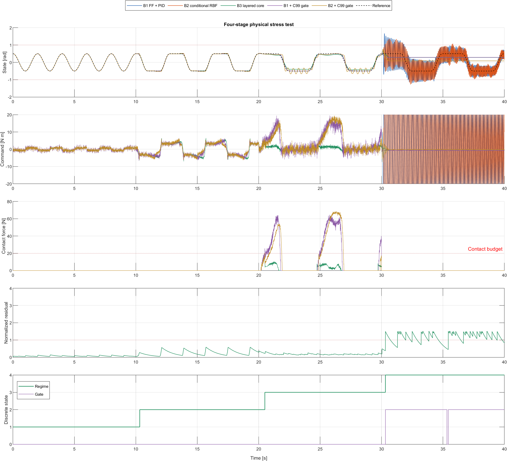
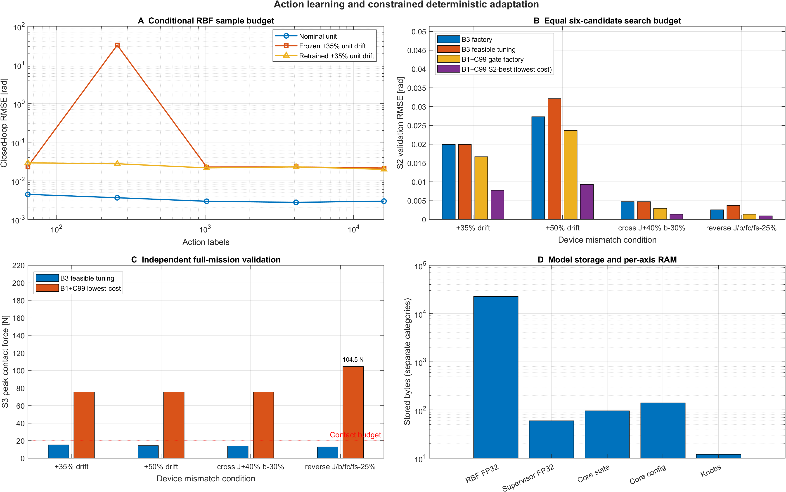
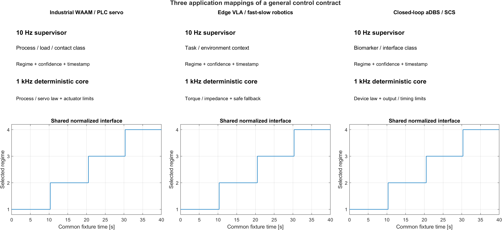

# ai-layered-control · v2.0.2

[](https://github.com/lijiawei255/ai-layered-control/releases/tag/v2.0.2)
[](c99_layered_core/layered_gatekeeper.h)
[](#36-reproduce)
[](LICENSE)
[](https://doi.org/10.5281/zenodo.23911915)
[](https://github.com/deepseek-ai/deepseek-harness)

[English](README.md) | [简体中文](README_zh.md) · [Agent guide](AGENTS.md)

**Let AI identify the situation. Let deterministic control own the actuator:** A portable **zero-trust fast-slow reference architecture** — 10 Hz qualitative supervision with active abstention, a 1 kHz C99 zero-trust safety gatekeeper, and field knob tuning after the AI is frozen. Traditional gain scheduling or fixed-threshold rule trees only partition known regimes; when they encounter unmodeled mechanical resonance or an out-of-distribution (OOD) disturbance, they still emit the nearest regime's control law. This architecture follows the Simplex / runtime assurance (RTA) division of responsibility and fixes that boundary as a cross-loop interface contract via fast-slow dual-layer active abstention: the 10 Hz slow loop performs manifold-distance low-confidence abstention and retreats to R4 damping, and the 1 kHz fast loop executes a millisecond-scale forced veto from an independent physical residual probe.

## Why This Architecture & Quick Navigation

This repository is an MIT-licensed reference design, comparison benchmark and AI adaptation template for research and engineering reuse. The reusable surface is a **full-stack, dual-loop reference**, not a single C filter: the slow loop, the MCU integration sample, the deterministic core and the Simulink adapter are four peer modules that share one interface contract.

### Four Reusable Modules, One Contract

- **[1] [python_bench/minimal_template.py](python_bench/minimal_template.py) — 119 lines, Architectural Minimalism:** A 10 Hz qualitative slow loop with small-sample commissioning (`auto_calibrate`: 36 labeled windows, 15 statistical scalars / 60 B), low-confidence abstention, frozen-AI three-knob field tuning (`auto_field_tune`, a 20-line pair of helpers) and a `SLOT 1..3` device skeleton.
- **[2] [c99_layered_core/gate_template.c](c99_layered_core/gate_template.c) — 120 lines:** A 1 kHz bare-metal MCU interrupt integration sample with a **32 B zero-heap physics-residual probe** (`LayeredProbe_Step`: median spike rejection plus a cascaded high-pass innovation envelope), the `blanking_active` hardware blanking window for stimulation pulses and commutation-edge artifacts, and the `outer_seq` commit-marker pattern.
- **[3] [c99_layered_core/layered_gatekeeper.h](c99_layered_core/layered_gatekeeper.h) / [.c](c99_layered_core/layered_gatekeeper.c) — 96 B state:** A zero-dependency ANSI C99 safety arbiter and four-bank anti-windup control microkernel for 1 kHz cyclic tasks.
- **[4] [simulink_sfunc/sfun_layered_gatekeeper.c](simulink_sfunc/sfun_layered_gatekeeper.c) — 685 lines:** A Level-2 C-MEX S-Function for model-based design: `DWork` holds the 96 B state, zero globals, zero dynamic memory, **11 inputs** (10 ABI inputs plus the `ack` rising edge) and **7 outputs** around the same frozen core.

### Key Engineering Metrics

- **Discrete qualitative routing and active OOD abstention (minimal sample and compute cost):** The slow-loop AI outputs only **discrete regime IDs (1..3)** and distance-based **low-confidence abstention (4)** at **10 Hz**, rather than fitting a high-dimensional continuous action surface. Because continuous quantitative feedback and trajectory tracking are carried by the four pre-commissioned deterministic controller banks and the nominal feedforward, the 10 Hz slow loop only has to perform coarse discrete regime classification and manifold-distance abstention; on a CPU it therefore needs only **36 labeled macro-windows** to complete the archive while online calibration stores and evaluates only **15 statistical scalars / 60 B (FP32)**, with zero GPU requirement for calibration or runtime inference. The template's built-in 15-statistical-scalar nearest-prototype classifier and six-point constrained search (`auto_field_tune`) are a minimal zero-dependency implementation; in a real machine the same interface can host a physical rule tree with an out-of-range fallback branch, safe Bayesian optimization, or another classification model. Baseline B2 (a 1 kHz continuous-action neural network trained on 16,000 samples) needs **16,000 action labels**, **5,664 scalars / 22,656 B (FP32)** and full **1 kHz** continuous inference compute.
- **96 B zero-trust C99 kernel and transient-hardened protection:** A zero-heap ANSI C99 core owns the **1 kHz** actuator command with **ten input fields**, four-pillar zero-trust protection against the slow loop (split input firewall, `outer_seq` local-clock lease, a 32 B independent physics-residual probe with the 25 ms phase-plane envelope look-ahead, and the 300 ms recovery cooldown with the 150 ms dwell anti-chatter), nine core protection duties and transient-response protection (`blanking_active` hardware-blanking freeze, four-bank reverse tracking anti-windup, and emergency R4 bypass with `blend = 1.0`). In this compound-fault benchmark, the unmodelled flexible-mode residual triggers a veto and closed-loop R4 (the conservative safe-fallback bank) within the same **1 ms control tick**.
- **Frozen AI topology, 12 B constrained physical field tuning:** Three physical knobs occupy **12 B** and support constrained adaptation to forward overload, cross mismatch, reverse light load and compound unit drift across six jointly constrained trials without retraining the frozen 60 B supervisor or requiring field GPU compute.
- **Cross-language bit-exact verification and 239-line adaptable templates:** **265 C regression checks** pass; Python/C replay is bit-exact (**max|du| = 0**), MATLAB/C replay is within **5e-9**, and the Level-2 S-Function reproduces all seven outputs over 1,100 frames with **max diff = 0.0**. The **119-line template** (paired with the 120-line MCU template, **239 lines** total) is ready to run and can be freely tailored to field codebases; the Simulink model illustrates the architecture.

**Human readers:** [§1](#1-ai-can-be-slow-control-authority-must-be-clear) explains the division of control authority through six field problems; [§2](#2-what-to-reuse-human--agent-quickstart) covers the four reusable modules and three-step interface adaptation; [§3.2](#32-four-stage-comparison) / [§3.3](#33-frozen-ai-field-tuned-hardware) / [§3.4](#34-mode-ablation-and-independent-protection) present the measured comparisons, the gating and abstention experiments, and the figures.

**AI coding assistants (DeepSeek Harness / Kimi Code / OpenCode / ZCode / Qoder / Codex / Claude Code / Cursor):** start with [AGENTS.md](AGENTS.md), then replace `SLOT 1..3` in [minimal_template.py](python_bench/minimal_template.py) and fill the ten input fields from the device contract.

## 1. AI can be slow. Control authority must be clear.

Industrial arms, CNC / additive manufacturing (WAAM) and closed-loop neuromodulation make prediction accuracy only half the problem; the other half is control authority — who owns the actuator command every millisecond. As long as a learned policy owns continuous commands, six field problems recur. This architecture resolves each one in the deterministic fast loop, not by tuning the model; the measured evidence is in §3 over four 10 s stages (S1 nominal, S2 load/stiction, S3 contact/noise, S4 unseen compound fault).

- **Scarce samples / continuous-policy compute.** B2 needs 16,000 action labels, 5,664 scalars / 22,656 B and 1 kHz inference, yet still posts **680 S4 violation ticks** without the gate; this architecture keeps the 10 Hz layer at discrete regime advice (`1..3`) + calibrated abstention (`4`) over **36 windows, with only 15 statistical scalars / 60 B for online calibration**, and leaves continuous feedback and feedforward to four deterministic banks.
- **Rigid vs compliant contact.** One gain set cannot both reject load and hold **20 N**; B1 reaches **64.59 N** in S3. Four banks (R1–R4), R3 compliant contact, per-bank reverse-tracking anti-windup and the emergency R4 bypass `blend = 1.0` resolve the conflict deterministically.
- **Unknown manifolds.** The nearest fixed rule keeps firing while the plant oscillates; it carries no distance to the calibrated data. A split-conformal distance confidence turns an in-box coupled load bias into a deterministic low-confidence veto and R4 damping.
- **Unit / batch drift.** Per-unit retraining needs data and field compute that do not exist. A frozen manifold topology plus a **12 B** `FieldTuning_t` covers forward, cross and reverse mismatch through six constrained trials.
- **Slow-loop blind spot, transients, link loss.** The 10 Hz loop is blind for up to 100 ms, pulses and commutation edges corrupt innovation, and a fieldbus can stall. A 32 B 1 kHz probe, `blanking_active` freeze-and-hold, the `outer_seq` local-clock lease and a bounded HOLD -> `GATE_SAFE_ZERO` close the gap.
- **Bare-metal limits, accountability.** Fixed RAM, no allocator; incidents need causal evidence. The 96 B zero-heap C99 core keeps a 7-bit sticky audit mask and latches `GATE_LATCHED_SAFE` after three severe episodes until explicit acknowledgement.

The split is calibrated end to end. `auto_calibrate` derives both confidence thresholds from one finite-sample split-conformal estimator: the 1 % lower-tail order statistic of the calibration confidence, `q = min(1, ceil((N+1)(1-alpha))/N)`. The main benchmark applies a 0.15x working-point factor to that quantile, which keeps a 36-window archive from false abstention across the wide dynamic envelope; the `off_manifold` audit runs the 1 % quantile itself with 5-frame persistence (99.5 % detection, zero false vetoes on independent nominal data). The 25 ms signed look-ahead is the 1D ZCBF boundary condition `h_dot + h/T >= 0` for `h = x_max − |x|`. The 16,000 labels are a simulation setting that prices dense sampling, not measured machine time.

**Inference bandwidth is not execution authority:** Computing an action a thousand times per second (1 kHz inference bandwidth) does not make a learned policy safe to own the actuator: its output is still an action proposal without physical guarantees. Execution authority means standing at the actuator every millisecond, maintaining the feedback invariants, tracking anti-windup, hard magnitude/slew limits and independent veto fallback. This repository provides exactly such a device-side software gateway for AI control permissions: the slow loop answers only "which regime?" (`1..3`) or "abstain" (`4`); an independent probe derives veto evidence from time-aligned nominal-model innovation and measurement spikes; an **ANSI C99 core with only 96 bytes of state and zero dynamic allocation** owns the 1 kHz command, closed-loop fallback and physical tuning knobs. The supervisor can change while the execution contract stays fixed. This gateway enforces **four zero-trust defence lines towards the slow-loop AI**: an **interface and numeric zero trust** — the slow loop cannot touch the actuator command `u` or the deterministic feedforward `u_ff` and may submit only regime proposals `1..4`, while the split input firewall sets `corrupted = 1` on any `NaN/±Inf`, out-of-range regime or sequence anomaly in a slow-loop field and forces closed-loop R4; a **time zero trust** — the transported frame age `outer_age_s` is never taken on faith, and with `outer_seq` enabled the 1 kHz core measures the frame lease on its own clock, so a stalled or forged age cannot mask a communication stall; a **physics zero trust** — even a full-confidence (`1.0`) slow-loop output is vetoed in the current 1 ms tick and replaced by R4 whenever the 32 B independent physical-residual probe or the 25 ms phase-plane envelope look-ahead crosses its threshold; and a **recovery zero trust** — after a fault clears or a manual `Layered_AcknowledgeFaultLatch` release, the AI cannot regain authority on the next tick and must pass the 300 ms clean recovery cooldown and the 150 ms dwell anti-chatter check.

**L0–L4 industrial safety-control stack positioning:** This repository converges on **L2 — 1 kHz deterministic safety arbitration** — and **L3 — 10 Hz calibrated qualitative routing**. The single canonical L0–L4 table, including why L2 must be deterministic code under ISO/IEC TR 5469 rather than a second black-box model, lives in the [Systems Engineering Manifesto](docs/systems_engineering_manifesto_en.md#layered-system-boundaries-l0l4).


Diagram timings are benchmark defaults. The device adapter computes `outer_age_s = now - source_timestamp` on every fast tick; with a non-zero `outer_seq`, the core measures frame age on its own 1 kHz clock and a frozen or forged `outer_age_s` cannot mask a stalled mailbox. The spike channel reads the measured signal directly; the broadband channel evaluates nominal-model innovation.

**Seven observable gate decisions:** These are deliberate, explainable states, logged by the field recorder:

| Code | Gate | Behaviour |
| :---: | :--- | :--- |
| 0 | `GATE_NORMAL` | Accepted AI regime; the selected bank runs with field-tuned gains and deterministic feedforward. |
| 1 | `GATE_HOLD_LATENCY` | Stale slow mailbox with healthy fast sensors: the measured 1 kHz loop stays closed on the fixed **R4 damping** law. Its unusable-fast-input sub-case (`GATE_HOLD_SENSOR`) freezes and holds the last applied safe command. This holds the actuator command, not mechanical position. |
| 2 | `GATE_VETO_OOD_RESIDUAL` | Physics innovation above threshold; the residual veto latches until it recedes below the clear ratio. |
| 3 | `GATE_VETO_LOW_CONFIDENCE` | Confidence below threshold, or explicit `ai_regime = 4` abstention; cleared only by a confident normal regime. |
| 4 | `GATE_VETO_SAFETY_ENVELOPE` | Measured or predicted state at the envelope; sticky until both state and prediction fall below the clear ratio. |
| 5 | `GATE_SAFE_ZERO` | Native HOLD ran past `max_hold_ticks = 100`: integrators and target are cleared and the command is ramped to zero in steps of `max(u_slew_max_per_s * dt_s, 1 binary32 ULP(\|u_prev\|))`; the one-ULP floor keeps the de-energise monotone and finite-time when the legal slew budget is below one representable step, and it never re-energises. A corrupt configuration uses its fixed 100-tick budget, zeroes immediately and latches. |
| 6 | `GATE_LATCHED_SAFE` | Three cumulative safety/OOD veto episodes (`max_fault_vetoes_before_latch = 3`) permanently lock R4; only `Layered_AcknowledgeFaultLatch()` releases the core, resets the episode counter and re-arms the cooldown. Lifetime counters and the audit mask survive. |

The sticky **7-bit fault audit mask** records the root causes: latency timeout, OOD residual, low confidence, envelope breach, NaN corruption, HOLD timeout and permanent latch. While a veto is active or the permanent latch is set, and the active regime is R4, the **emergency bypass** skips `blend_alpha` and applies the raw R4 law with `blend = 1.0`; magnitude and slew limits still apply.

## 2. What to reuse: Human & Agent Quickstart

| Reusable module | Size | What you take into your system |
| :--- | :--- | :--- |
| **[1] [minimal_template.py](python_bench/minimal_template.py)** | 119 lines | Standalone 10 Hz supervisor + 1 kHz C binding: `auto_calibrate`, `auto_field_tune`, low-confidence abstention and `SLOT 1..3` |
| **[2] [gate_template.c](c99_layered_core/gate_template.c)** | 120 lines | 1 kHz MCU integration sample: 32 B `LayeredProbe_t`, `blanking_active`, `outer_seq` lease and a PASS self-check |
| **[3] [layered_gatekeeper.c](c99_layered_core/layered_gatekeeper.c) / [.h](c99_layered_core/layered_gatekeeper.h)** | 96 / 140 / 12 / 40 / 28 B | Zero-dependency ANSI C99 control and safety gatekeeper for an MCU, PLC or RTOS cyclic task |
| **[4] [sfun_layered_gatekeeper.c](simulink_sfunc/sfun_layered_gatekeeper.c)** | 685 lines | Level-2 C-MEX S-Function around the same frozen core: 11 inputs, 7 outputs, no mutable globals |

When copying the C99 core, retain the MIT copyright and permission notice in [LICENSE](LICENSE).

**Adapt with an AI coding assistant (DeepSeek Harness / Kimi Code / OpenCode / ZCode / Qoder / Codex / Claude Code / Cursor):** ask the Agent to read [AGENTS.md](AGENTS.md) and replace `SLOT 1..3` in the [minimal template](python_bench/minimal_template.py) using your device contract, then fill the ten input fields and build the MCU sample from [gate_template.c](c99_layered_core/gate_template.c).

> **Copy-paste prompt for AI coding assistants:** Read `AGENTS.md` first (focusing on the §1 zero-trust contract and the §4 Step 5 three-layer reuse guide), then load both `python_bench/minimal_template.py` (119 lines) and `c99_layered_core/gate_template.c` (120 lines). The two reusable templates total **239 lines (< 6,000 tokens)**; load both in a single context window and do not invent cross-file APIs.
>
> Adapt the architecture to my device using whichever mode fits my setup: (1) **Full dual-loop integration**: replace the three `SLOT 1..3` blocks with this device's sensor / reference / actuator I/O, commissioned predictor and constrained safe-trial callback (reuse or customize `auto_calibrate` and `auto_field_tune` as needed), and adapt `gate_template.c` for the 1 kHz ISR with `LayeredProbe_Step`, `blanking_active` and `outer_seq`; or (2) **Existing-loop integration (`AGENTS.md` Step 5)**: discard the 1-DOF rotary benchmark fixture, instantiate the 96 B `layered_gatekeeper.c` per channel inside my existing control task, or slice out individual mechanisms (`outer_seq` local-clock lease, `blanking_active` artifact-blanking probe, tracking anti-windup, or the three-episode permanent latch) as instructed.
>
> Field reality and my existing codebase always come first: the slots (SLOT 1..3), bank count and function signatures here are a reference starting point, not a rigid mandate. If my setup requires adding/removing regimes, reshaping structs, translating the logic into fixed-point/C++/PLC code, or extracting just a single mechanism (such as OOD abstention, the residual probe, blanking, or the local-clock lease) into an existing loop, adapt and refactor freely to fit my actual engineering constraints.

From the repository root, run the minimal skeleton first (Python 3 and a C99 compiler on `CC` or `PATH`), then the full benchmark when ready:

```powershell
python -m pip install -r python_bench/requirements.txt
python python_bench/minimal_template.py
python python_bench/run_benchmark.py
```

### Three-step interface adaptation

1. **Define and connect.** Specify units, the safe zero and output limits; commission the nominal model and controller bank, then connect sensors, references and the actuator.
2. **Calibrate from small samples.** Run `auto_calibrate` on measured macro-features to build regime prototypes and confidence thresholds.
3. **Freeze AI and field-tune.** Use `auto_field_tune` with constrained cross-condition trials, then validate the selected knobs on independent trajectories.

The two adaptation helpers stay within 20 lines and are device-independent; the demo below commissions a prototype archive and tunes the three physical knobs with the classifier frozen:

```python
observations = np.vstack([probe_features(device, load) for load in (0.4, 2.0, 5.0)])
model = auto_calibrate(observations, np.repeat((1, 2, 3), 12))      # 36 labeled windows -> 15 statistical scalars / 60 B
cfg.update(min_ai_confidence=model[2], confidence_clear_ratio=model[3])
evaluate = lambda knobs: closed_loop_cost(device, knobs, model)    # -> (measured cost, valid)
tuning = auto_field_tune(evaluate)                                 # 6 bounded trials, AI frozen
```

Initialize once; on each fast tick, populate all ten input fields and call `Layered_Step`:

```c
LayeredState_t state;
LayeredConfig_t config;
LayeredInput_t input;
FieldTuning_t field_tuning = {1.0f, 1.0f, 1.0f};
/* Populate config and all ten input fields from the commissioned device interface. */
Layered_Init(&state, &config, &field_tuning);
LayeredOutput_t output = Layered_Step(&state, &config, &field_tuning, &input);
```

| Input field | Meaning |
| :--- | :--- |
| `ai_regime` | Slow decision: `1..3` normal regime, `4` explicit abstention |
| `ai_confidence` | Classifier confidence in [0, 1]; a distance-based value for the prototype classifier |
| `outer_age_s` | Age of the freshest slow frame, computed every fast tick |
| `physics_residual` | Normalized independent nominal-physics innovation, nonnegative |
| `x`, `x_dot` | Measured state and derivative in the device's units |
| `r`, `r_dot` | Bounded reference and reference rate in the same units |
| `u_ff` | Deterministic commissioned-model feedforward; never produced by the AI |
| `outer_seq` | Slow-frame sequence number; non-zero selects the local clock lease, zero keeps the legacy age path |

`Layered_AcknowledgeFaultLatch(&state, &config)` releases a latched unit after the field engineer has inspected the audit mask; it keeps lifetime counters and the 7-bit mask, and re-arms the recovery cooldown so the AI cannot return on the next tick.

### Three integration examples, an open device interface

Three application families motivate the same separation: **industrial WAAM / PLC servo**, **edge VLA / fast-slow robotics**, and **closed-loop aDBS / SCS neuromodulation**. They are examples of a common control contract, open to other systems with scarce samples, unit variation, intermittent contact, uncertain context and strict output constraints.

| Application example | Slow qualitative decision | Device adapter and deterministic fast-loop connection |
|---|---|---|
| Industrial WAAM / PLC servo | Process, inter-layer thermal load and contact regime | Connect process, servo / wire-feed laws and actuator constraints; implement force sensing and hard force limits in the device layer; field-tune for a new batch |
| Edge VLA / fast-slow robotics | Task and environment-contact class | Connect 1 kHz torque / impedance laws; absorb joint-stiction differences through feedback and tuning; use envelope vetoes and fallback to handle state-limit risks |
| Closed-loop neuromodulation: aDBS / SCS | Brain biomarkers for aDBS; posture / activity (lying, walking, coughing) and interface state for SCS | Define a first-order stimulation-current / evoked-response (ECAP) recruitment model and artifact probe for SCS, and a biomarker-specific law for aDBS; validate individual knobs within device output / timing limits and clinically established comfort bounds |

For SCS, the 1 kHz artifact probe mirrors the `blanking_active` pattern in [gate_template.c](c99_layered_core/gate_template.c): the HAL masks the stimulation window, the probe freezes its internal state instead of integrating the pulse, and holds the pre-blanking residual output, so a periodic pulse neither triggers a false veto nor interrupts the latch count during a sustained fault, and after the fault ends the residual decays naturally on non-blanked ticks. Background: pulse-artifact blanking as commonly used in closed-loop spinal cord stimulation (ECAP-SCS) and adaptive deep brain stimulation (aDBS).

A new physical domain needs new units, limits, control laws and probes; a new unit in the same domain can retain the classifier and complete its adaptation with the three physical knobs.

See [AGENTS.md](AGENTS.md), the [domain mapping guide](docs/domain_mapping_guide.md), and the [systems engineering rationale](docs/systems_engineering_manifesto_en.md). Deployment code does not accept stage labels, fault frequency or simulator truth.

### Hardware adaptation notes

Configuration points when porting to target hardware:

1. **Define the target machine's fail-safe action (`R4` and `GATE_SAFE_ZERO`).** The core's default `R4` (zero reference, fixed low-gain PD toward `x = 0`) and `GATE_SAFE_ZERO` (command ramp to zero) correspond to the horizontal rotary fixture. When adapting a vertical gravity-loaded axis (which needs a drop-prevention brake or position hold), WAAM welding (retract the torch / break the arc) or closed-loop neuromodulation aDBS/SCS (stimulation amplitude must remain nonnegative; retreat to clinical open-loop baseline parameters or a controlled shutdown), replace these two branches with the device's physical safe state.
2. **Calibrate the envelope look-ahead and the filter against the actuator limits.** The `25 ms` signed motion look-ahead (`|x + T * x_dot|`, with `T` the look-ahead horizon) plus the direction-blind instantaneous `|x|` guard is the 1D zeroing control barrier function (ZCBF) boundary condition `h_dot + h/T >= 0` for `h = x_max - |x|`; high-inertia or strong-disturbance devices need to calibrate the switching margin against actuator saturation limits and detection delay (for example through reachable sets or control barrier functions, CBF). The always-on first-order smoother `blend_alpha` provides command smoothing and explains most of B3's TV reduction; for phase-sensitive high-bandwidth loops it can be set to `1.0`, relying only on the four-bank reverse tracking anti-windup for bumpless switching. The 32 B model-free high-pass envelope probe in `gate_template.c` and the observer with the fixture's nominal model in `run_benchmark.py` differ in complexity, so the filter coefficients must be calibrated to the target sample rate.
3. **Cross-interrupt data exchange and struct synchronization.** `outer_seq` defines the cross-loop logical lease; on a bare-metal MCU, use double buffering, interrupt-disabled copy or atomic publication ordering so the 1 kHz interrupt cannot tear the slow-loop mailbox. If C-side struct fields are added or removed, update the Python `ctypes` binding accordingly, and re-verify the binary32 TwoSum slew-limiter rounding on single-precision FPU MCUs.

## 3. Evidence: five graded branches, one physical fixture

### 3.1 The graded branches

| Branch | Slow context | Continuous actuator command at 1 kHz |
|---|---|---|
| B1 · modern white-box baseline | Single fixed regime | Nominal inverse-dynamics feedforward + high-gain anti-windup PID |
| B2 · learned fast-slow policy | Four measured macro-features at 10 Hz, delayed independently | Conditioned 512-center RBF action head with clamped error-integral history, `u = π(x, x_dot, r, r_dot, r_ddot, z, integ)` |
| B3 · qualitative / quantitative separation | Model-agnostic regime + confidence + timestamp at 10 Hz | C99 controller bank, nine duties of protection, deterministic feedforward and field tuning |
| B1+C99 Gate · fairness control | Same as B1 | The same B1 law routed through the transparent C99 gate shell |
| B2+C99 Gate · fairness control | Same as B2 | The same B2 law routed through the transparent C99 gate shell |

The three control laws are baseline B1 (fixed-parameter high-gain PID + inverse-dynamics feedforward), baseline B2 (a 1 kHz continuous-action neural network trained on 16,000 samples, with one clamped error-integral feature), and this architecture B3 (10 Hz qualitative routing + 1 kHz C99 safety gating). The two `+C99 Gate` rows are not new control laws: they mount the identical 96 B gate on top of B1 and B2 so the comparison separates what the runtime-assurance shell buys from what the slow qualitative layer buys.


**Full-strength baselines:** B1 and B3 receive the **same nominal feedforward in normal operation** and share the same anti-windup, magnitude and slew limits; B1's high gain posts the lowest raw S2 RMSE in the main table (**0.017125 rad**), while the fixed-parameter waterbed effect still drives S3 contact to **64.59 N** (63.47 N with the identical `alpha = 0.3` low-pass). B2 runs its action head at the full 1 kHz — **40,000 action evaluations in 40 s**, zero fast-loop state delay — and posts the highest S3 contact force (**65.61 N**); with its clamped error-integral history feature but no external deterministic PID stabilizer, and no physical gate, it carries larger S2 error and **680 S4 violation ticks**. The physical rule tree reads the same measured features as the prototype classifier and matches its S1/S2 decisions and 19.9 N S3 contact peak. One 1-DOF fixture exercises all seven gate states and the anti-windup bank-switching process. Mounted transparently on the same 1 kHz C99 gate (zero normal-bank gains, unit feedforward, `blend_alpha = 1`; identical envelope/residual/latency/hold/R4/slew parameters), B1 and B2 reach zero S4 violation ticks without re-tuning the graded baseline. The S4 OOD veto rests on the real unmodelled-flexible-mode residual plus the random glitch process; the broadband-residual detection delay is reported in the §3.4 collapsible note.

All branches share actuator magnitude and slew limits, sensor processing, noise, reference, plant and fault realization. B1 has no `blend_alpha` smoother. Latency applies only to B2's context; its action head is a nominal PD map with one clamped error-integral history feature and no external deterministic PID stabilizer. B3's first-order command smoothing operates on every tick.

All published metrics in the main table (§3.2), field-tuning table (§3.3) and regime-ablation table (§3.4) match at display precision across Python/C and MATLAB (cross-engine double-precision reduction residuals, impact sensitivity and script provenance for the specialized ablation/sensitivity runs are detailed in the §3.3 collapsible note).

### 3.2 Four-stage comparison

**Key Takeaways:** B1 is the fixed high-gain white-box baseline; B2 is the learned fast-slow continuous-action policy; B3 is this layered architecture. In the main run:

- **S1/S2 — tracking with lower command variation:** B3 keeps tracking error in the same order as B1 while reducing TV from **8,217.67 / 8,100.68** to **1,565.97 / 2,081.44 N·m**.
- **S3 — compliant unilateral contact:** B1 reaches **64.59 N**, about **3.23 times** the 20 N budget; B3 switches to the compliant R3 bank and stays within budget at **19.9 N**. B3's TV is **3,870.03 N·m**, versus B2's **13,837.56 N·m**.
- **S4 — zero envelope violations under the unmodelled flexible mode (Figure 1, 30–40 s):** B1/B2 record **834 / 680 violation ticks** (`|x| > 1 rad`). B3 vetoes on the unmodelled-flexible-mode residual and enters closed-loop R4: **0 violations**, with TV of **1,528.1 N·m**. R4 gives up reference tracking to protect the envelope.

Four 10 s test stages: S1 nominal, S2 +35% load/stiction, S3 unilateral contact, S4 unmodelled flexible mode (fault injection).

40 s total, a 1 ms control period and two 0.5 ms physical substeps. Actuator limits are **20 N·m** and **2,000 N·m/s**. The state envelope is **|x| ≤ 1 rad**; S3's contact-force budget is **20 N**, using a 0.25 m lever arm.

RMSE compares reference and true state at the same tick. TV is the within-stage sum of absolute command changes. A violation tick means the true state lies outside the envelope; it is separate from a gate activation. Tables use Python + C99, seed 7. MATLAB independently reproduces the main metrics at displayed precision.

| Stage | Branch | RMSE / rad | TV(u) / N·m | Violation ticks | Peak contact / N |
|---|---|---|---|---|---|
| S1 | B1 | 0.000664 | 8217.67 | 0 | — |
| S1 | B2 | 0.002924 | 6190.93 | 0 | — |
| S1 | B3 | 0.000585 | 1565.97 | 0 | — |
| S2 | B1 | 0.017125 | 8100.68 | 0 | — |
| S2 | B2 | 0.020591 | 6309.24 | 0 | — |
| S2 | B3 | 0.020165 | 2081.44 | 0 | — |
| S3 | B1 | 0.028964 | 15959.27 | 0 | 64.59 |
| S3 | B2 | 0.086788 | 13837.56 | 0 | 65.61 |
| S3 | B3 | 0.074317 | 3870.03 | 0 | 19.9 |
| S4 | B1 | 0.411028 | 10385.35 | 834 | — |
| S4 | B2 | 0.370525 | 12677.56 | 680 | — |
| S4 | B3 | 0.534138 | 1528.1 | 0 | — |
| S4 | B1+C99 Gate | 0.538413 | 1593.41 | 0 | — |
| S4 | B2+C99 Gate | 0.45781 | 1654.03 | 0 | — |

The two gated baselines are bit-identical to their base controllers in S1–S3 (the transparent shell changes nothing there), so only their S4 rows are listed; the shell's effect is exactly the envelope-violation column.



**Two-layer fairness conclusion.** The comparison is fair at two levels.

**Layer 1 — the 96 B C99 core as a universal runtime-assurance shell.** With the plain baselines, S4 shows **834 (B1) / 680 (B2)** true-state envelope violation ticks; the same B1 and B2 mounted on the identical C99 gate reach **0 violation ticks** in S4 (`B1+C99 Gate`, `B2+C99 Gate` rows). The gate is mounted transparently — zero normal-bank gains, unit feedforward, `blend_alpha = 1`, and identical envelope/residual/latency/hold/R4/slew parameters — so it does not re-tune the graded baseline.

**Layer 2 — what the top-level architecture adds beyond a simple safety shell.** Even with the same C99 gate, the single-bank B1 and the continuous-action B2 still violate the S3 compliant-contact budget (peak **64.59 N** and **65.61 N**, both far above the 20 N device budget), because the stiffness/compliance conflict and the S2-vs-S3 Pareto conflict cannot be resolved by one fixed gain set or one continuous map without an external deterministic stabilizer. The frozen-AI field tuning table shows the same result: with the gate mounted, B1+C99-Gate has **0 feasible candidates** in all four mismatches, while B3 finds feasible knob sets in all four and its independently seeded 40 s S3 missions stay at **12.86–15.12 N**. B3 additionally needs only **15 statistical scalars for online calibration** and **36 commissioning windows** because it offloads high-bandwidth continuous control to the deterministic core and prior model, then handles regime choice, abstention and three physical knobs at 10 Hz.

### 3.3 Frozen AI, field-tuned hardware

**Key Takeaways — adaptation without retraining (Figure 2):** The classifier stays frozen while `auto_field_tune` searches six bounded gain/damping candidates under a joint constraint set. Forward overload (**+35% / +50%** compound drift) accepts **`(1.0, 1.0, 1.0)`** and **`(0.75, 1.0, 1.0)`** respectively; cross mismatch (**J +40%, b −30%**) accepts the factory tuple **`(1.0, 1.0, 1.0)`**; reverse light load (**J, b, fc, fs −25%**) downshifts to **`(0.75, 1.0, 1.0)`**. The independently seeded 40 s S3 missions stay at **15.12 / 14.43 / 13.91 / 12.86 N**, all within the 20 N budget. With the same C99 gate mounted, B1+C99-Gate has **0 feasible candidates** in all four mismatches; its S2-best **`(2,1,1)`** counterfactual would cost **75.51 / 75.49 / 75.53 / 104.54 N** on the four mission peaks.

The classifier stays frozen. "+35% / +50% unit drift" means **inertia change plus strong stiction**, not inertia alone; amplified friction dominates this fixture's S2 error. RMSE is in rad and TV in N·m.

| Case | Accepted knobs (gain, damping, margin) | S2 RMSE before | S2 RMSE after | S3 mission peak / N | B1+C99-Gate valid candidates | B1+C99-Gate lowest-cost knobs | B1+C99-Gate S2 RMSE | B1+C99-Gate S3 mission peak / N |
| :--- | :---: | ---: | ---: | ---: | ---: | :---: | ---: | ---: |
| drift = 0.35 | (1.0, 1.0, 1.0) | 0.01995 | 0.01995 | 15.12 | 0 | (2.0, 1.0, 1.0) | 0.016682 | 75.51 |
| drift = 0.50 | (0.75, 1.0, 1.0) | 0.027298 | 0.032103 | 14.43 | 0 | (2.0, 1.0, 1.0) | 0.023648 | 75.49 |
| cross J +40%, b −30% | (1.0, 1.0, 1.0) | 0.004754 | 0.004754 | 13.91 | 0 | (2.0, 1.0, 1.0) | 0.002961 | 75.53 |
| reverse J/b/fc/fs −25% | (0.75, 1.0, 1.0) | 0.002602 | 0.003733 | 12.86 | 0 | (2.0, 1.0, 1.0) | 0.001398 | 104.54 |

The search takes **6 candidates × 40 s commissioning trial + 6 × 10 s independently wall-phased contact probe + 6 s S2 validation runs** per case; device trajectory seconds and host computation seconds are separate. Accepted B3 tuning keeps zero normal-stage veto/R4 occupancy on every condition. In the drift and reverse conditions the helper downshifts gain, trading S2 tracking stiffness to satisfy the 20 N contact contract across all four cases.



<details>
<summary><b>Details: equal-budget counterfactuals, command smoothing and physical fixture</b></summary>

B3 accepts **`(1.0,1.0,1.0)`** in `gain / damping / safety margin` order for the drift = 0.35 and cross conditions, and **`(0.75,1.0,1.0)`** for the drift = 0.50 and reverse conditions. B1+C99-Gate's S2-best candidate **`(2,1,1)` is infeasible** in all four conditions and is shown as a counterfactual, not an accepted deployment. Independent full 40 s missions expose its contact-force cost:

| Condition | Candidate | S3 mission peak / N |
|---|---|---|
| drift = 0.35 | B3 (1.0,1.0,1.0) | 15.12 |
| drift = 0.35 | B1+C99-Gate (2,1,1) | 75.51 |
| drift = 0.50 | B3 (0.75,1.0,1.0) | 14.43 |
| drift = 0.50 | B1+C99-Gate (2,1,1) | 75.49 |
| cross J +40%, b −30% | B3 (1.0,1.0,1.0) | 13.91 |
| cross J +40%, b −30% | B1+C99-Gate (2,1,1) | 75.53 |
| reverse J/b/fc/fs −25% | B3 (0.75,1.0,1.0) | 12.86 |
| reverse J/b/fc/fs −25% | B1+C99-Gate (2,1,1) | 104.54 |

Each branch receives the same six fixed joint gain/damping candidates: `(0.75,1)`, `(1,1)`, `(1.25,1)`, `(2,1)`, `(1.25,0.5)`, `(1.25,0.75)`; safety margin stays at 1. Each pair is evaluated independently. Each 40 s trial includes sinusoidal and ramped references, stiction, contact and OOD. Acceptance requires zero state violations, S1 RMSE < 0.01 rad, and in each normal stage peak contact < 20 N, veto fraction ≤ 5% and R4 occupancy ≤ 10%. The objective is measured S2 error. When none qualifies, the helper retains the current knobs; that is why every B1+C99-Gate unit keeps its factory tuple.

**Command smoothing explains much of B3's TV advantage:** Giving B1 the identical per-tick low-pass coefficient `alpha = 0.3` reduces TV substantially but leaves excessive contact force:

| Controller | S1 TV | S3 TV | S3 peak / N |
|---|---|---|---|
| B1 | 8217.67 | 15959.27 | 64.59 |
| B1 + LP | 2120.64 | 8278.80 | 63.47 |
| B3 | 1565.97 | 3870.03 | 19.9 |

### Physical fixture

| Stage | Physical mechanism |
|---|---|
| S1 · nominal | Inertia 0.010 kg·m², viscous damping 0.060 N·m·s/rad, ground stiffness 0.300 N·m/rad; dynamic/static friction 0.6 / 1.0 N·m |
| S2 · +35% load/stiction | Inertia +35%; dynamic/static friction 3.09 / 6.2625 N·m. Karnopp zero-speed band 0.003 rad/s; insufficient drive locks the state, breakaway switches to sliding friction |
| S3 · unilateral contact | One-sided wall: stiffness 300 N·m/rad, damping 0.8 N·m·s/rad; during S3, position 0.43 + 0.025 sin(2π·0.73t + phase) + 0.24 exp(−(t−20)/0.25) rad, including continuous approach. White measurement-noise standard deviation 0.006 rad; context delay 60–120 ms and 8% frame drops |
| S4 · unmodelled flexible mode (fault injection) | At 30.037 s, a motor/load pair with 20%/80% inertia split replaces the rigid actuator; positive stiffness/damping create a 12→24 Hz swept mode. Load sensing also receives 0.025 rad bias |

Inertia and viscous-damping changes persist through S3/S4; elevated friction belongs to S2. For drift fraction d, damping is 0.060(1 + 0.3d) N·m·s/rad, or 0.0663 at +35%. Both engines use the same 32-bit LCG and bounded, unit-variance white-noise construction. There is no sinusoidal measurement-noise tone. The flexible plant has a decaying zero-input response at the checked fixed modal frequencies. The swept model uses positive stiffness and damping throughout.

B2 trains on **16,000 nominal-model action labels**: 75% cover nearby sinusoidal/ramped trajectories with correlated position and velocity errors, and 25% retain broad error/context coverage. Contact-like context softens its nominal action target. Strong stiction, the moving wall and the flexible actuator are deployment shifts. Panel A separately trains on shifted-unit labels; evaluation trajectories are not training labels.

Panel A plots the measured label-budget curve at 64 / 256 / 1,024 / 4,096 / 16,000 action labels (up to 512 centers) on a logarithmic error axis; the raw rows remain in the `--json` report. Nominal accuracy improves gradually with the budget, the 256-label frozen policy under drift is unstable, and retraining does not consistently beat the frozen policy at large budgets.

### Controller bank

| Controller | Kp | Ki | Kd | Feedforward scale |
|---|---|---|---|---|
| B1 | 110 | 300 | 1.5 | 1 |
| B3 R1 · nominal | 60 | 60 | 1.2 | 1 |
| B3 R2 · load / friction | 110 | 300 | 1.5 | 1 |
| B3 R3 · compliant contact | 8 | 2 | 0.8 | 1 |
| B3 R4 · safe fallback | 2 | 0 | 0.35 | **0** |

R4 uses **zero reference, fixed gains and zero feedforward**, independently of all field knobs. The state coordinate's zero must be the commissioned safe fallback point. During abstention, this damping law deliberately gives up trajectory tracking and pulls the state toward zero to preserve the envelope. Friction can stop the physical state before it reaches zero.

### Cross-engine floating-point reconciliation

The main table, field-tuning table and regime-ablation table match at displayed precision across Python/C and MATLAB. Python/C command agreement is bit-exact (max|du| = 0 over 6,000 frames); MATLAB/C agreement is max|du| = 5e-9 over 40,000 normal, 40,000 mailbox-fault and four 40,000-frame tuning-injection replays, plus 3.6e-8 over a 10,000-tick `outer_seq` lease replay that covers HOLD → `SAFE_ZERO`, the zero-sequence corruption path and cooldown recovery. The rejected B1 counterfactual peaks carry a ~1e-14 double-precision sensitivity between the two engines, which changes no feasibility verdict.

</details>

### 3.4 Mode ablation and independent protection

Fixed-bank ablations retain the **same fast safety gates**. Dynamic classification and physical rules read only measured features. All six supervisor variants below have zero state-envelope violations.

| Supervisor | S1 RMSE | S2 RMSE | S3 RMSE | S4 RMSE | S3 TV | S3 peak / N |
|---|---|---|---|---|---|---|
| R1 | 0.000585 | 0.04731 | 0.0376 | 0.449248 | 6235.16 | 29.77 |
| R2 | 0.000721 | 0.018957 | 0.029178 | 0.53869 | 8276.36 | 63.66 |
| R3 | 0.001567 | 0.414278 | 0.061565 | 0.543373 | 3636.69 | 8.51 |
| R4 | 0.44028 | 0.529412 | 0.460963 | 0.461034 | 6183.85 | 0.00 |
| dynamic | 0.000585 | 0.020165 | 0.074317 | 0.534138 | 3870.03 | 19.9 |
| rules | 0.000585 | 0.020165 | 0.074317 | 0.534138 | 3870.03 | 19.9 |

The fixed-bank results expose the load/contact tradeoff: the nominal bank pays 29.77 N in S3, the high-load bank 63.66 N, and the compliant bank accepts S2 tracking error to post 8.51 N. R4's zero contact force is the damping fallback, not a tracking controller. On the main stages the fixed rule set (same residual and envelope logic, no nearest-class confidence) reproduces the classifier run exactly — the regime boundaries are known there; the two separate only off the calibrated support, which the next experiment measures.


**1 kHz fast-loop gating ablation:** Removing the fast-loop gate turns the layered supervisor into a context sensor. The S4 compound fault then produces **383 violation ticks** and a peak command at the 20 N·m actuator limit. A position-envelope gate alone cuts that to **14** violations but still reaches **20.0 N·m** and trips the cumulative permanent latch (**8,185 latched ticks**). The full B3 path rejects the fault on the first 1 kHz physics-residual sample: zero violations, zero latch, and a **2.51 N·m** S4 peak.

| Configuration | S4 violation ticks | S4 peak \|u\| / N·m | `GATE_LATCHED_SAFE` ticks | Four-stage TV / N·m |
| :--- | ---: | ---: | ---: | ---: |
| `unguarded_dual` (no fast-loop gate) | 383 | 20.0 | 0 | 19,116.9 |
| `envelope_only_dual` (position envelope only) | 14 | 20.0 | 8,185 | 9,370.0 |
| full B3 (envelope + 1 kHz residual) | 0 | **2.51** | 0 | 9,045.5 |

**Manifold-external abstention (`off_manifold_abstention`, seeds 0–4):** The fixture runs at normal amplitude (0.46 rad) and commissioning noise, and adds an unmodelled coupled constant load torque (0.08 N·m) that the nominal predictor does not know. The single-dimension support box is the empirical per-feature span of the 36 labelled calibration windows with a 25 % margin — not the algebraic saturation caps of the normalization. All five seeds keep **in-box fraction 1.0**, so the range-rule comparator stays inside its own box and retreats on **0 %** of frames; the joint signature is nevertheless off-manifold. The manifold-distance confidence is calibrated on 199 independent nominal 10 Hz frames with a **1 % per-frame split-conformal lower-tail order statistic** (no interpolation: the 2nd-smallest of 199 samples; trip 0.70857, clear 0.74399, both strictly below 1.0), and a **5-frame (500 ms) persistence** rejects isolated filter transients. Across five seeds the classifier detects **99.5 %** of slow frames (19,380 R4 ticks each); an independent nominal control set records **0** false-veto ticks.

| Seed | In-box | `B3` frame detection | `rules` retreat | `B3` RMSE / rad | `B3_no_conf` RMSE / rad | `rules` RMSE / rad | `B3` low-confidence ticks |
| :---: | ---: | ---: | ---: | ---: | ---: | ---: | ---: |
| 0 | 1.0 | 0.995 | 0.000 | 0.361455 | 0.001106 | 0.001106 | 19380 |
| 1 | 1.0 | 0.995 | 0.000 | 0.361987 | 0.001148 | 0.001148 | 19380 |
| 2 | 1.0 | 0.995 | 0.000 | 0.361581 | 0.001236 | 0.001259 | 19380 |
| 3 | 1.0 | 0.995 | 0.000 | 0.361091 | 0.001368 | 0.001368 | 19380 |
| 4 | 1.0 | 0.995 | 0.000 | 0.361120 | 0.001380 | 0.001367 | 19380 |

Every configuration keeps zero state-envelope violations and `max|x| = 0.46 rad`. Abstention trades tracking RMSE for detection by construction: this audit measures detection of a joint shift the single-dimension rule cannot see. The abstention is the design response to an unmodelled load; a device that must keep tracking under such an offset would add it to the predictor or to the commissioning archive instead of expecting the classifier to accept it.

**Contact-memory release:** The contact feature combines signed nominal-model residual power with a 20 ms stalled-velocity one-signed tracking-error term and holds an 8 s surface memory against real contact. Release is physical, not a slow tail: a commanded-unload directional rule (the contact-normal sign accumulated with the evidence plus the reference, tracking-error and measured-velocity directions) rejects inertial unload transients without any single-step reference threshold, so both a reference step and a smooth quintic retreat release in 0.219 s; the remembered contact point is abandoned once the state passes it with position-independent speed, and the free-state decay is **0.10 s**; a genuine resistive blockage re-arms the surface immediately.

| Transition | Time of last R3 tick after the transition | Late-window R3 occupancy | S1 RMSE / rad |
| :--- | ---: | :--- | ---: |
| `reverse_s3_to_s1` — wall withdrawn | **0.219 s** | last-2-s fraction 0.000 | 0.00404 |
| `retreat_s3_to_s1` — wall kept, reference returns to the interior zero | **0.219 s** | last-5-s fraction 0.000 | 0.03035 |

Both directions release in **0.219 s**; the final windows contain no R3 tick, and the retreated S1 segment tracks the interior reference at 0.03035 rad RMSE.

The independent physics probe monitors spikes and broadband innovation; the fast loop uses it for explicit OOD abstention. The unmodelled flexible-mode residual triggers a veto in the same control tick.

<details>
<summary><b>Details: contact/noise separation, wall phases, fault injection and interface boundaries</b></summary>

**Contact recognition persists at nominal noise:** The fourth feature accumulates signed nominal-model residual power relative to residual load energy, with an activation threshold and release memory for intermittent contact. It reads measured acceleration, velocity and applied command, not noise RMS or the wall schedule. The other features describe tracking error, effort and slow innovation. With S3 noise reduced to nominal, both supervisors still select R3 and meet the contact budget:

| Noise std / rad | Supervisor | S3 R3 fraction | S3 peak / N | S3 veto fraction | S3 R4 fraction |
|---|---|---|---|---|---|
| 0.006 | dynamic | 94.99% | 19.9 | 0% | 0% |
| 0.0015 | dynamic | 94.99% | 17.51 | 0% | 0% |
| 0.0015 | rules | 94.99% | 17.51 | 0% | 0% |
| 0.006; no wall | dynamic | 0% | 0.00 | 0% | 0% |
| 0.006; no wall | rules | 0% | 0.00 | 0% | 0% |

Veto and R4 fractions are distinct: recovery cooldown can retain R4 after a veto clears. Increased noise without a wall never selects R3, and neither supervisor records a false veto or R4 tick in this control experiment.

The safety probe combines a median-based spike channel with a **broadband high-frequency innovation envelope**: time-aligned nominal acceleration prediction, two-pole 25 Hz low-pass processing, 5 Hz high-pass innovation, an 8 ms energy window, normalization by 500 rad/s² and a 1 s release envelope. No fault frequency enters the deployed probe.

The full compound fault exercises the fast-loop forced veto in one control tick. **Anomaly detection delay and core response time are different measurements.** With the random glitch channel present, the S4 stage of the main B3 run records **9,577 OOD-veto ticks**; the residual latch holds the loop in closed-loop R4 (**9,685 R4 ticks**), so no HOLD or SAFE_ZERO escalation occurs on this mission, and the whole-mission maximum state stays at **0.516 rad** (well inside the 1.0 rad envelope). The audit separately removes the fast-loop gate: the unguarded dual loop then posts 383 true-state violations. Persistent slow-mailbox corruption from 22 s (`slow_corruption`) produces **18,000 corrupted frames**, continued closed-loop updates and **zero violations**, with whole-mission maximum **|x| = 0.516 rad**; the corrupt mailbox is visible in flags and counters while valid sensors keep the fallback loop running. A smoothed single-loop baseline (`b1_smoothed`, the same low-pass coefficient on B1) still shows **921 S4 violation ticks**, which isolates the fast-loop gate rather than the smoother as the source of envelope safety.


#### Interface, multi-axis and timeout conventions

The nine core duties are input/settings validation, predictive envelope veto, residual veto, confidence/abstention veto, heartbeat watchdog, minimum dwell, recovery cooldown, controller-bank execution with anti-windup and magnitude/slew limits, and sticky fault reporting. The active bank's integrator is back-calculated against the magnitude/slew-limited command before the blend filter, while inactive banks track the finally applied command; magnitude is clamped before slew. Dwell, latency and diagnostic counters saturate at `UINT32_MAX`. The C ABI and signatures remain fixed: 96 B state, 140 B configuration, 12 B tuning, 40 B input and 28 B output.

**Invalid slow mailboxes or field knobs select closed-loop R4:** set `corrupted` and latch the existing corruption fault bit; envelope and residual vetoes retain priority. Invalid fast signals or configuration retain the native command-HOLD path. Invalid knobs are internally replaced by `(1,1,1)` while R4 runs, keeping normal-bank tracking integrators finite. Signed state, reference, velocity and feedforward values are valid; only the normalized residual must be nonnegative. Gain and damping knobs lie in **[0.10,4.0]**; safety margin lies in **[0.10,1.0]** and can only tighten the envelope. These ranges define input validity, not a closed-loop stability guarantee; admissible operating gains come from constrained `auto_field_tune` trials. R4 ignores knob scaling, trajectory references and feedforward.

Use **one state, probe, tuning tuple and timestamp per axis/channel**. Share read-only configuration only where units and limits agree; coupled constraints belong in the device adapter. On a **350 ms** slow-loop timeout the adapter sends explicit R4 abstention and preserves real frame age. With `outer_seq`, the core checks the same stall on its own clock: a changed sequence opens a fresh lease, an unchanged one ages it, and a sequence falling back to zero is treated as mailbox corruption. Clean recovery passes through the core's **300 ms** cooldown. A stale slow mailbox with healthy fast sensors keeps the 1 kHz loop closed on the fixed R4 law; only an unusable fast input holds the **actuator command** in native C `HOLD` open-loop; the device adapter defines its physical consequence. Past the HOLD budget the core ramps to zero and latches the evidence.

</details>

### 3.5 Small-sample commissioning, resources and domain mappings

`auto_calibrate(samples, labels)` builds three four-dimensional prototypes and confidence parameters from **36 labeled macro-windows**, twelve from each of three 10 s commissioning probes. Online calibration therefore needs only **15 statistical scalars** (twelve prototype values, a distance-decay coefficient and two confidence thresholds). Both confidence thresholds come from one estimator: the 1 % split-conformal lower-tail order statistic of the calibration confidence. The main benchmark applies a 0.15x working-point factor to that quantile, which keeps a 36-window archive from false abstention across the S1–S4 dynamic envelope; the `off_manifold` audit runs the 1 % quantile itself with 5-frame persistence (99.5 % detection, zero false vetoes on independent nominal data).

`auto_field_tune(evaluate, current)` freezes that model and searches physical gains using measured error and an explicit cross-condition validity result. The two helpers occupy **20 lines** inside the [119-line template](python_bench/minimal_template.py).

| Resource category | Size |
|---|---|
| Conditional RBF, including normalization, centers, width, output coefficients and the integral feature | 5,664 scalars; FP64 45,312 B / FP32 storage 22,656 B |
| Prototype classifier | 15 statistical scalars for online calibration; FP32 storage 60 B |
| C99 state / configuration / field knobs / input / output | **96 / 140 / 12 / 40 / 28 B** |
| `LayeredProbe_t` (1 kHz residual probe, gate template) | **32 B** |
| C99 object text, GCC 4.9.2 x86-64 | `-Os`: 6,572 B; `-O2`: 7,744 B |

FP32 bytes are a storage calculation; numerical RBF runs use FP64. State RAM, model storage and code size are separate quantities. Python reports RBF and C-call host times, including ctypes overhead; they are not target WCET. The core uses only `<stdint.h>`, fixed-size arithmetic and no heap, I/O, libm or mutable globals.



### 3.6 Reproduce

Python 3 + the existing NumPy/matplotlib requirements; C99 compiler for the core-backed path:

```powershell
python -m pip install -r python_bench/requirements.txt
python python_bench/run_benchmark.py
python python_bench/run_benchmark.py --no-c
python python_bench/run_benchmark.py --selftest
python python_bench/minimal_template.py
gcc -std=c99 -pedantic -Wall -Wextra -O2 -o c99_layered_core/test_gatekeeper_standalone.exe c99_layered_core/layered_gatekeeper.c c99_layered_core/test_gatekeeper_standalone.c
.\c99_layered_core\test_gatekeeper_standalone.exe
gcc -std=c99 -pedantic -Wall -Wextra -O2 -o c99_layered_core/gate_template.exe c99_layered_core/layered_gatekeeper.c c99_layered_core/gate_template.c
.\c99_layered_core\gate_template.exe
```

The template requires all ten input fields and recompiles when C source or header changes; compiler failure is explicit. Its PASS checks tracking error, zero true-state violations and zero abnormal gates. The benchmark's `--no-c` path is a complete Python mirror. C regression: **265 passes, zero failures**. The MCU template's own self-check exits zero after exercising HOLD → `SAFE_ZERO`, three OOD episodes → `GATE_LATCHED_SAFE`, blanking freeze, `outer_seq` commit and a successful acknowledgement. Python/C replay: **6,000 frames** covering R1 = 901, R2 = 900, R3 = 303 and R4 = 3,896 ticks, including ack re-arming and a 7→5→3→1→0 slew-shaped return to zero on both trigger paths; discrete outputs are exact and the continuous command agrees bit for bit (**max|du| = 0**). Compilers are found through `CC` or `PATH`.

MATLAB R2024b + Simulink, built-in functions and blocks. Full acceptance requires a C99 compiler; its absence is an error:

```powershell
matlab -batch "cd('matlab_simulink'); run_all_benchmarks"
matlab -batch "cd('matlab_simulink'); verify_core_equivalence"
matlab -batch "clearvars; sim('matlab_simulink/ai_layered_control_bench.slx'); disp('standalone model PASS')"
```

The acceptance run prints five PASS verdicts, rebuilds the existing model and three 240 dpi figures, and emits JSON. MATLAB/C replays cover **40,000 normal and 40,000 persistent-mailbox-fault frames**, with exact discrete outputs and **max|du| = 5e-9**. A further 10,000-tick `outer_seq` lease replay covers the local frame lease, native HOLD → `SAFE_ZERO`, a sequence fallback to zero and cooldown recovery with exact discrete outputs and **max|du| = 3.6e-8**. Four additional 40,000-frame replays inject invalid knobs at 5 s: all have zero HOLD ticks, zero violations and finite integrators. The Level-2 C-MEX S-Function links the same frozen core; a 1,100-frame frame-by-frame comparison reproduces all seven outputs with **max diff = 0.0** across gate codes 0–6. Build it from `simulink_sfunc/` with:

```powershell
mex -v -I../c99_layered_core sfun_layered_gatekeeper.c ../c99_layered_core/layered_gatekeeper.c
```

The `.slx` is a self-contained architectural sketch; the numerical engines and the S-Function generate quantitative results. Its B2 delay/hold is on context, while the action path runs at 1 kHz. Read [the builder](matlab_simulink/build_simulink_model.m) as the model's source.

The safety partition relates to Simplex / runtime assurance; see [AFRL RTA](https://github.com/act3-ace/run-time-assurance) and [ISO/IEC TR 5469:2024](https://www.iso.org/standard/81283.html).

## License and citation

Copyright (c) 2026 Jiawei Li. This reference design, benchmark and AI adaptation template is available under the permissive [MIT License](LICENSE). Use and modify it for academic research, teaching and commercial applications, including closed-source products. When copying or distributing the software or substantial portions, include the MIT copyright and permission notice. No email or separate permission from the author is needed.

If this work helps, a Star or a citation using [CITATION.cff](CITATION.cff) is welcome; both are optional. The citation file contains the author, ORCID and release metadata.

**Scope:** This repository is an uncertified engineering reference architecture maintained by an independent developer, supplying a reference control contract and reproducible numerical evidence for the specified fixture.

The application mappings are directions for adaptation, not hardware, clinical or functional-safety verification or certification, and they do not replace certification or lifecycle processes under IEC 61508, ISO 13849, ISO 26262 or IEC 62304.

Deployment requires device-specific hazard analysis, envelope definition and validation. Any industrial, robotic or biomedical integration on real equipment must retain hardware safety protection that operates independently of this software: a hardware emergency stop (E-stop), Safe Torque Off (STO), and hardware charge-balance limiters.
