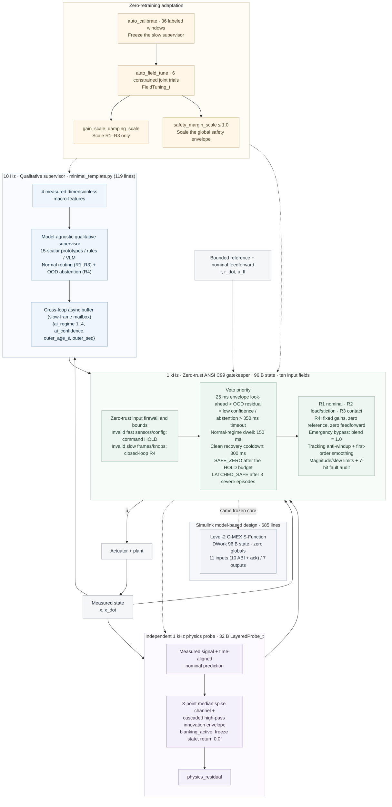

# ai-layered-control · v2.0.2

[](https://github.com/lijiawei255/ai-layered-control/releases/tag/v2.0.2)
[](c99_layered_core/layered_gatekeeper.h)
[](#36-reproduce)
[](LICENSE)
[](https://doi.org/10.5281/zenodo.23911915)
[](https://github.com/deepseek-ai/deepseek-harness)

[English](README.md) | [简体中文](README_zh.md) · [Agent guide](AGENTS.md)

**Let AI identify the situation. Let deterministic control own the actuator:** A portable **zero-trust fast-slow reference architecture** — 10 Hz qualitative supervision with active abstention, a 1 kHz C99 zero-trust safety gatekeeper, and field knob tuning after the AI is frozen. Traditional layered control (gain scheduling or fixed rule switching) is confined by the complete-world assumption: it can only hard-switch among the preset known regimes R1–R3. Facing unmodeled mechanical resonance or an out-of-distribution (OOD) disturbance, it has no abstention capability and can only emit the nearest regime's control law, which amplifies oscillation. This architecture draws the generational line with fast-slow dual-layer abstention: 10 Hz manifold-distance low-confidence abstention retreats to R4 damping, and a 1 kHz millisecond-scale forced veto from an independent physical residual probe.

## Why This Architecture & Quick Navigation

This repository is an MIT-licensed reference design, comparison benchmark and AI adaptation template for research and engineering reuse. The reusable surface is a **full-stack, dual-loop reference**, not a single C filter: the slow loop, the MCU integration sample, the deterministic core and the Simulink adapter are four peer modules that share one interface contract.

### Four Reusable Modules, One Contract

- **[1] [python_bench/minimal_template.py](python_bench/minimal_template.py) — 119 lines:** A 10 Hz qualitative slow loop with small-sample commissioning (`auto_calibrate`: 36 labeled windows, 15 scalars / 60 B), low-confidence abstention, frozen-AI three-knob field tuning (`auto_field_tune`, a 20-line pair of helpers) and a `SLOT 1..3` device skeleton.
- **[2] [c99_layered_core/gate_template.c](c99_layered_core/gate_template.c) — 120 lines:** A 1 kHz bare-metal MCU interrupt integration sample with a **32 B zero-heap physics-residual probe** (`LayeredProbe_Step`: median spike rejection plus a cascaded high-pass innovation envelope), the `blanking_active` hardware blanking window for stimulation pulses and commutation-edge artifacts, and the `outer_seq` commit-marker pattern.
- **[3] [c99_layered_core/layered_gatekeeper.h](c99_layered_core/layered_gatekeeper.h) / [.c](c99_layered_core/layered_gatekeeper.c) — 96 B state:** A zero-dependency ANSI C99 safety arbiter and four-bank anti-windup control microkernel for 1 kHz cyclic tasks.
- **[4] [simulink_sfunc/sfun_layered_gatekeeper.c](simulink_sfunc/sfun_layered_gatekeeper.c) — 685 lines:** A Level-2 C-MEX S-Function for model-based design: `DWork` holds the 96 B state, zero globals, zero dynamic memory, **11 inputs** (10 ABI inputs plus the `ack` rising edge) and **7 outputs** around the same frozen core.

### Key Engineering Metrics

- **Small-sample calibration, no GPU required:** The slow supervisor is calibrated on CPU from **36 labeled macro-windows** and stores **15 scalars / 60 B (FP32)**; baseline B2 (a 1 kHz continuous-action neural network trained on 16,000 samples) needs **16,000 action labels / 20,596 B (FP32)**.
- **96 B deterministic C99 fallback:** A zero-heap ANSI C99 core owns the **1 kHz** actuator command with **ten input fields**, a 32 B independent physics-residual probe and nine core protection duties. In this compound-fault benchmark, the first spike triggers a veto and closed-loop R4 (the conservative safe-fallback bank) within the same **1 ms control tick**.
- **Frozen AI, physical field tuning:** Three knobs occupy **12 B** and support constrained adaptation to forward overload, cross mismatch, reverse light load and compound unit drift without retraining the supervisor.
- **Cross-language replay and a 119-line skeleton:** **245 C regression checks** pass; Python/C replay is bit-exact (**max|du| = 0**), MATLAB/C replay is within **5e-8**, and the Level-2 S-Function reproduces all seven outputs over 1,100 frames with **max diff = 0.0**. The **119-line template** is ready to run; the Simulink model illustrates the architecture.

**Human readers:** [§1](#1-ai-can-be-slow-control-authority-must-be-clear) explains the division of control authority through six field problems; [§2](#2-what-to-reuse-human--agent-quickstart) covers the four reusable modules and three-step interface adaptation; [§3.2](#32-four-stage-comparison) / [§3.3](#33-frozen-ai-field-tuned-hardware) / [§3.4](#34-mode-ablation-and-independent-protection) present the measured comparisons, the new gating and abstention experiments, and the figures.

**AI coding assistants (DeepSeek Harness / Kimi Code / OpenCode / ZCode / Qoder / Codex / Claude Code / Cursor):** start with [AGENTS.md](AGENTS.md), then replace `SLOT 1..3` in [minimal_template.py](python_bench/minimal_template.py) and fill the ten input fields from the device contract.

## 1. AI can be slow. Control authority must be clear.

Bringing AI into industrial arms, CNC / additive manufacturing (WAAM), or closed-loop neuromodulation (Parkinson's aDBS, spinal cord stimulation / SCS) makes prediction accuracy only half the problem; the other half is control authority — who owns the actuator command every millisecond. A slow model that understands context plus a fast neural action head does improve responsiveness. But as long as the learned policy still owns continuous commands, the six field problems below keep recurring. They cannot be masked by blind tuning; each one must be resolved in low-level control authority and safety mechanisms. The measured results cited below come from four 10 s test stages: S1 nominal tracking, S2 load and stiction drift, S3 intermittent contact and measurement noise, S4 an unseen compound fault. The design horizon here is 2027+ deployment across constrained devices.

Traditional layered control (gain scheduling or fixed rule switching) is confined by the complete-world assumption: it can only hard-switch among the preset known regimes (R1–R3). Facing unmodeled mechanical resonance or an out-of-distribution (OOD) disturbance, it has no abstention capability and can only emit the nearest regime's control law, which amplifies oscillation. This architecture adds fast-slow dual-layer abstention: 10 Hz manifold-distance low-confidence abstention that identifies an unknown manifold and retreats to R4 damping, and a 1 kHz millisecond-scale forced-veto abstention driven by an independent physical residual probe.

1. **Scarce samples, expensive trials**

   **Field problem:** A learned continuous-action policy can only cover its trajectory neighbourhood and state-velocity grid through dense sampling. In this benchmark, baseline B2 (a 1 kHz continuous-action neural network trained on 16,000 samples) is trained on **16,000 nominal simulated action labels / 20,596 B (FP32)**; Figure 2 Panel A shows that its nominal tracking RMSE has already converged at 64–1,024 samples, yet without the 1 kHz deterministic gate it still posts **589 S4 violation ticks**.

   **Architecture mechanism:** The slow loop does not learn a policy; it classifies coarse operating regimes, so **36 labeled macro-windows / 15 scalars / 60 B** on a CPU are enough to complete `auto_calibrate` and freeze a prototype archive.

   > **Note:** The 16,000 samples are a simulation-based experimental setting, not measured machine time or wear; the count makes the engineering cost of relying on dense exploratory sampling and retraining concrete.

2. **Rigid and compliant conditions conflict**

   **Field problem:** A single fixed-parameter white-box loop must trade disturbance rejection against contact compliance. Baseline B1 (fixed-parameter high-gain PID + inverse-dynamics feedforward) breaks stiction well with its high gain, yet drives S3 contact to **64.59 N** against a 20 N budget.

   **Architecture mechanism:** The fast loop owns a four-bank deterministic library — R1 nominal, R2 high load, R3 compliant contact, R4 conservative safe fallback — with per-bank reverse tracking anti-windup on every tick and an **emergency R4 bypass (`blend = 1.0`)** that removes the first-order smoothing lag from the braking response.

3. **Unknown manifolds and sub-healthy oscillation**

   **Field problem:** A fixed-threshold rule tree and a fuzzy controller have no notion of distance from the data that produced them; they keep issuing the nearest rule while the plant oscillates.

   **Architecture mechanism:** The prototype classifier carries a distance-based **confidence**. When the operating point leaves the calibrated manifold and enters the **`OFF_MANIFOLD`** regime, it abstains with low confidence into R4 damping — the unmodeled transmission dead zone plus a 4 Hz lightly damped mounting mode used in §3.4. This is the divide from traditional layered control: gain scheduling and fixed rule switching have no measure of how far the current point lies from the known manifold, so they can only hard-select the nearest calibrated regime; this architecture turns that distance into an observable, adjudicable deterministic abstention event.

   > **Note:** The fixed-threshold rule tree compared in this benchmark embeds no explicit manifold-distance or density model.

4. **Cross-machine, batch and unit drift without retraining compute**

   **Field problem:** Joint inertia, damping, friction and contact stiffness move between units, and a field site has no GPU for retraining.

   **Architecture mechanism:** The architecture keeps the **frozen AI manifold topology** orthogonal to a **12 B physical knob tuple** (`FieldTuning_t`); `auto_field_tune` runs six bounded, constrained trials and calibrates forward overload (+35% / +50%), cross mismatch (J +40%, b −30%) and reverse light load (−25%) without touching the classifier.

5. **Slow-loop blind spot, transient artifacts and communication loss**

   **Field problem:** A 10 Hz supervisor is blind for up to 100 ms; stimulation pulses and commutation edges corrupt innovation; a fieldbus can stall.

   **Architecture mechanism:** A 1 kHz, 32 B blanking probe absorbs the artifacts first: during a stimulation pulse or motor commutation, the hardware blanking signal (`blanking_active`) freezes the 1 kHz probe state and forces `0.0f` output — it neither mistakes a normal periodic pulse for a physical anomaly, nor lets a pre-blanking residual wave lock the system into an OOD veto. The **96 B core** adds a 25 ms phase-plane envelope look-ahead, an independent residual veto, an `outer_seq` local-clock lease, and a bounded HOLD that escalates to **`GATE_SAFE_ZERO`** with a slew-limited energy release whose per-tick step is `max(u_slew_max_per_s * dt_s, 1 binary32 ULP(|u_prev|))`.

6. **Silicon limits and incident accountability**

   **Field problem:** An MCU or PLC control task has fixed RAM and no allocator; industrial and medical incidents require causal evidence.

   **Architecture mechanism:** The core is zero-heap ANSI C99; **three cumulative severe-fault episodes** permanently latch **`GATE_LATCHED_SAFE`** with a **7-bit black-box mask** (`fault_audit_bitmask`). Only an explicit `Layered_AcknowledgeFaultLatch()` call, followed by the recovery cooldown, re-arms the AI.

**Inference bandwidth is not execution authority:** Computing an action a thousand times per second (1 kHz inference bandwidth) does not make a learned policy safe to own the actuator: its output is still an action proposal without physical guarantees. Execution authority means standing at the actuator every millisecond, maintaining the feedback invariants, tracking anti-windup, hard magnitude/slew limits and independent veto fallback. This repository provides exactly such a device-side software gateway for AI control permissions: the slow loop answers only "which regime?" (`1..3`) or "abstain" (`4`); an independent probe derives veto evidence from time-aligned nominal-model innovation and measurement spikes; an **ANSI C99 core with only 96 bytes of state and zero dynamic allocation** owns the 1 kHz command, closed-loop fallback and physical tuning knobs. The supervisor can change while the execution contract stays fixed. This gateway enforces **four zero-trust defence lines towards the slow-loop AI**: an **interface and numeric zero trust** — the slow loop cannot touch the actuator command `u` or the deterministic feedforward `u_ff` and may submit only regime proposals `1..4`, while the split input firewall sets `corrupted = 1` on any `NaN/±Inf`, out-of-range regime or sequence anomaly in a slow-loop field and forces closed-loop R4; a **time zero trust** — the transported frame age `outer_age_s` is never taken on faith, and with `outer_seq` enabled the 1 kHz core measures the frame lease on its own clock, so a stalled or forged age cannot mask a communication stall; a **physics zero trust** — even a full-confidence (`1.0`) slow-loop output is vetoed in the current 1 ms tick and replaced by R4 whenever the 32 B independent physical-residual probe or the 25 ms phase-plane envelope look-ahead crosses its threshold; and a **recovery zero trust** — after a fault clears or a manual `Layered_AcknowledgeFaultLatch` release, the AI cannot regain authority on the next tick and must pass the 300 ms clean recovery cooldown and the 150 ms dwell anti-chatter check.



Diagram timings are benchmark defaults. The device adapter computes `outer_age_s = now - source_timestamp` on every fast tick; with a non-zero `outer_seq`, the core measures frame age on its own 1 kHz clock and a frozen or forged `outer_age_s` cannot mask a stalled mailbox. The spike channel reads the measured signal directly; the broadband channel evaluates nominal-model innovation.

**Seven observable gate decisions:** These are deliberate, explainable states, logged by the field recorder:

| Code | Gate | Behaviour |
| :---: | :--- | :--- |
| 0 | `GATE_NORMAL` | Accepted AI regime; the selected bank runs with field-tuned gains and deterministic feedforward. |
| 1 | `GATE_HOLD_LATENCY` | Stale mailbox or unusable fast input; the last applied command is held. This holds the actuator command, not mechanical position. |
| 2 | `GATE_VETO_OOD_RESIDUAL` | Physics innovation above threshold; the residual veto latches until it recedes below the clear ratio. |
| 3 | `GATE_VETO_LOW_CONFIDENCE` | Confidence below threshold, or explicit `ai_regime = 4` abstention; cleared only by a confident normal regime. |
| 4 | `GATE_VETO_SAFETY_ENVELOPE` | Measured or predicted state at the envelope; sticky until both state and prediction fall below the clear ratio. |
| 5 | `GATE_SAFE_ZERO` | Native HOLD ran past `max_hold_ticks = 100`: integrators and target are cleared and the command is ramped to zero in steps of `max(u_slew_max_per_s * dt_s, 1 binary32 ULP(\|u_prev\|))`; the one-ULP floor keeps the de-energise monotone and finite-time when the legal slew budget is below one representable step, and it never re-energises. A corrupt configuration uses its fixed 100-tick budget, zeroes immediately and latches. |
| 6 | `GATE_LATCHED_SAFE` | Three cumulative safety/OOD veto episodes (`max_fault_vetoes_before_latch = 3`) permanently lock R4; only `Layered_AcknowledgeFaultLatch()` releases the core, resets the episode counter and re-arms the cooldown. Lifetime counters and the audit mask survive. |

The sticky **7-bit fault audit mask** records the root causes: latency timeout, OOD residual, low confidence, envelope breach, NaN corruption, HOLD timeout and permanent latch. While a veto is active or the permanent latch is set, and the active regime is R4, the **emergency bypass** skips `blend_alpha` and applies the raw R4 law with `blend = 1.0`; magnitude and slew limits still apply.

## 2. What to reuse: Human & Agent Quickstart

| Reusable module | Size | What you take into your system |
| :--- | :--- | :--- |
| **[1] [minimal_template.py](python_bench/minimal_template.py)** | 119 lines | Standalone 10 Hz supervisor + 1 kHz C binding: `auto_calibrate`, `auto_field_tune`, low-confidence abstention and `SLOT 1..3` |
| **[2] [gate_template.c](c99_layered_core/gate_template.c)** | 120 lines | 1 kHz MCU integration sample: 32 B `LayeredProbe_t`, `blanking_active`, `outer_seq` lease and a PASS self-check |
| **[3] [layered_gatekeeper.c](c99_layered_core/layered_gatekeeper.c) / [.h](c99_layered_core/layered_gatekeeper.h)** | 96 / 140 / 12 / 40 / 28 B | Zero-dependency ANSI C99 control and safety gatekeeper for an MCU, PLC or RTOS cyclic task |
| **[4] [sfun_layered_gatekeeper.c](simulink_sfunc/sfun_layered_gatekeeper.c)** | 685 lines | Level-2 C-MEX S-Function around the same frozen core: 11 inputs, 7 outputs, no mutable globals |

When copying the C99 core, retain the MIT copyright and permission notice in [LICENSE](LICENSE).

**Adapt with an AI coding assistant (DeepSeek Harness / Kimi Code / OpenCode / ZCode / Qoder / Codex / Claude Code / Cursor):** ask the Agent to read [AGENTS.md](AGENTS.md) and replace `SLOT 1..3` in the [minimal template](python_bench/minimal_template.py) using your device contract, then fill the ten input fields and build the MCU sample from [gate_template.c](c99_layered_core/gate_template.c).

> **Copy-paste prompt for AI coding assistants:** Read `AGENTS.md` first (focusing on the §1 zero-trust contract and the §4 Step 5 three-layer reuse guide), then load both `python_bench/minimal_template.py` (119 lines) and `c99_layered_core/gate_template.c` (120 lines). The two reusable templates total **239 lines (< 6,000 tokens)**; load both in a single context window and do not invent cross-file APIs.
>
> Adapt the architecture to my device using whichever mode fits my setup: (1) **Full dual-loop integration**: replace the three `SLOT 1..3` blocks with this device's sensor / reference / actuator I/O, commissioned predictor and constrained safe-trial callback (keeping `auto_calibrate` and `auto_field_tune` unchanged), and adapt `gate_template.c` for the 1 kHz ISR with `LayeredProbe_Step`, `blanking_active` and `outer_seq`; or (2) **Existing-loop integration (`AGENTS.md` Step 5)**: discard the 1-DOF rotary benchmark fixture, instantiate the 96 B `layered_gatekeeper.c` per channel inside my existing control task, or slice out individual mechanisms (`outer_seq` local-clock lease, `blanking_active` artifact-blanking probe, tracking anti-windup, or the three-episode permanent latch) as instructed.

From the repository root, run the minimal skeleton first (Python 3 and a C99 compiler on `CC` or `PATH`), then the full benchmark when ready:

```powershell
python -m pip install -r python_bench/requirements.txt
python python_bench/minimal_template.py
python python_bench/run_benchmark.py
```

### Three-step interface adaptation

1. **Define and connect.** Specify units, the safe zero and output limits; commission the nominal model and controller bank, then connect sensors, references and the actuator.
2. **Calibrate from small samples.** Run `auto_calibrate` on measured macro-features to build regime prototypes and confidence thresholds.
3. **Freeze AI and field-tune.** Use `auto_field_tune` with constrained cross-condition trials, then validate the selected knobs on independent trajectories.

The two adaptation helpers stay within 20 lines and are device-independent; the demo below commissions a prototype archive and tunes the three physical knobs with the classifier frozen:

```python
observations = np.vstack([probe_features(device, load) for load in (0.4, 2.0, 5.0)])
model = auto_calibrate(observations, np.repeat((1, 2, 3), 12))      # 36 labeled windows -> 15 scalars / 60 B
cfg.update(min_ai_confidence=model[2], confidence_clear_ratio=model[3])
evaluate = lambda knobs: closed_loop_cost(device, knobs, model)    # -> (measured cost, valid)
tuning = auto_field_tune(evaluate)                                 # 6 bounded trials, AI frozen
```

Initialize once; on each fast tick, populate all ten input fields and call `Layered_Step`:

```c
LayeredState_t state;
LayeredConfig_t config;
LayeredInput_t input;
FieldTuning_t field_tuning = {1.0f, 1.0f, 1.0f};
/* Populate config and all ten input fields from the commissioned device interface. */
Layered_Init(&state, &config, &field_tuning);
LayeredOutput_t output = Layered_Step(&state, &config, &field_tuning, &input);
```

| Input field | Meaning |
| :--- | :--- |
| `ai_regime` | Slow decision: `1..3` normal regime, `4` explicit abstention |
| `ai_confidence` | Classifier confidence in [0, 1]; a distance-based value for the prototype classifier |
| `outer_age_s` | Age of the freshest slow frame, computed every fast tick |
| `physics_residual` | Normalized independent nominal-physics innovation, nonnegative |
| `x`, `x_dot` | Measured state and derivative in the device's units |
| `r`, `r_dot` | Bounded reference and reference rate in the same units |
| `u_ff` | Deterministic commissioned-model feedforward; never produced by the AI |
| `outer_seq` | Slow-frame sequence number; non-zero selects the local clock lease, zero keeps the legacy age path |

`Layered_AcknowledgeFaultLatch(&state, &config)` releases a latched unit after the field engineer has inspected the audit mask; it keeps lifetime counters and the 7-bit mask, and re-arms the recovery cooldown so the AI cannot return on the next tick.

### Three integration examples, an open device interface

Three application families motivate the same separation: **industrial WAAM / PLC servo**, **edge VLA / fast-slow robotics**, and **closed-loop aDBS / SCS neuromodulation**. They are examples of a common control contract, open to other systems with scarce samples, unit variation, intermittent contact, uncertain context and strict output constraints.

| Application example | Slow qualitative decision | Device adapter and deterministic fast-loop connection |
|---|---|---|
| Industrial WAAM / PLC servo | Process, inter-layer thermal load and contact regime | Connect process, servo / wire-feed laws and actuator constraints; implement force sensing and hard force limits in the device layer; field-tune for a new batch |
| Edge VLA / fast-slow robotics | Task and environment-contact class | Connect 1 kHz torque / impedance laws; absorb joint-stiction differences through feedback and tuning; use envelope vetoes and fallback to handle state-limit risks |
| Closed-loop neuromodulation: aDBS / SCS | Brain biomarkers for aDBS; posture / activity (lying, walking, coughing) and interface state for SCS | Define a first-order stimulation-current / evoked-response (ECAP) recruitment model and artifact probe for SCS, and a biomarker-specific law for aDBS; validate individual knobs within device output / timing limits and clinically established comfort bounds |

For SCS, the 1 kHz artifact probe mirrors the `blanking_active` pattern in [gate_template.c](c99_layered_core/gate_template.c): the HAL masks the stimulation window, the probe freezes instead of integrating the pulse, and the returned residual is zero, so a pre-blanking elevated value cannot hold the OOD veto through blanking. Background: pulse-artifact blanking as commonly used in closed-loop spinal cord stimulation (ECAP-SCS) and adaptive deep brain stimulation (aDBS).

A new physical domain needs new units, limits, control laws and probes; a new unit in the same domain can retain the classifier and complete its adaptation with the three physical knobs.

See [AGENTS.md](AGENTS.md), the [domain mapping guide](docs/domain_mapping_guide.md), and the [systems engineering rationale](docs/systems_engineering_manifesto_en.md). Deployment code does not accept stage labels, fault frequency or simulator truth.

## 3. Evidence: three control paths, one physical fixture

### 3.1 The three control paths

| Branch | Slow context | Continuous actuator command at 1 kHz |
|---|---|---|
| B1 · modern white-box baseline | Single fixed regime | Nominal inverse-dynamics feedforward + high-gain anti-windup PID |
| B2 · learned fast-slow policy | Four measured macro-features at 10 Hz, delayed independently | Conditioned 512-center RBF action head, `u = π(x, x_dot, r, r_dot, r_ddot, z)` |
| B3 · qualitative / quantitative separation | Model-agnostic regime + confidence + timestamp at 10 Hz | C99 controller bank, nine duties of protection, deterministic feedforward and field tuning |

The three paths are: baseline B1 (fixed-parameter high-gain PID + inverse-dynamics feedforward), baseline B2 (a 1 kHz continuous-action neural network trained on 16,000 samples), and this architecture B3 (10 Hz qualitative routing + 1 kHz C99 safety gating).

**Full-strength baselines:** B1 and B3 receive the **same nominal feedforward in normal operation** and share the same anti-windup, magnitude and slew limits; B1's high gain posts the lowest raw S2 RMSE in the main table (**0.017125 rad**), while the fixed-parameter waterbed effect still drives S3 contact to **64.59 N** (63.47 N with the identical `alpha = 0.3` low-pass). B2 runs its action head at the full 1 kHz — **40,000 action evaluations in 40 s**, zero fast-loop state delay — and posts the lowest S3 contact force (**12.52 N**); without an explicit integrator or physical gate it carries larger S2 error and **589 S4 violation ticks**. The physical rule tree reads the same measured features as the prototype classifier and matches its S1/S2 decisions and 19.47 N S3 contact peak.

All branches share actuator magnitude and slew limits, sensor processing, noise, reference, plant and fault realization. B1 has no `blend_alpha` smoother. Latency applies only to B2's context; its policy contains no integrator input or external PD stabilizer. B3's first-order command smoothing operates on every tick.

All published metrics in the main and appendix tables agree at displayed precision between Python/C and MATLAB (cross-engine double-precision reduction tails and collision sensitivity are detailed in the §3.3 collapsible section).

### 3.2 Four-stage comparison

**Key Takeaways:** B1 is the fixed high-gain white-box baseline; B2 is the learned fast-slow continuous-action policy; B3 is this layered architecture. In the main run:

- **S1/S2 — tracking with lower command variation:** B3 keeps tracking error in the same order as B1 while reducing TV from **8,217.67 / 8,100.68** to **1,567.40 / 2,083.14 N·m**.
- **S3 — compliant intermittent contact:** B1 reaches **64.59 N**, about **3.23 times** the 20 N budget; B3 switches to the compliant R3 bank and stays within budget at **19.47 N**. B3's TV is **3,873.76 N·m**, versus B2's **12,621.12 N·m**.
- **S4 — zero envelope violations under the compound fault (Figure 1, 30–40 s):** With a swept two-inertia mode and sensor spikes, B1/B2 record **840 / 589 violation ticks** (`|x| > 1 rad`). B3 vetoes on the first spike in the same control tick and enters closed-loop R4: **0 violations**, with TV of **1,545.01 N·m**. R4 gives up reference tracking to protect the envelope.

Four 10 s test stages: S1 nominal tracking, S2 load and stiction drift, S3 intermittent contact and measurement noise, S4 an unseen compound fault.

40 s total, a 1 ms control period and two 0.5 ms physical substeps. Actuator limits are **20 N·m** and **2,000 N·m/s**. The state envelope is **|x| ≤ 1 rad**; S3's contact-force budget is **20 N**, using a 0.25 m lever arm.

RMSE compares reference and true state at the same tick. TV is the within-stage sum of absolute command changes. A violation tick means the true state lies outside the envelope; it is separate from a gate activation. Tables use Python + C99, seed 7. MATLAB independently reproduces the main metrics at displayed precision.

| Stage | Branch | RMSE / rad | TV(u) / N·m | Violation ticks | Peak contact / N |
|---|---|---|---|---|---|
| S1 | B1 | 0.000664 | 8217.67 | 0 | — |
| S1 | B2 | 0.003031 | 6261.70 | 0 | — |
| S1 | B3 | 0.000630 | 1567.40 | 0 | — |
| S2 | B1 | 0.017125 | 8100.68 | 0 | — |
| S2 | B2 | 0.042307 | 6569.89 | 0 | — |
| S2 | B3 | 0.020819 | 2083.14 | 0 | — |
| S3 | B1 | 0.028964 | 15959.27 | 0 | 64.59 |
| S3 | B2 | 0.099757 | 12621.12 | 0 | 12.52 |
| S3 | B3 | 0.069478 | 3873.76 | 0 | 19.47 |
| S4 | B1 | 0.411768 | 10383.77 | 840 | — |
| S4 | B2 | 0.367208 | 11349.37 | 589 | — |
| S4 | B3 | 0.539985 | 1545.01 | 0 | — |


### 3.3 Frozen AI, field-tuned hardware

**Key Takeaways — adaptation without retraining (Figure 2):** The classifier stays frozen while `auto_field_tune` searches six bounded gain/damping candidates under a joint constraint set. Forward overload (**+35% / +50%** compound drift) selects **`(1.25, 0.5, 1)`** and cuts independent S2 validation RMSE by **18.7% / 16.5%**; full-mission validation has zero envelope violations and contact peaks of **17.93 / 18.65 N** within the 20 N budget. Cross mismatch (**J +40%, b −30%**) selects the same tuple and cuts RMSE by **20.4%** with a **16.75 N** mission peak. Reverse light load (**J, b, fc, fs −25%**) makes the factory tuple infeasible at **21.64 N** in the search task; the helper automatically downshifts to the only compliant candidate **`(0.75, 1.0, 1)`** (search peak 18.50 N), which posts a **13.12 N** mission peak with zero violations and accepts S2 RMSE **0.002704 → 0.004041** in exchange for contact safety. B1's six candidates fail the joint constraints in every condition; the contract retains its factory knobs, and its S2-best **`(2,1,1)`** would cost **75.51 / 75.49 N** and **1,397 / 1,031 violation ticks** on the two drift units.

The classifier stays frozen. These independent S2 validations use a 6 s trajectory of amplitude 0.43 rad, seed 811, shared by all controllers. They are separate from the 10 s S2 window above. "+35% / +50% unit drift" means **inertia change plus strong stiction**, not inertia alone; amplified friction dominates this fixture's S2 error. RMSE is in rad and TV in N·m.

| Condition | B1 factory RMSE | B3 factory (1,1,1) | B3 selected knobs | B3 tuned RMSE | B3 TV: before → after | Mission S3 peak / N | Mission violations |
| :--- | ---: | ---: | :---: | ---: | :---: | ---: | ---: |
| +35% compound drift | 0.016682 | 0.020331 | (1.25, 0.5, 1) | 0.016522 (**−18.7%**) | 1249.03 → 864.10 | 17.93 | 0 |
| +50% compound drift | 0.023648 | 0.027846 | (1.25, 0.5, 1) | 0.023253 (**−16.5%**) | 1254.20 → 902.48 | 18.65 | 0 |
| Cross mismatch (J +40%, b −30%) | 0.002961 | 0.005191 | (1.25, 0.5, 1) | 0.004134 (**−20.4%**) | 1239.75 → 812.21 | 16.75 | 0 |
| Reverse mismatch (J, b, fc, fs −25%) | 0.001398 | 0.002704 | (0.75, 1.0, 1) | 0.004041 (tracking traded) | 1259.05 → 1189.92 | 13.12 | 0 |

The search takes **240 s of device trajectories per branch and unit**, followed by **12 s paired S2 validation + 40 s full-mission validation**. Host computation time is reported separately. Accepted B3 tuning reduces independent S2 validation RMSE by **18.7% / 16.5%** on the drift units and keeps zero normal-stage veto/R4 occupancy on every condition. In the reverse condition the helper preserves contact compliance by lowering gain; the RMSE increase is the price of the 20 N contract, not a search failure.


<details>
<summary><b>Details: equal-budget counterfactuals, command smoothing and physical fixture</b></summary>

B3 selects **`(1.25,0.5,1)`** in `gain / damping / safety margin` order for the drift and cross conditions, and **`(0.75,1,1)`** for the reverse condition. B1's S2-best candidate **`(2,1,1)` is infeasible** and is shown as a counterfactual, not an accepted deployment. Independent full 40 s missions expose its contact-force cost:

| Condition | Candidate | S3 peak / N | S3 TV / N·m | S3 veto fraction | S3 R4 fraction | Mission violation ticks |
|---|---|---|---|---|---|---|
| +35% | B3 (1.25,0.5,1) | 17.93 | 2061.94 | 0.00% | 0.00% | 0 |
| +35% | B1 (2,1,1) | 75.51 | 16372.36 | 0.00% | 0.00% | 1397 |
| +50% | B3 (1.25,0.5,1) | 18.65 | 2061.46 | 0.00% | 0.00% | 0 |
| +50% | B1 (2,1,1) | 75.49 | 16347.53 | 0.00% | 0.00% | 1031 |

Each branch receives the same six fixed joint gain/damping candidates: `(0.75,1)`, `(1,1)`, `(1.25,1)`, `(2,1)`, `(1.25,0.5)`, `(1.25,0.75)`; safety margin stays at 1. Each pair is evaluated independently. Each 40 s trial includes sinusoidal and ramped references, stiction, contact and OOD. Acceptance requires zero state violations, S1 RMSE < 0.01 rad, and in each normal stage peak contact < 20 N, veto fraction ≤ 5% and R4 occupancy ≤ 10%. The objective is measured S2 error. When none qualifies, the helper retains the current knobs; that is why every B1 unit keeps its factory tuple.

**Command smoothing explains much of B3's TV advantage:** Giving B1 the identical per-tick low-pass coefficient `alpha = 0.3` reduces TV substantially but leaves excessive contact force:

| Controller | S1 TV | S3 TV | S3 peak / N |
|---|---|---|---|
| B1 | 8217.67 | 15959.27 | 64.59 |
| B1 + LP | 2120.64 | 8278.80 | 63.47 |
| B3 | 1567.40 | 3873.76 | 19.47 |

### Physical fixture

| Stage | Physical mechanism |
|---|---|
| S1 · nominal tracking | Inertia 0.010 kg·m², viscous damping 0.060 N·m·s/rad, ground stiffness 0.300 N·m/rad; dynamic/static friction 0.6 / 1.0 N·m |
| S2 · Unit Drift: Inertia + Stiction | Inertia +35%; dynamic/static friction 3.09 / 6.2625 N·m. Karnopp zero-speed band 0.003 rad/s; insufficient drive locks the state, breakaway switches to sliding friction |
| S3 · contact and edge jitter | One-sided wall: stiffness 300 N·m/rad, damping 0.8 N·m·s/rad; during S3, position 0.43 + 0.025 sin(2π·0.73t + phase) + 0.24 exp(−(t−20)/0.25) rad, including continuous approach. White measurement-noise standard deviation 0.006 rad; context delay 60–120 ms and 8% frame drops |
| S4 · unseen compound OOD | At 30.037 s, a motor/load pair with 20%/80% inertia split replaces the rigid actuator; positive stiffness/damping create a 12→24 Hz swept mode. Load sensing also receives 0.025 rad bias and 0.18 rad spikes |

Inertia and viscous-damping changes persist through S3/S4; elevated friction belongs to S2. For drift fraction d, damping is 0.060(1 + 0.3d) N·m·s/rad, or 0.0663 at +35%. Both engines use the same 32-bit LCG and bounded, unit-variance white-noise construction. There is no sinusoidal measurement-noise tone. The flexible plant has a decaying zero-input response at the checked fixed modal frequencies. The swept model uses positive stiffness and damping throughout.

B2 trains on **16,000 nominal-model action labels**: 75% cover nearby sinusoidal/ramped trajectories with correlated position and velocity errors, and 25% retain broad error/context coverage. Contact-like context softens its nominal action target. Strong stiction, the moving wall and the flexible actuator are deployment shifts. Panel A separately trains on shifted-unit labels; evaluation trajectories are not training labels.

Panel A uses the actual conditional RBF at 64 / 256 / 1,024 / 4,096 / 16,000 action labels, with up to 512 centers. It reports nominal performance, frozen transfer and retrained transfer on a logarithmic error axis, including unstable low-budget rollouts. The curves are non-monotonic; retraining does not consistently recover nominal accuracy.

### Controller bank

| Controller | Kp | Ki | Kd | Feedforward scale |
|---|---|---|---|---|
| B1 | 110 | 300 | 1.5 | 1 |
| B3 R1 · nominal | 60 | 60 | 1.2 | 1 |
| B3 R2 · load / friction | 110 | 300 | 1.5 | 1 |
| B3 R3 · compliant contact | 8 | 2 | 0.8 | 1 |
| B3 R4 · safe fallback | 2 | 0 | 0.35 | **0** |

R4 uses **zero reference, fixed gains and zero feedforward**, independently of all field knobs. The state coordinate's zero must be the commissioned safe fallback point. During abstention, this damping law deliberately gives up trajectory tracking and pulls the state toward zero to preserve the envelope. Friction can stop the physical state before it reaches zero.

### Cross-engine floating-point reconciliation

All published metrics in the main and appendix tables agree at displayed precision between Python/C and MATLAB. Across the main table, the five holdout runs and the four field-tuning conditions, the 200 raw B3 reductions collected from those tables differ by at most 8.6e-15 between the two engines. B1 and B2 are likewise identical at displayed precision; their raw binary64 accumulation carries double-precision reduction tails of, for example, about 9.1e-6 in B2's S3 TV. In the rejected B1 instability candidates and in the reverse-mismatch counterfactual, an approximately 1e-16–1e-14 double-precision tail is amplified by the repeated rigid-wall collisions into O(1 N) differences in the contact peaks (193.12 N in Python versus 194.02 N in MATLAB), with no change to any feasibility verdict. The B2 ridge-regression weights differ by about 1.9e-6 in double precision between NumPy and MATLAB LAPACK, which can shift the fourth decimal of broad-band sensitivity metrics, and B2's S4 RMSE at seeds 307 and 503 differs in the last displayed digit by 1e-6. None of these differences changes a published B3 metric.

</details>

### 3.4 Mode ablation and independent protection

Fixed-bank ablations retain the **same fast safety gates**. Dynamic classification and physical rules read only measured features. All six supervisor variants below have zero state-envelope violations.

| Supervisor | S1 RMSE | S2 RMSE | S3 RMSE | S4 RMSE | S3 TV | S3 peak / N |
|---|---|---|---|---|---|---|
| R1 | 0.000630 | 0.048769 | 0.037056 | 0.536478 | 6238.73 | 29.13 |
| R2 | 0.000715 | 0.019624 | 0.029165 | 0.538375 | 8278.80 | 63.47 |
| R3 | 0.002368 | 0.416069 | 0.069065 | 0.538638 | 3642.12 | 6.93 |
| R4 | 0.440280 | 0.529412 | 0.460963 | 0.461034 | 6183.85 | 0.00 |
| dynamic | 0.000630 | 0.020819 | 0.069478 | 0.539985 | 3873.76 | 19.47 |
| rules | 0.000630 | 0.020819 | 0.075100 | 0.540437 | 3950.99 | 19.47 |

The fixed-bank results expose the load/contact tradeoff: the nominal bank pays 29.13 N in S3, the high-load bank 63.47 N, and the compliant bank accepts S2 tracking error to post 6.93 N. R4's zero contact force is the damping fallback, not a tracking controller. The rule tree and the prototype classifier agree on the main S1/S2 outcome and on the 19.47 N S3 peak; their S3 R3 occupancy differs slightly (93.49% versus 94.99%), which shows up in the third decimal of S3/S4 RMSE (0.075100 / 0.540437 versus 0.069478 / 0.539985). A rule tree or compact VLM can therefore replace the prototype classifier without changing actuator ownership.

**1 kHz fast-loop gating ablation:** Removing the fast-loop gate turns the layered supervisor into a context sensor. The S4 compound fault then produces **509 violation ticks** and a peak command at the 20 N·m actuator limit. A position-envelope gate alone recovers zero violations only by tripping the cumulative permanent latch after three veto episodes (9,085 latched ticks), and the pre-latch command still reaches **20.0 N·m**. The full B3 path rejects the fault on the first spike with the 1 kHz physics-residual probe: zero violations, zero latch, and a **3.33 N·m** S4 peak.

| Configuration | S4 violation ticks | S4 peak \|u\| / N·m | `GATE_LATCHED_SAFE` ticks | Four-stage TV / N·m |
| :--- | ---: | ---: | ---: | ---: |
| `unguarded_dual` (no fast-loop gate) | 509 | 20.0 | 0 | 19,528.1 |
| `envelope_only_dual` (position envelope only) | 0 | 20.0 | 9,085 | 9,242.8 |
| full B3 (envelope + 1 kHz residual) | 0 | **3.33** | 0 | 9,069.3 |

**Manifold-external abstention (`off_manifold_abstention`, seeds 0–4):** The fixture adds an **18 mN·m transmission dead zone** and a **4 Hz lightly damped mounting mode** with `noise_scale = 0.05`. In the B3 branch the fast-loop single-step residual stays at or below **0.223**; the `B3_no_conf` and `rules` variants reach **0.828 / 0.825**. All three stay below the **1.0** OOD threshold, so the residual probe cannot see the oscillation. The fixed rule tree and the variant with the confidence gate knocked out keep tracking and oscillate. The prototype distance confidence trips **900–1600 low-confidence 1 kHz gate ticks**, abstains into R4 damping, and cuts RMSE by more than 50% relative to the rule tree (48.3%–56.6% relative to `B3_no_conf`):

| Seed | `B3` RMSE / rad | `B3_no_conf` RMSE / rad | `rules` RMSE / rad | `B3` low-confidence ticks |
| :---: | ---: | ---: | ---: | ---: |
| 0 | 0.014458 | 0.029455 | 0.029431 | 1300 |
| 1 | 0.014705 | 0.029448 | 0.029456 | 1600 |
| 2 | 0.014640 | 0.028320 | 0.029430 | 1600 |
| 3 | **0.012797** | 0.029453 | 0.029453 | 900 |
| 4 | 0.013187 | 0.029454 | 0.029454 | 1600 |

Every configuration keeps zero state-envelope violations; the difference is oscillation amplitude under an unmodeled mode. This is the evidence for the slow-interface design: without hand-written mode-specific rule branches, the fixed-threshold rule tree (with no explicit density model embedded) only outputs the nearest rule, whereas the prototype classifier with manifold-distance confidence can directly recognise out-of-distribution drift and abstain.

**Contact-memory asymmetry:** The fourth feature accumulates signed nominal-model residual power with an activation threshold and release memory, so intermittent contact does not chatter between R3 and R1. The memory drains as fast as the contact evidence disappears:

| Transition | Time of last R3 tick | Residual R3 occupancy |
| :--- | ---: | :--- |
| `reverse_s3_to_s1` — wall withdrawn | **0.119 s** | S1 R3 fraction 0.012 |
| `retreat_s3_to_s1` — wall kept, reference retreats | 3.919 s | last-5-s R3 fraction 0.000 |

With the wall gone, the loop leaves compliant R3 at 0.120 s, one tick after the last R3 tick at 0.119 s, passes through a brief transition and returns to R1 at 2.020 s; only 1.2% of the S1 stage remains in R3. With the wall kept, the loop leaves R3 at 3.920 s, one tick after the last R3 tick at 3.919 s, and the last five seconds contain no R3 tick.

The independent physics probe monitors spikes and broadband innovation; the fast loop uses it for explicit OOD abstention. The first spike of the compound fault triggers a veto in the same control tick.

<details>
<summary><b>Details: contact/noise separation, wall phases, fault injection and interface boundaries</b></summary>

**Contact recognition persists at nominal noise:** The fourth feature accumulates signed nominal-model residual power relative to residual load energy, with an activation threshold and release memory for intermittent contact. It reads measured acceleration, velocity and applied command, not noise RMS or the wall schedule. The other features describe tracking error, effort and slow innovation. With S3 noise reduced to nominal, both supervisors still select R3 and meet the contact budget:

| Noise std / rad | Supervisor | S3 R3 fraction | S3 peak / N | S3 veto fraction | S3 R4 fraction |
|---|---|---|---|---|---|
| 0.006 | dynamic | 94.99% | 19.47 | 0% | 0% |
| 0.0015 | dynamic | 90.88% | 17.40 | 1.11% | 4.11% |
| 0.0015 | rules | 93.49% | 17.40 | 0% | 0% |
| 0.006; no wall | dynamic | 0% | 0.00 | 1.52% | 4.52% |
| 0.006; no wall | rules | 0% | 0.00 | 0% | 0% |

Veto and R4 fractions are distinct: recovery cooldown can retain R4 after a veto clears. Increased noise without a wall never selects R3; the prototype supervisor has a short confidence/recovery interval in that control experiment.

The safety probe combines a median-based spike channel with a **broadband high-frequency innovation envelope**: time-aligned nominal acceleration prediction, two-pole 25 Hz low-pass processing, 5 Hz high-pass innovation, an 8 ms energy window, normalization by 500 rad/s² and a 1 s release envelope. No fault frequency enters the deployed probe.

The full compound fault's first spike triggers a veto in the same control tick. **Anomaly detection delay and core response time are different measurements.** With the spike channel disabled, a 0.2 rad sensor oscillation at 12 / 18 / 37 / 83 / 137 Hz is detected after **30 / 6 / 4 / 3 / 3 ms**, following quiet initialization. With spikes, confidence, envelope and timeout vetoes removed from the compound test, the broadband probe detects after **670 ms**, retains zero violations and limits S4 maximum |x| to **0.6984 rad**. Removing only OOD veto also retains zero violations through the remaining gates (no true physical breach, and the maximum |x| stays at **0.8591 rad**, below the 1.0 rad red line), but TV rises to **1,718.48 N·m**; what follows is **three safety-envelope veto episodes** (`GATE_VETO_SAFETY_ENVELOPE`, triggered by the 0.9x fractional threshold and the 25 ms look-ahead before |x| reaches the 1.0 rad physical limit), which trip the permanent latch for **9,085 ticks**. Veto episodes and true physical breaches are distinct events and must not be counted one for the other.

The main run uses R1 throughout S1, R2 for 96.8% of S2 and R3 for 94.99% of S3; normal stages have no vetoes. S4 remains in R4 after fault onset. Persistent `ai_confidence = NaN` from 22 s produces **18,000 corrupted frames**, continued R4 command updates and **zero violations**, with whole-mission maximum **|x| = 0.5159 rad**. Corruption remains visible in flags and counters while valid sensors keep the fallback closed loop running.

Five independent noise/phase runs give B1/B2 S4 violations of **777–899 / 622–753 ticks** and zero for B3. Factory B3's S3 force spans **16.94–26.14 N** while every phase preserves the state envelope. The 10 Hz frame rate and normal-regime dwell delay switching, so the first collision can precede completed selection of R3 (19.47 N in the main run). Across the five runs the per-run B3-to-B1 S3 peak-force ratio stays between **0.24x and ~0.35x of B1 (at most 0.355x)**. The accepted tuning table validates the commissioned wall phase with independent noise. With one/two/four physical substeps, B3's peak force is **20.03 / 19.47 / 19.35 N**, with zero state violations. Removing context jitter changes B2's main S3 peak from **12.52 to 10.22 N**. Contact force, state safety and asynchronous-context sensitivity are separate outcomes.

#### Interface, multi-axis and timeout conventions

The nine core duties are input/settings validation, predictive envelope veto, residual veto, confidence/abstention veto, heartbeat watchdog, minimum dwell, recovery cooldown, controller-bank execution with anti-windup and magnitude/slew limits, and sticky fault reporting. Each integrator tracks the applied command; magnitude is clamped before slew. Dwell, latency and diagnostic counters saturate at `UINT32_MAX`. The C ABI and signatures remain fixed: 96 B state, 140 B configuration, 12 B tuning, 40 B input and 28 B output.

**Invalid slow mailboxes or field knobs select closed-loop R4:** set `corrupted` and latch the existing corruption fault bit; envelope and residual vetoes retain priority. Invalid fast signals or configuration retain the native command-HOLD path. Invalid knobs are internally replaced by `(1,1,1)` while R4 runs, keeping normal-bank tracking integrators finite. Signed state, reference, velocity and feedforward values are valid; only the normalized residual must be nonnegative. Gain and damping knobs lie in **[0.10,4.0]**; safety margin lies in **[0.10,1.0]** and can only tighten the envelope. These ranges define input validity, not a closed-loop stability guarantee; admissible operating gains come from constrained `auto_field_tune` trials. R4 ignores knob scaling, trajectory references and feedforward.

Use **one state, probe, tuning tuple and timestamp per axis/channel**. Share read-only configuration only where units and limits agree; coupled constraints belong in the device adapter. On a **350 ms** slow-loop timeout the adapter sends explicit R4 abstention and preserves real frame age. With `outer_seq`, the core checks the same stall on its own clock: a changed sequence opens a fresh lease, an unchanged one ages it, and a sequence falling back to zero is treated as mailbox corruption. Clean recovery passes through the core's **300 ms** cooldown. Native C `HOLD` freezes the **actuator command**, not mechanical position; past the HOLD budget the core ramps to zero and latches the evidence.

</details>

### 3.5 Small-sample commissioning, resources and domain mappings

`auto_calibrate(samples, labels)` builds three four-dimensional prototypes and confidence parameters from **36 labeled macro-windows**, twelve from each of three 10 s commissioning probes. The model has **15 stored scalars**: twelve prototype values, a distance-decay coefficient and two confidence thresholds.

`auto_field_tune(evaluate, current)` freezes that model and searches physical gains using measured error and an explicit cross-condition validity result. The two helpers occupy **20 lines** inside the [119-line template](python_bench/minimal_template.py).

| Resource category | Size |
|---|---|
| Conditional RBF, including normalization, centers, width and output coefficients | 5,149 scalars; FP64 41,192 B / FP32 storage 20,596 B |
| Prototype classifier | 15 scalars; FP32 storage 60 B |
| C99 state / configuration / field knobs / input / output | **96 / 140 / 12 / 40 / 28 B** |
| `LayeredProbe_t` (1 kHz residual probe, gate template) | **32 B** |
| C99 object text, GCC 4.9.2 x86-64 | `-Os`: 6,572 B; `-O2`: 7,744 B |

FP32 bytes are a storage calculation; numerical RBF runs use FP64. State RAM, model storage and code size are separate quantities. Python reports RBF and C-call host times, including ctypes overhead; they are not target WCET. The core uses only `<stdint.h>`, fixed-size arithmetic and no heap, I/O, libm or mutable globals.


### 3.6 Reproduce

Python 3 + the existing NumPy/matplotlib requirements; C99 compiler for the core-backed path:

```powershell
python -m pip install -r python_bench/requirements.txt
python python_bench/run_benchmark.py
python python_bench/run_benchmark.py --no-c
python python_bench/run_benchmark.py --selftest
python python_bench/minimal_template.py
gcc -std=c99 -pedantic -Wall -Wextra -O2 -o c99_layered_core/test_gatekeeper_standalone.exe c99_layered_core/layered_gatekeeper.c c99_layered_core/test_gatekeeper_standalone.c
.\c99_layered_core\test_gatekeeper_standalone.exe
gcc -std=c99 -pedantic -Wall -Wextra -O2 -o c99_layered_core/gate_template.exe c99_layered_core/layered_gatekeeper.c c99_layered_core/gate_template.c
.\c99_layered_core\gate_template.exe
```

The template requires all ten input fields and recompiles when C source or header changes; compiler failure is explicit. Its PASS checks tracking error, zero true-state violations and zero abnormal gates. The benchmark's `--no-c` path is a complete Python mirror. C regression: **245 passes, zero failures**. The MCU template's own self-check exits zero after exercising HOLD → `SAFE_ZERO`, three OOD episodes → `GATE_LATCHED_SAFE`, blanking freeze, `outer_seq` commit and a successful acknowledgement. Python/C replay: **6,000 frames** covering R1 = 901, R2 = 900, R3 = 304 and R4 = 3,895 ticks, including ack re-arming and a 7→5→3→1→0 slew-shaped return to zero on both trigger paths; discrete outputs are exact and the continuous command agrees bit for bit (**max|du| = 0**). Compilers are found through `CC` or `PATH`.

MATLAB R2024b + Simulink, built-in functions and blocks. Full acceptance requires a C99 compiler; its absence is an error:

```powershell
matlab -batch "cd('matlab_simulink'); run_all_benchmarks"
matlab -batch "cd('matlab_simulink'); verify_core_equivalence"
matlab -batch "clearvars; sim('matlab_simulink/ai_layered_control_bench.slx'); disp('standalone model PASS')"
```

The acceptance run prints five PASS verdicts, rebuilds the existing model and three 240 dpi figures, and emits JSON. MATLAB/C replays cover **40,000 normal and 40,000 persistent-mailbox-fault frames**, with exact discrete outputs and **max|du| = 5e-9**. A further 10,000-tick `outer_seq` lease replay covers the local frame lease, native HOLD → `SAFE_ZERO`, a sequence fallback to zero and cooldown recovery with exact discrete outputs and **max|du| = 4.19e-8**. Four additional 40,000-frame replays inject invalid knobs at 5 s: all have zero HOLD ticks, zero violations and finite integrators. The Level-2 C-MEX S-Function links the same frozen core; a 1,100-frame frame-by-frame comparison reproduces all seven outputs with **max diff = 0.0** across gate codes 0–6. Build it from `simulink_sfunc/` with:

```powershell
mex -v -I../c99_layered_core sfun_layered_gatekeeper.c ../c99_layered_core/layered_gatekeeper.c
```

The `.slx` is a self-contained architectural sketch; the numerical engines and the S-Function generate quantitative results. Its B2 delay/hold is on context, while the action path runs at 1 kHz. Read [the builder](matlab_simulink/build_simulink_model.m) as the model's source.

The safety partition relates to Simplex / runtime assurance; see [AFRL RTA](https://github.com/act3-ace/run-time-assurance) and [ISO/IEC TR 5469:2024](https://www.iso.org/standard/81283.html).

## License and citation

Copyright (c) 2026 Jiawei Li. This reference design, benchmark and AI adaptation template is available under the permissive [MIT License](LICENSE). Use and modify it for academic research, teaching and commercial applications, including closed-source products. When copying or distributing the software or substantial portions, include the MIT copyright and permission notice. No email or separate permission from the author is needed.

If this work helps, a Star or a citation using [CITATION.cff](CITATION.cff) is welcome; both are optional. The citation file contains the author, ORCID and release metadata.

**Scope:** This repository is an uncertified engineering reference architecture maintained by an independent developer, supplying a reference control contract and reproducible numerical evidence for the specified fixture.

Application mappings are adaptation directions, not hardware, clinical or functional-safety validation or certification.

Deployment requires device-specific hazard analysis, envelope definition and validation. Any industrial, robotic or biomedical integration on real equipment must retain hardware safety protection that operates independently of this software: a hardware emergency stop (E-stop), Safe Torque Off (STO), and hardware charge-balance limiters.
