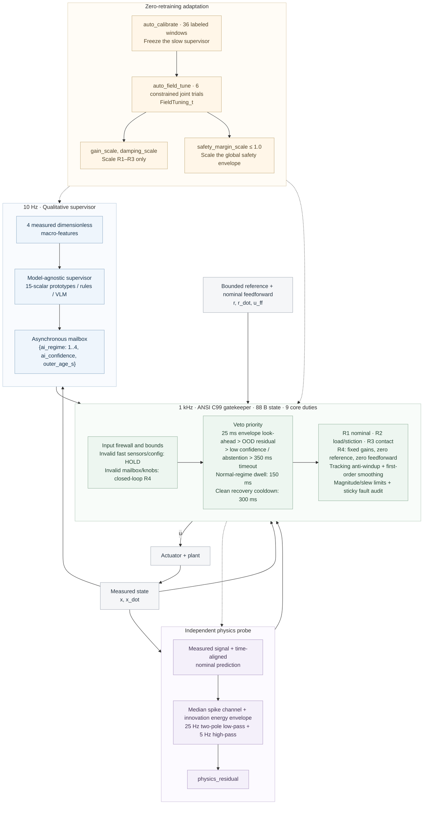

# ai-layered-control · v2.0.1

[](https://github.com/lijiawei255/ai-layered-control/releases/tag/v2.0.1)
[](c99_layered_core/layered_gatekeeper.h)
[](#36-reproduce)
[](LICENSE)
[](https://doi.org/10.5281/zenodo.23911916)

[English](README.md) | [简体中文](README_zh.md) · [Agent guide](AGENTS.md)

**Let AI identify the situation. Let deterministic control own the actuator.** A portable fast-slow reference architecture: 10 Hz qualitative supervision, a 1 kHz C99 feedback loop, and field tuning with the AI frozen.

## Why This Architecture & Quick Navigation

An MIT-licensed reference design, comparison benchmark and AI adaptation template for research and engineering reuse.

- **Small-sample calibration, no GPU required.** The slow supervisor is calibrated on CPU from **36 labeled macro-windows** and stores **15 scalars / 60 B (FP32)**, versus **16,000 action labels / 20,596 B (FP32)** for B2.
- **88 B deterministic C99 fallback.** A zero-heap ANSI C99 core owns the **1 kHz** actuator command, with an independent physics-residual probe and nine core protection duties. In this compound-fault benchmark, the first spike triggers a veto and closed-loop R4 fallback within the same **1 ms control tick**.
- **Frozen AI, physical field tuning.** Three knobs occupy **12 B** and support constrained adaptation to load and stiction drift without retraining the supervisor.
- **Cross-language replay and a 119-line skeleton.** Python and MATLAB core mirrors match C99 replay exactly for discrete outputs, with command differences below **1e-4**; **159 C regression checks** pass. The **119-line template** is ready to run; the Simulink model illustrates the architecture.

**Human readers:** [§1](#1-ai-can-be-slow-control-authority-must-be-clear) explains the division of control authority and deployment problems; [§2](#2-what-to-reuse-human--agent-quickstart) covers reusable files and three-step porting; [§3.2](#32-four-stage-comparison) / [§3.3](#33-frozen-ai-field-tuned-hardware) present the measured comparisons and figures.

**AI coding assistants (Cursor / Claude Code / Codex):** start with [AGENTS.md](AGENTS.md), then replace `SLOT 1..3` in [minimal_template.py](python_bench/minimal_template.py) using the device contract.

## 1. AI can be slow. Control authority must be clear.

Bringing AI into industrial arms, CNC / additive manufacturing (WAAM), or closed-loop neuromodulation (Parkinson's aDBS, spinal cord stimulation / SCS) raises a question beyond prediction accuracy: who decides what the actuator does every millisecond? A slow model that understands context plus a fast neural action head improves responsiveness. When the learned policy still owns continuous commands, three deployment problems remain:

- **Tight hardware budgets.** Action inference must fit the compute and memory available to an MCU or PLC control task; implantable devices also face strict power limits.
- **Different hardware, different physics.** Joint stiction, load changes or electrode-interface drift can move a new device away from the learned relationship, producing steady error or chatter.
- **Faults need an explicit exit.** Unseen structural resonance, strong artifacts and corrupted model outputs need an independent veto and fallback path. Predicting a continuous command does not provide that contract by itself.

**Inference bandwidth is not execution authority.** This repository provides a device-side software gateway for AI control permissions. The slow loop answers only “which regime?” (`1..3`) or “abstain” (`4`). An independent probe derives veto evidence from time-aligned nominal-model innovation and measurement spikes. An **ANSI C99 core with only 88 bytes of state and zero dynamic allocation** owns the 1 kHz command, closed-loop fallback and physical tuning knobs. The supervisor can change while the execution contract stays fixed.



Diagram timings are benchmark defaults. The device adapter computes `outer_age_s = now - source_timestamp` on every fast tick. The spike channel reads the measured signal directly; the broadband channel evaluates nominal-model innovation.

## 2. What to reuse: Human & Agent Quickstart

| Reusable files | What you take into your system |
|---|---|
| **[1] [layered_gatekeeper.c](c99_layered_core/layered_gatekeeper.c) / [layered_gatekeeper.h](c99_layered_core/layered_gatekeeper.h)** | Zero-dependency ANSI C99 control and safety gatekeeper: 88 B state / 132 B configuration / 12 B tuning; connect it to an MCU, PLC or RTOS cyclic task |
| **[2] [minimal_template.py](python_bench/minimal_template.py)** | A standalone 119-line fast-slow skeleton with `auto_calibrate` and `auto_field_tune`; replace `SLOT 1..3` to connect your device |

When copying the C99 core, retain the MIT copyright and permission notice in [LICENSE](LICENSE).

**Port with an AI coding assistant (Cursor / Claude Code / Codex):** ask the Agent to read [AGENTS.md](AGENTS.md) and replace `SLOT 1..3` in the [minimal template](python_bench/minimal_template.py) using your device contract, connecting auto-calibration and field tuning in roughly a hundred lines of adapter code.

From the repository root, run the minimal skeleton first (Python 3 and a C99 compiler on `CC` or `PATH`), then the full benchmark when ready:

```powershell
python -m pip install -r python_bench/requirements.txt
python python_bench/minimal_template.py
python python_bench/run_benchmark.py
```

### Three steps to port

1. **Define and connect.** Specify units, the safe zero and output limits; commission the nominal model and controller bank, then connect sensors, references and the actuator.
2. **Calibrate from small samples.** Run `auto_calibrate` on measured macro-features to build regime prototypes and confidence thresholds.
3. **Freeze AI and field-tune.** Use `auto_field_tune` with constrained cross-condition trials, then validate the selected knobs on independent trajectories.

Initialize once; on each fast tick, populate all nine input fields and call `Layered_Step`:

```c
LayeredState_t state;
LayeredConfig_t config;
FieldTuning_t field_tuning = {1.0f, 1.0f, 1.0f};
LayeredInput_t input;
/* Populate config and input from the commissioned device interface. */
Layered_Init(&state, &config, &field_tuning);
LayeredOutput_t output = Layered_Step(&state, &config, &field_tuning, &input);
```

### Three integration examples, an open device interface

Three application families motivate the same separation: **industrial WAAM / PLC servo**, **edge VLA / fast-slow robotics**, and **closed-loop aDBS / SCS neuromodulation**. They are examples of a common control contract, open to other systems with scarce samples, unit variation, intermittent contact, uncertain context and strict output constraints.

| Application example | Slow qualitative decision | Device adapter and deterministic fast-loop connection |
|---|---|---|
| Industrial WAAM / PLC servo | Process, inter-layer thermal load and contact regime | Connect process, servo / wire-feed laws and actuator constraints; implement force sensing and hard force limits in the device layer; field-tune for a new batch |
| Edge VLA / fast-slow robotics | Task and environment-contact class | Connect 1 kHz torque / impedance laws; absorb joint-stiction differences through feedback and tuning; use envelope vetoes and fallback to handle state-limit risks |
| Closed-loop neuromodulation: aDBS / SCS | Brain biomarkers for aDBS; posture / activity (lying, walking, coughing) and interface state for SCS | Define a first-order stimulation-current / evoked-response (ECAP) recruitment model and artifact probe for SCS, and a biomarker-specific law for aDBS; validate individual knobs within device output / timing limits and clinically established comfort bounds |

These are **device-adaptation directions**. ECAP feedback is an SCS integration example; aDBS uses its own brain-signal measures. For interface context, see [Saluda ECAP closed-loop SCS](https://www.saludamedical.com/international/evoke-eva/) and [Medtronic adaptive DBS](https://news.medtronic.com/2025-02-24-Medtronic-earns-U-S-FDA-approval-for-the-worlds-first-Adaptive-deep-brain-stimulation-system-for-people-with-Parkinsons).

A new physical domain needs new units, limits, control laws and probes. A new unit in the same domain can retain the classifier for moderate parameter shifts such as the benchmark's compound unit drift. Large pure-inertia shifts, for example beyond +75%, can change closed-loop feature scales; rerun the 36-window calibration when that occurs.

See [AGENTS.md](AGENTS.md), the [domain mapping guide](docs/domain_mapping_guide.md), and the [systems engineering rationale](docs/systems_engineering_manifesto_en.md). Deployment code does not accept stage labels, fault frequency or simulator truth.

## 3. Evidence: three control paths, one physical fixture

### 3.1 The three control paths

| Branch | Slow context | Continuous actuator command at 1 kHz |
|---|---|---|
| B1 · modern white-box baseline | Single fixed regime | Nominal inverse-dynamics feedforward + high-gain anti-windup PID |
| B2 · learned fast-slow policy | Four measured macro-features at 10 Hz, delayed independently | Conditioned 512-center RBF action head, `u = π(x, x_dot, r, r_dot, r_ddot, z)` |
| B3 · qualitative / quantitative separation | Model-agnostic regime + confidence + timestamp at 10 Hz | C99 controller bank, nine duties of protection, deterministic feedforward and field tuning |

B1 and B3 receive the **same nominal feedforward in normal operation**. All branches share actuator magnitude and slew limits, sensor processing, noise, reference, plant and fault realization. B1 has no `blend_alpha` smoother. B2 performs **40,000 action evaluations in 40 s**; latency applies only to context. Its policy contains no integrator input or external PD stabilizer. B3's first-order command smoothing operates on every tick.

Learning-based fast-slow systems are an active engineering direction; [Helix 02](https://www.figure.ai/news/helix-02) is one example. B2 is a reproducible representative of the continuous-action route, not a reproduction of that system. The design horizon is **2027+ deployment across constrained devices**.

### 3.2 Four-stage comparison

**Key Takeaways.** B1 is the fixed high-gain white-box baseline; B2 is the learned fast-slow continuous-action policy; B3 is this layered architecture. In the main run:

- **S1/S2 — tracking with lower command variation.** B3 keeps tracking error in the same order as B1 while reducing TV from **8,217.67 / 8,100.68** to **1,567.40 / 2,083.14 N·m**.
- **S3 — compliant intermittent contact.** B1 reaches **64.59 N**, about **3.23 times** the 20 N budget; B3 switches to the compliant R3 bank and stays within budget at **19.47 N**. B3's TV is **3,873.76 N·m**, versus B2's **12,621.12 N·m**.
- **S4 — zero envelope violations under the compound fault (Figure 1, 30–40 s).** With a swept two-inertia mode and sensor spikes, B1/B2 record **840 / 589 violation ticks** (`|x| > 1 rad`). B3 vetoes on the first spike in the same control tick and enters closed-loop R4: **0 violations**, with TV of **396.60 N·m**. R4 gives up reference tracking to protect the envelope.

S1 tests nominal tracking, S2 load and stiction drift, S3 intermittent contact and measurement noise, and S4 an unseen compound fault.

40 s, four 10 s stages, a 1 ms control period and two 0.5 ms physical substeps. Actuator limits are **20 N·m** and **2,000 N·m/s**. The state envelope is **|x| ≤ 1 rad**; S3's contact-force budget is **20 N**, using a 0.25 m lever arm.

RMSE compares reference and true state at the same tick. TV is the within-stage sum of absolute command changes. A violation tick means the true state lies outside the envelope; it is separate from a gate activation. Tables use Python + C99, seed 7. MATLAB independently reproduces the main metrics at displayed precision.

| Stage | Branch | RMSE / rad | TV(u) / N·m | Violation ticks | Peak contact / N |
|---|---|---|---|---|---|
| S1 | B1 | 0.000664 | 8217.67 | 0 | — |
| S1 | B2 | 0.003031 | 6261.70 | 0 | — |
| S1 | B3 | 0.000630 | 1567.40 | 0 | — |
| S2 | B1 | 0.017125 | 8100.68 | 0 | — |
| S2 | B2 | 0.042307 | 6569.89 | 0 | — |
| S2 | B3 | 0.020819 | 2083.14 | 0 | — |
| S3 | B1 | 0.028964 | 15959.27 | 0 | 64.59 |
| S3 | B2 | 0.099757 | 12621.12 | 0 | 12.52 |
| S3 | B3 | 0.069478 | 3873.76 | 0 | 19.47 |
| S4 | B1 | 0.411768 | 10383.77 | 840 | — |
| S4 | B2 | 0.367208 | 11349.37 | 589 | — |
| S4 | B3 | 0.538412 | 396.60 | 0 | — |


### 3.3 Frozen AI, field-tuned hardware

**Key Takeaways — adaptation without retraining (Figure 2).** Under **+35% / +50% compound unit drift**, B3 keeps the AI frozen and selects **`(1.25, 0.5, 1)`**, reducing independent S2 validation RMSE by **18.7% / 16.5%**. Full-mission validation has zero envelope violations and contact peaks of **17.93 / 18.65 N**, within the 20 N budget. B1's equal-budget S2-best candidate reaches **75.51 / 75.49 N** and **1,397 / 1,031 violation ticks** in the full mission; all six B1 candidates fail the joint constraints.

**Zero-retraining unit adaptation.** The classifier stays frozen. These independent S2 validations use a 6 s trajectory of amplitude 0.43 rad, seed 811, shared by all controllers. They are separate from the 10 s S2 window above. “+35% / +50% unit drift” means **inertia change plus strong stiction**, not inertia alone; amplified friction dominates this fixture's S2 error. RMSE is in rad and TV in N·m.

| Unit drift | B1 factory | B1 equal-budget S2-best (infeasible) | B3 factory (1,1,1) | B3 feasible tuning (1.25,0.5,1) | B3 RMSE reduction | B3 TV: before → after |
|---|---|---|---|---|---|---|
| +35% | 0.016682 | 0.007751 | 0.020331 | 0.016522 | 18.7% | 1249.03 → 864.10 |
| +50% | 0.023648 | 0.009317 | 0.027846 | 0.023253 | 16.5% | 1254.20 → 902.48 |

The search takes **240 s of device trajectories per branch and unit**, followed by **12 s paired S2 validation + 40 s full-mission validation**. Host computation time is reported separately. Accepted B3 tuning reduces independent S2 validation RMSE by **18.7% / 16.5%**. The tuned errors are slightly below factory B1 while meeting the measured contact budget, with zero normal-stage veto/R4 occupancy. B3 accepts position error during contact and stops reference tracking in R4; S4 RMSE is not a safety ranking.


<details>
<summary><b>📊 Details: equal-budget counterfactuals, command smoothing and physical fixture</b></summary>

B3 selects **`(1.25,0.5,1)`**, in `gain / damping / safety margin` order. B1's S2-best candidate **`(2,1,1)` is infeasible** and is shown as a counterfactual, not an accepted deployment. Independent full 40 s missions expose its contact-force cost:

| Unit drift | Candidate | S3 peak / N | S3 TV / N·m | S3 veto fraction | S3 R4 fraction | Mission violation ticks |
|---|---|---|---|---|---|---|
| +35% | B3 (1.25,0.5,1) | 17.93 | 2061.94 | 0.00% | 0.00% | 0 |
| +35% | B1 (2,1,1) | 75.51 | 16372.36 | 0.00% | 0.00% | 1397 |
| +50% | B3 (1.25,0.5,1) | 18.65 | 2061.46 | 0.00% | 0.00% | 0 |
| +50% | B1 (2,1,1) | 75.49 | 16347.53 | 0.00% | 0.00% | 1031 |

Each branch receives the same six fixed joint gain/damping candidates: `(0.75,1)`, `(1,1)`, `(1.25,1)`, `(2,1)`, `(1.25,0.5)`, `(1.25,0.75)`; safety margin stays at 1. Each pair is evaluated independently. Each 40 s trial includes sinusoidal and ramped references, stiction, contact and OOD. Acceptance requires zero state violations, S1 RMSE < 0.01 rad, and in each normal stage peak contact < 20 N, veto fraction ≤ 5% and R4 occupancy ≤ 10%. The objective is measured S2 error. All six B1 candidates fail the joint constraints; the helper retains current knobs if none qualifies.

**Command smoothing explains much of B3's TV advantage.** Giving B1 the identical per-tick low-pass coefficient `alpha = 0.3` reduces TV substantially but leaves excessive contact force:

| Controller | S1 TV | S3 TV | S3 peak / N |
|---|---|---|---|
| B1 | 8217.67 | 15959.27 | 64.59 |
| B1 + LP | 2120.64 | 8278.80 | 63.47 |
| B3 | 1567.40 | 3873.76 | 19.47 |

### Physical fixture

| Stage | Physical mechanism |
|---|---|
| S1 · nominal tracking | Inertia 0.010 kg·m², viscous damping 0.060 N·m·s/rad, ground stiffness 0.300 N·m/rad; dynamic/static friction 0.6 / 1.0 N·m |
| S2 · Unit Drift: Inertia + Stiction | Inertia +35%; dynamic/static friction 3.09 / 6.2625 N·m. Karnopp zero-speed band 0.003 rad/s; insufficient drive locks the state, breakaway switches to sliding friction |
| S3 · contact and edge jitter | One-sided wall: stiffness 300 N·m/rad, damping 0.8 N·m·s/rad; during S3, position 0.43 + 0.025 sin(2π·0.73t + phase) + 0.24 exp(−(t−20)/0.25) rad, including continuous approach. White measurement-noise standard deviation 0.006 rad; context delay 60–120 ms and 8% frame drops |
| S4 · unseen compound OOD | At 30.037 s, a motor/load pair with 20%/80% inertia split replaces the rigid actuator; positive stiffness/damping create a 12→24 Hz swept mode. Load sensing also receives 0.025 rad bias and 0.18 rad spikes |

Inertia and viscous-damping changes persist through S3/S4; elevated friction belongs to S2. For drift fraction d, damping is 0.060(1 + 0.3d) N·m·s/rad, or 0.0663 at +35%. Both engines use the same 32-bit LCG and bounded, unit-variance white-noise construction. There is no sinusoidal measurement-noise tone. The flexible plant has a decaying zero-input response at the checked fixed modal frequencies. The swept model uses positive stiffness and damping throughout.

B2 trains on **16,000 nominal-model action labels**: 75% cover nearby sinusoidal/ramped trajectories with correlated position and velocity errors, and 25% retain broad error/context coverage. Contact-like context softens its nominal action target. Strong stiction, the moving wall and the flexible actuator are deployment shifts. Panel A separately trains on shifted-unit labels; evaluation trajectories are not training labels. Conclusions concern this memoryless action head and training distribution.

Panel A uses the actual conditional RBF at 64 / 256 / 1,024 / 4,096 / 16,000 action labels, with up to 512 centers. It reports nominal performance, frozen transfer and retrained transfer on a logarithmic error axis, including unstable low-budget rollouts. The curves are non-monotonic; retraining does not consistently recover nominal accuracy. Action labels and macro-windows are distinct units and are not divided into a sample-efficiency ratio.

Windows are not independent experiments.

### Controller bank

| Controller | Kp | Ki | Kd | Feedforward scale |
|---|---|---|---|---|
| B1 | 110 | 300 | 1.5 | 1 |
| B3 R1 · nominal | 60 | 60 | 1.2 | 1 |
| B3 R2 · load / friction | 110 | 300 | 1.5 | 1 |
| B3 R3 · compliant contact | 8 | 2 | 0.8 | 1 |
| B3 R4 · safe fallback | 2 | 0 | 0.35 | **0** |

R4 uses **zero reference, fixed gains and zero feedforward**, independently of all field knobs. The state coordinate's zero must be the commissioned safe fallback point. During abstention, this damping law deliberately gives up trajectory tracking and pulls the state toward zero to preserve the envelope. Friction can stop the physical state before it reaches zero.

</details>

### 3.4 Mode ablation and independent protection

Fixed-bank ablations retain the **same fast safety gates**. Dynamic classification and physical rules read only measured features. All six variants below have zero state-envelope violations.

| Supervisor | S1 RMSE | S2 RMSE | S3 RMSE | S4 RMSE | S3 TV | S3 peak / N |
|---|---|---|---|---|---|---|
| R1 | 0.000630 | 0.048769 | 0.037056 | 0.534793 | 6238.73 | 29.13 |
| R2 | 0.000715 | 0.019624 | 0.029165 | 0.536179 | 8278.80 | 63.47 |
| R3 | 0.002368 | 0.416069 | 0.069065 | 0.537493 | 3642.12 | 6.93 |
| R4 | 0.441515 | 0.532464 | 0.503824 | 0.498797 | 1558.46 | 0.00 |
| dynamic | 0.000630 | 0.020819 | 0.069478 | 0.538412 | 3873.76 | 19.47 |
| rules | 0.000630 | 0.020819 | 0.069478 | 0.538412 | 3873.76 | 19.47 |

The fixed-bank results expose the load/contact tradeoff. Rules and the prototype classifier produce the same main result, supporting the **model-agnostic slow interface**. A rule tree or compact VLM can replace the prototype classifier without changing actuator ownership.

The independent physics probe monitors spikes and broadband innovation; the fast loop uses it for explicit OOD abstention. The first spike of the compound fault triggers a veto in the same control tick.

<details>
<summary><b>🔍 Details: contact/noise separation, wall phases, fault injection and interface boundaries</b></summary>

**Contact recognition persists at nominal noise.** The fourth feature accumulates signed nominal-model residual power relative to residual load energy, with an activation threshold and release memory for intermittent contact. It reads measured acceleration, velocity and applied command, not noise RMS or the wall schedule. The other features describe tracking error, effort and slow innovation. With S3 noise reduced to nominal, both supervisors still select R3 and meet the contact budget:

| Noise std / rad | Supervisor | S3 R3 fraction | S3 peak / N | S3 veto fraction | S3 R4 fraction |
|---|---|---|---|---|---|
| 0.006 | dynamic | 94.99% | 19.47 | 0% | 0% |
| 0.0015 | dynamic | 94.99% | 17.40 | 0% | 0% |
| 0.0015 | rules | 94.99% | 17.40 | 0% | 0% |
| 0.006; no wall | dynamic | 0% | 0.00 | 0.76% | 3.76% |
| 0.006; no wall | rules | 0% | 0.00 | 0% | 0% |

Veto and R4 fractions are distinct: recovery cooldown can retain R4 after a veto clears. Increased noise without a wall never selects R3; the prototype supervisor has a short confidence/recovery interval in that control experiment.

The safety probe combines a median-based spike channel with a **broadband high-frequency innovation envelope**: time-aligned nominal acceleration prediction, two-pole 25 Hz low-pass processing, 5 Hz high-pass innovation, an 8 ms energy window, normalization by 500 rad/s² and a 1 s release envelope. No fault frequency enters the deployed probe.

The full compound fault's first spike triggers a veto in the same control tick. **Anomaly detection delay and core response time are different measurements.** With the spike channel disabled, a 0.2 rad sensor oscillation at 12 / 18 / 37 / 83 / 137 Hz is detected after **30 / 6 / 4 / 3 / 3 ms**, following quiet initialization. With spikes, confidence, envelope and timeout vetoes removed from the compound test, the broadband probe detects after **2,008 ms**, retains zero violations and limits S4 maximum |x| to **0.4738 rad**. Removing only OOD veto also retains zero violations through the remaining gates, but S4 maximum |x| rises to **0.8780 rad** and TV to **4,197.18 N·m**.

The main run uses R1 throughout S1, R2 for 96.8% of S2 and R3 for 94.99% of S3; normal stages have no vetoes. S4 remains in R4 after fault onset. Persistent `ai_confidence = NaN` from 22 s produces **18,000 corrupted frames**, continued R4 command updates and **zero violations**, with whole-mission maximum **|x| = 0.5159 rad**. Corruption remains visible in flags and counters while valid sensors keep the fallback closed loop running.

Five independent noise/phase runs give B1/B2 S4 violations of **777–899 / 622–753 ticks** and zero for B3. Factory B3's S3 force spans **13.44–26.14 N**: three of five phases exceed the 20 N contact budget despite preserving the state envelope. The 10 Hz frame rate and normal-regime dwell delay switching, so the first collision can precede completed selection of R3 (19.47 N in the main run). Across the phase scan, B3 reduces peak force to roughly one third of B1, but some phases exceed budget. A hard first-impact force limit requires contact-force protection in the 1 kHz fast loop. The accepted tuning table validates the commissioned wall phase with independent noise, not every contact geometry. Those five runs have no fresh-frame low-confidence veto; real timeout and cooldown are counted separately. With one/two/four physical substeps, B3's peak force is **20.03 / 19.47 / 19.35 N**, with zero state violations; the coarsest integration slightly exceeds the force budget. Removing context jitter changes B2's main S3 peak from **12.52 to 10.22 N**. Contact force, state safety and asynchronous-context sensitivity are separate outcomes.

S4's unstable nonlinear trajectories are sensitive to floating-point roundoff: cross-platform comparisons preserve the scale of violation counts and allow differences in the last decimals, rather than requiring identical unstable trajectories.

#### Interface, multi-axis and timeout conventions

The nine core duties are input/settings validation, predictive envelope veto, residual veto, confidence/abstention veto, heartbeat watchdog, minimum dwell, recovery cooldown, controller-bank execution with anti-windup and output limits, and sticky fault reporting. Each integrator tracks the applied command; magnitude is clamped before slew. Dwell and diagnostic counters saturate at `UINT32_MAX`. C ABI and signatures remain fixed.

**Invalid slow mailboxes or field knobs select closed-loop R4**, set `corrupted` and latch the existing corruption fault bit; envelope and residual vetoes retain priority. Invalid fast signals or configuration retain the native command-HOLD path. Invalid knobs are internally replaced by `(1,1,1)` while R4 runs, keeping normal-bank tracking integrators finite. Signed state, reference, velocity and feedforward values are valid; only the normalized residual must be nonnegative. Gain and damping knobs lie in **[0.10,4.0]**; safety margin lies in **[0.10,1.0]** and can only tighten the envelope. These ranges define input validity, not a closed-loop stability guarantee; admissible operating gains come from constrained `auto_field_tune` trials. R4 ignores knob scaling, trajectory references and feedforward.

Use **one state, probe, tuning tuple and timestamp per axis/channel**. Share read-only configuration only where units and limits agree; coupled constraints belong in the device adapter. On a **350 ms** slow-loop timeout the adapter sends explicit R4 abstention and preserves real frame age. Clean recovery passes through the core's **300 ms** cooldown. Native C `HOLD` freezes the **actuator command**, not mechanical position.

</details>

### 3.5 Small-sample commissioning, resources and domain mappings

`auto_calibrate(samples, labels)` builds three four-dimensional prototypes and confidence parameters from **36 labeled macro-windows**, twelve from each of three 10 s commissioning probes. The model has **15 stored scalars**: twelve prototype values, a distance-decay coefficient and two confidence thresholds.

`auto_field_tune(evaluate, current)` freezes that model and searches physical gains using measured error and an explicit cross-condition validity result. The two helpers occupy **20 lines** inside the [119-line template](python_bench/minimal_template.py).

| Resource category | Size |
|---|---|
| Conditional RBF, including normalization, centers, width and output coefficients | 5,149 scalars; FP64 41,192 B / FP32 storage 20,596 B |
| Prototype classifier | 15 scalars; FP32 storage 60 B |
| C99 state / configuration / field knobs / input / output | **88 / 132 / 12 / 36 / 28 B** |
| C99 object text, GCC 4.9.2 x86-64 | `-Os`: 4,284 B; `-O2`: 5,276 B |

FP32 bytes are a storage calculation; numerical RBF runs use FP64. State RAM, model storage and code size are separate quantities. Python reports RBF and C-call host times, including ctypes overhead; they are not target WCET. The core uses only `<stdint.h>`, fixed-size arithmetic and no heap, I/O, libm or mutable globals.


### 3.6 Reproduce

Python 3 + the existing NumPy/matplotlib requirements; C99 compiler for the core-backed path:

```powershell
python -m pip install -r python_bench/requirements.txt
python python_bench/run_benchmark.py
python python_bench/run_benchmark.py --no-c
python python_bench/run_benchmark.py --selftest
python python_bench/minimal_template.py
gcc -std=c99 -pedantic -Wall -Wextra -O2 -o c99_layered_core/test_gatekeeper_standalone.exe c99_layered_core/layered_gatekeeper.c c99_layered_core/test_gatekeeper_standalone.c
.\c99_layered_core\test_gatekeeper_standalone.exe
```

The template requires all nine input fields and recompiles when C source or header changes; compiler failure is explicit. Its PASS checks tracking error, zero true-state violations and zero abnormal gates. The benchmark's `--no-c` path is a complete Python mirror. C regression: **159 passes, zero failures**. Python/C replay: **6,000 frames**, exact gate/regime/fault/corruption flags and maximum command difference below `1e-4`. Compilers are found through `CC` or `PATH`.

MATLAB R2024b + Simulink, built-in functions and blocks. Full acceptance requires a C99 compiler; its absence is an error:

```powershell
matlab -batch "cd('matlab_simulink'); run_all_benchmarks"
matlab -batch "cd('matlab_simulink'); verify_core_equivalence"
matlab -batch "clearvars; sim('matlab_simulink/ai_layered_control_bench.slx'); disp('standalone model PASS')"
```

The acceptance run prints five PASS verdicts, rebuilds the existing model and three 240 dpi figures, and emits JSON. MATLAB/C replays cover **40,000 normal and 40,000 persistent-mailbox-fault frames**, with exact discrete outputs. Four additional 40,000-frame replays inject invalid knobs at 5 s: all have zero HOLD ticks, zero violations and finite integrators. The `.slx` is a self-contained architectural sketch; numerical engines generate quantitative results. Its B2 delay/hold is on context, while the action path runs at 1 kHz. Read [the builder](matlab_simulink/build_simulink_model.m) as the model's source.

The safety partition relates to Simplex / runtime assurance; see [AFRL RTA](https://github.com/act3-ace/run-time-assurance) and [ISO/IEC TR 5469:2024](https://www.iso.org/standard/81283.html).

## License and citation

Copyright (c) 2026 Jiawei Li. This reference design, benchmark and AI adaptation template is available under the permissive [MIT License](LICENSE). Use and modify it for academic research, teaching and commercial applications, including closed-source products. When copying or distributing the software or substantial portions, include the MIT copyright and permission notice. No email or separate permission from the author is needed.

If this work helps, a Star or a citation using [CITATION.cff](CITATION.cff) is welcome; both are optional. The citation file contains the author, ORCID and release metadata.

**Scope.** This repository supplies a reference control contract and reproducible numerical evidence for the specified fixture. Application mappings do not constitute hardware, clinical or functional-safety validation or certification; deployment requires device-specific hazard analysis, envelope definition and validation.
