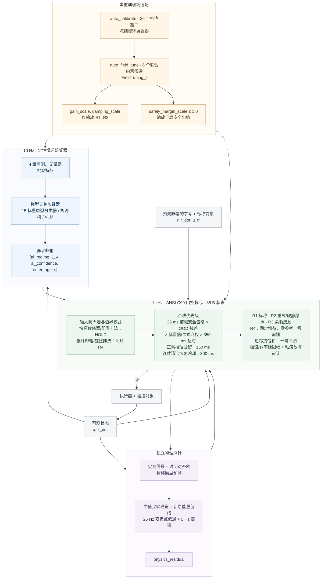

# ai-layered-control · v2.0.0

[](https://github.com/lijiawei255/ai-layered-control/tree/main)
[](c99_layered_core/layered_gatekeeper.h)
[](#6-复现)
[](LICENSE)

[English](README.md) | [简体中文](README_zh.md) · [Agent 指引](AGENTS.md)

**面向慢速定性 AI、快环确定性控制与 AI 零重训适配的通用参考架构。** 慢环只选择工况或显式弃权，零依赖 C99 核在 1 kHz 独占执行器。

三类应用共同体现这一分工：**工业增材 WAAM／PLC 伺服**、**边缘 VLA／快慢分层机器人**、**闭环 aDBS／SCS 神经调控**。它们是同一控制契约的实例；任何面临小样本、跨设备差异、间歇接触、上下文不确定性与严格输出约束的系统，都可以按此契约建立适配层。

## 1. 三条控制路线



设备适配层在每个快环 tick 计算 `outer_age_s = now - source_timestamp`。尖峰通道直接读取测量信号，宽频通道计算标称模型新息。

| 支路 | 慢环上下文 | 1 kHz 连续执行器指令 |
|---|---|---|
| B1 · 现代白盒基线 | 单组固定档位 | 标称逆动力学前馈＋高增益抗饱和 PID |
| B2 · 学习式快慢策略 | 10 Hz 四维可测宏观特征，独立延迟 | 512 中心条件 RBF 动作头，`u = π(x, x_dot, r, r_dot, r_ddot, z)` |
| B3 · 定性／定量解耦 | 10 Hz 与算法解耦的档位＋置信度＋时间戳 | C99 控制器组、九项保护职责、确定性前馈及现场整定 |

B1 与 B3 在**正常控制档使用完全相同的标称前馈**。三支路共享执行器幅值与斜率限制、测量处理、噪声、参考、对象及故障实现。B1 不使用 `blend_alpha` 平滑器。B2 在 40 s 中实际执行 **40,000 次动作推理**；延迟只作用于上下文，策略没有积分器输入或外接 PD 稳定器。B3 的一阶指令平滑作用于每个 tick。

学习式快慢系统正在持续演进，[Helix 02](https://www.figure.ai/news/helix-02) 是其中一个实例。B2 是连续动作路线的可复现代表，并非对该系统的复刻。本仓库的设计目标是 **2027 年及之后受限设备上的工程落地**。

## 2. 四阶段基准与现场整定

总时长 40 s，每阶段 10 s；控制周期 1 ms，物理积分采用两个 0.5 ms 子步。执行器限制为 **20 N·m** 与 **2,000 N·m/s**。状态包络为 **|x| ≤ 1 rad**；S3 接触力预算为 **20 N**，通过 0.25 m 力臂换算。

RMSE 比较同一 tick 的参考与真实状态。TV 为阶段内指令变化绝对值之和。越界 tick 按真实状态超包络计数，与门控激活次数分别统计。表格来自种子 7 的 Python＋C99 实测；MATLAB 独立实现复现主表显示精度。

| 阶段 | 支路 | RMSE / rad | TV(u) / N·m | 越界 tick | 峰值接触力 / N |
|---|---|---|---|---|---|
| S1 | B1 | 0.000664 | 8217.67 | 0 | — |
| S1 | B2 | 0.003031 | 6261.70 | 0 | — |
| S1 | B3 | 0.000630 | 1567.40 | 0 | — |
| S2 | B1 | 0.017125 | 8100.68 | 0 | — |
| S2 | B2 | 0.042307 | 6569.89 | 0 | — |
| S2 | B3 | 0.020819 | 2083.14 | 0 | — |
| S3 | B1 | 0.028964 | 15959.27 | 0 | 64.59 |
| S3 | B2 | 0.099757 | 12621.12 | 0 | 12.52 |
| S3 | B3 | 0.069478 | 3873.76 | 0 | 19.47 |
| S4 | B1 | 0.411768 | 10383.77 | 840 | — |
| S4 | B2 | 0.367208 | 11349.37 | 589 | — |
| S4 | B3 | 0.538412 | 396.60 | 0 | — |


**换机台零重训适配。** 分类器保持冻结。以下独立 S2 验证采用 6 s、幅值 0.43 rad、种子 811 的共同轨迹，与上方 10 s S2 窗口分别统计。“+35%／+50% 复合机台漂移”指**惯量变化＋强静摩擦死区**，不是单独改变惯量；摩擦强化主导此试验场的 S2 误差。RMSE 单位为 rad，TV 单位为 N·m。

| 复合机台漂移 | B1 出厂 | B1 同预算 S2 最优（不合格） | B3 出厂 (1,1,1) | B3 合格整定 (1.25,0.5,1) | B3 RMSE 降幅 | B3 TV：前 → 后 |
|---|---|---|---|---|---|---|
| +35% | 0.016682 | 0.007751 | 0.020331 | 0.016522 | 18.7% | 1249.03 → 864.10 |
| +50% | 0.023648 | 0.009317 | 0.027846 | 0.023253 | 16.5% | 1254.20 → 902.48 |

每台设备、每条支路对应 **240 s 搜索轨迹**，随后进行 **12 s 配对 S2 验证＋40 s 完整任务验证**。主机计算时间单独报告。合格的 B3 整定将独立 S2 验证 RMSE 降低 **18.7%／16.5%**，略低于出厂 B1，同时满足实测接触力预算，正常阶段否决率与 R4 占比为零。B3 在接触时接受位置偏差，进入 R4 后停止跟踪参考；S4 RMSE 不作为安全排名。


<details>
<summary><b>📊 展开查看：同预算反事实对照、指令平滑归因与物理夹具参数明细</b></summary>

B3 选择 **`(1.25,0.5,1)`**，顺序为 `增益／阻尼／安全裕度`。B1 的 S2 最优候选 **`(2,1,1)` 不满足跨工况约束**，仅作为反事实对比，不是获准部署的整定结果。独立完整 40 s 任务呈现其接触力代价：

| 复合机台漂移 | 候选 | S3 峰力 / N | S3 TV / N·m | S3 否决率 | S3 R4 占比 | 全程越界 tick |
|---|---|---|---|---|---|---|
| +35% | B3 (1.25,0.5,1) | 17.93 | 2061.94 | 0.00% | 0.00% | 0 |
| +35% | B1 (2,1,1) | 75.51 | 16372.36 | 0.00% | 0.00% | 1397 |
| +50% | B3 (1.25,0.5,1) | 18.65 | 2061.46 | 0.00% | 0.00% | 0 |
| +50% | B1 (2,1,1) | 75.49 | 16347.53 | 0.00% | 0.00% | 1031 |

两条支路采用相同的六个固定增益／阻尼联合候选：`(0.75,1)`、`(1,1)`、`(1.25,1)`、`(2,1)`、`(1.25,0.5)`、`(1.25,0.75)`；安全裕度保持 1，各组合独立评估。每次 40 s 试验覆盖正弦与梯形参考、静摩擦、接触及 OOD。合格条件为全程零状态越界、S1 RMSE < 0.01 rad，且每个正常阶段峰值接触力 < 20 N、否决率 ≤ 5%、R4 占比 ≤ 10%；优化目标为实测 S2 误差。B1 的六个候选均未通过联合约束；全部不合格时，帮助函数保留当前旋钮。

**B3 的 TV 优势很大程度来自指令平滑。** 为 B1 加上相同的逐 tick 低通系数 `alpha = 0.3` 后，TV 显著下降，但接触力仍超预算：

| 控制器 | S1 TV | S3 TV | S3 峰力 / N |
|---|---|---|---|
| B1 | 8217.67 | 15959.27 | 64.59 |
| B1 + LP | 2120.64 | 8278.80 | 63.47 |
| B3 | 1567.40 | 3873.76 | 19.47 |

### 物理试验场

| 阶段 | 物理机制 |
|---|---|
| S1 · 标称跟踪 | 惯量 0.010 kg·m²，黏性阻尼 0.060 N·m·s/rad，基底刚度 0.300 N·m/rad；动／静摩擦 0.6／1.0 N·m |
| S2 · 复合机台漂移：惯量＋强静摩擦 | 惯量 +35%；动／静摩擦 3.09／6.2625 N·m。Karnopp 零速带为 0.003 rad/s；驱动力不足时锁止，突破后转为滑动摩擦 |
| S3 · 接触与边缘抖动 | 单边墙刚度 300 N·m/rad、阻尼 0.8 N·m·s/rad；S3 墙位置为 0.43 + 0.025 sin(2π·0.73t + phase) + 0.24 exp(−(t−20)/0.25) rad，包含连续接近过程。白噪声标准差 0.006 rad；上下文延迟 60～120 ms、丢帧率 8% |
| S4 · 未知复合 OOD | 30.037 s 时由惯量分配 20%／80% 的电机／负载双惯量替代刚性执行器；正刚度、正阻尼产生 12→24 Hz 扫频模态。负载传感另叠加 0.025 rad 偏置与 0.18 rad 尖峰 |

惯量与黏性阻尼偏差延续至 S3／S4，摩擦强化仅属于 S2。漂移比例为 d 时，阻尼为 0.060(1 + 0.3d) N·m·s/rad；+35% 对应 0.0663。双引擎使用同一 32 位 LCG 及有界、单位方差白噪声构造，不叠加正弦测量杂音。柔性对象在所检验的固定模态频率下零输入自由响应衰减；扫频模型全程使用正刚度与正阻尼。

B2 使用 **16,000 条标称模型动作标签**：75% 覆盖正弦／梯形轨迹附近的位置与速度相关误差，25% 保留宽范围误差及上下文覆盖。接触型上下文会降低标称动作目标的刚度。强静摩擦、运动接触墙和柔性执行器属于部署分布变化。Panel A 另用漂移机台标签重训；验证轨迹不充当训练标签。结论针对这里的无记忆动作头及训练分布。

Panel A 使用真实条件 RBF，在 64／256／1,024／4,096／16,000 个动作标签和最多 512 个中心下，用对数误差轴报告标称性能、冻结迁移与重训迁移，包含低样本预算下的失稳轨迹。曲线并不单调，重训也未一致恢复标称精度。动作标签与宏观窗口采用不同单位，不直接相除构造样本效率倍数。

窗口数量不等于独立试验次数。

### 控制器组

| 控制器 | Kp | Ki | Kd | 前馈比例 |
|---|---|---|---|---|
| B1 | 110 | 300 | 1.5 | 1 |
| B3 R1 · 标称 | 60 | 60 | 1.2 | 1 |
| B3 R2 · 重载／摩擦 | 110 | 300 | 1.5 | 1 |
| B3 R3 · 柔顺接触 | 8 | 2 | 0.8 | 1 |
| B3 R4 · 安全回退 | 2 | 0 | 0.35 | **0** |

R4 固定使用**零参考、原始档位增益与零前馈**，独立于所有现场旋钮。状态坐标的零点须对应建档时定义的安全回退点。弃权期间，该阻尼控制主动放弃轨迹跟踪，将状态拉向零以保住包络；摩擦可能使实际状态在到达零点前停住。

</details>

## 3. 模态必要性与独立保护

固定档位消融保留**同一套快速安全门控**。动态分类器和物理规则只读取可测特征。下面六种配置均为零状态包络越界。

| 监督方式 | S1 RMSE | S2 RMSE | S3 RMSE | S4 RMSE | S3 TV | S3 峰力 / N |
|---|---|---|---|---|---|---|
| R1 | 0.000630 | 0.048769 | 0.037056 | 0.534793 | 6238.73 | 29.13 |
| R2 | 0.000715 | 0.019624 | 0.029165 | 0.536179 | 8278.80 | 63.47 |
| R3 | 0.002368 | 0.416069 | 0.069065 | 0.537493 | 3642.12 | 6.93 |
| R4 | 0.441515 | 0.532464 | 0.503824 | 0.498797 | 1558.46 | 0.00 |
| 动态原型分类器 | 0.000630 | 0.020819 | 0.069478 | 0.538412 | 3873.76 | 19.47 |
| 物理规则监督器 | 0.000630 | 0.020819 | 0.069478 | 0.538412 | 3873.76 | 19.47 |

固定档位呈现了重载与接触之间的取舍。规则监督器与原型分类器在主实验中得到相同结果，支持**慢环接口与算法解耦**：规则树或轻量 VLM 可替换原型分类器，执行器控制权保持不变。

独立物理探针同时监测尖峰与宽频新息，快环据此执行显式 OOD 弃权。完整复合故障的首个尖峰在同一控制 tick 触发否决。

<details>
<summary><b>🔍 展开查看：接触—噪声解耦验证、多相位扫描与故障注入边界</b></summary>

**标称低噪声下仍能识别接触。** 第四维特征结合带符号的标称模型残差功率与残差负载能量，并设置激活阈值和适配间歇接触的释放记忆；只读取实测加速度、速度及已施加指令，不读取噪声 RMS 或接触墙时序。其余特征描述跟踪误差、出力和慢新息。S3 噪声降回标称后，两种监督器仍能切入 R3 并满足接触力预算：

| 噪声标准差 / rad | 监督方式 | S3 R3 占比 | S3 峰力 / N | S3 否决率 | S3 R4 占比 |
|---|---|---|---|---|---|
| 0.006 | 动态原型分类器 | 94.99% | 19.47 | 0% | 0% |
| 0.0015 | 动态原型分类器 | 94.99% | 17.40 | 0% | 0% |
| 0.0015 | 物理规则监督器 | 94.99% | 17.40 | 0% | 0% |
| 0.006；无接触墙 | 动态原型分类器 | 0% | 0.00 | 0.76% | 3.76% |
| 0.006；无接触墙 | 物理规则监督器 | 0% | 0.00 | 0% | 0% |

否决率与 R4 占比分开计算：否决解除后，恢复冷却仍可保持 R4。只有噪声增大、没有接触墙时不会选择 R3；原型监督器在这个对照中出现短暂的低置信与恢复区间。

安全探针由中值尖峰通道与**宽频高频新息能量包络**组成：时间对齐的标称加速度预测、25 Hz 双极点低通、5 Hz 高通新息、8 ms 能量窗口、500 rad/s² 归一化及 1 s 释放包络。部署探针不接收故障频率。

完整复合故障的首个尖峰在同一控制 tick 触发否决。**异常检出时间与核心响应时间分别报告。** 禁用尖峰通道、经过安静初始化后，0.2 rad 传感振荡在 12／18／37／83／137 Hz 下分别于 **30／6／4／3／3 ms** 检出。在复合故障试验中去掉尖峰、置信度、包络和超时否决，仅保留宽频探针时，检出延迟为 **2,008 ms**，仍为零越界，S4 最大 **|x| = 0.4738 rad**。只关闭 OOD 否决时，其余门控仍维持零越界，但 S4 最大 **|x| 增至 0.8780 rad**、TV 增至 **4,197.18 N·m**。

主实验 S1 全程 R1，S2 有 96.8% 时间处于 R2，S3 有 94.99% 时间处于 R3；正常阶段没有否决。S4 故障后保持 R4。自 22 s 起持续注入 `ai_confidence = NaN` 时，记录 **18,000 个损坏帧**，R4 指令继续闭环更新，**零越界**，完整任务最大 **|x| = 0.5159 rad**。故障标志与计数保持可见，有效传感器继续驱动安全回退闭环。

五组独立噪声／墙相位试验中，B1／B2 的 S4 越界范围为 **777～899／622～753 tick**，B3 全部为零。出厂 B3 的 S3 峰力范围为 **13.44～26.14 N**：其中三组超过 20 N 接触预算，但状态包络仍未越界。10 Hz 帧率与正常档位驻留时间限制了切换速度，首次碰撞可能发生在 R3 切换完成前（主运行峰力 19.47 N）。多相位扫描中，B3 将峰力压至 B1 的约三分之一，但部分相位仍超预算；若需硬性保证首次碰撞力上限，须将接触力保护下沉至 1 kHz 快环。整定表验证的是已建档墙相位下的独立噪声，并非所有接触几何。五组试验均没有新鲜帧低置信否决；真实超时及恢复冷却单独统计。一个／两个／四个物理子步下，B3 峰力分别为 **20.03／19.47／19.35 N**，状态越界均为零；最粗积分略超接触预算。取消上下文抖动使 B2 主实验 S3 峰力从 **12.52 变为 10.22 N**。接触力、状态安全与异步上下文敏感性分别评价。

S4 失稳支路处于对浮点舍入敏感的非线性区：跨平台比较保持越界数量级一致，允许末位小数差异，不要求失稳轨迹逐点相同。

</details>

## 4. 小样本建档与资源核算

`auto_calibrate(samples, labels)` 从三段各 10 s 的建档探测中，各取十二个标注宏观窗口，共 **36 个窗口**，生成三组四维原型与置信参数。模型实际存储 **15 个标量**：十二个原型值、一个距离衰减系数和两个置信阈值。

`auto_field_tune(evaluate, current)` 冻结上述模型，根据实测误差与明确的跨工况合格标志搜索物理增益。两个帮助函数合计 **20 行**，位于 [114 行极简模板](python_bench/minimal_template.py) 中。

| 资源类别 | 大小 |
|---|---|
| 条件 RBF，含归一化、中心、宽度和输出系数 | 5,149 个标量；FP64 41,192 B／FP32 存储 20,596 B |
| 原型分类器 | 15 个标量；FP32 存储 60 B |
| C99 状态／配置／现场旋钮／输入／输出 | **88／132／12／36／28 B** |
| C99 对象文件 text，GCC 4.9.2 x86-64 | `-Os` 为 4,284 B；`-O2` 为 5,276 B |

FP32 字节数是存储换算，RBF 数值试验使用 FP64。状态 RAM、模型存储与代码体积分别计量。Python 输出 RBF 与 C 调用主机时间，包含 ctypes 开销，不作为目标设备 WCET。C 核只依赖 `<stdint.h>`，采用固定规模算术，不使用堆、I/O、libm 或可变全局状态。

## 5. 将契约接入新系统

**AI 编程助手（Cursor / Claude Code / Codex）一键移植**：直接让 Agent 阅读 [AGENTS.md](AGENTS.md)，并按设备契约替换 [极简模板](python_bench/minimal_template.py) 中的 `SLOT 1..3`，在百行左右的适配代码中接入新设备的自动建档与旋钮整定。

1. **定义并接线。** 约定单位、安全零点与输出限制，建立标称模型和控制器组，接入传感器、参考及执行器。
2. **小样本建档。** 从可测宏观特征运行 `auto_calibrate`，建立工况原型与置信阈值。
3. **冻结 AI，现场整定。** 运行跨工况约束试验，以 `auto_field_tune` 选择旋钮，并在独立轨迹上验证。

复制 C99 核心时，请一并保留 [LICENSE](LICENSE) 中的 MIT 版权与许可声明。

| 应用实例 | 慢环定性决策 | 确定性快环 |
|---|---|---|
| 工业 WAAM／PLC 伺服 | 工艺、负载和接触工况 | 过程／伺服调节律、执行器约束、现场整定 |
| 边缘 VLA／快慢机器人 | 任务与环境上下文 | 力矩／阻抗律、快速扰动处理、回退 |
| 闭环 aDBS／SCS | 生物标志物和接口状态分类 | 设备定义的调节律、输出包络和时序 |


全新物理场景需要重新定义单位、限制、控制律与探针；同场景跨机台保留分类器适用于本基准复合漂移这类中度参数偏移；过大的纯惯量变化（例如超过 +75%）可能改变闭环特征尺度，此时需要重新运行 36 窗口标定。

```c
LayeredState_t state;
LayeredConfig_t config;
FieldTuning_t field_tuning = {1.0f, 1.0f, 1.0f};
LayeredInput_t input;
/* Populate config and input from the commissioned device interface. */
Layered_Init(&state, &config, &field_tuning);
LayeredOutput_t output = Layered_Step(&state, &config, &field_tuning, &input);
```

<details>
<summary><b>🔧 展开查看：核心接口、多轴实例与超时约定</b></summary>

核心的九项职责为：输入／配置校验、预测包络否决、物理残差否决、低置信／弃权否决、心跳监视、最小驻留、恢复冷却、带抗饱和和输出限制的控制器组执行、粘性故障记录。每个积分器跟踪实际施加指令；先限幅，再限斜率。驻留与诊断计数器在 `UINT32_MAX` 饱和。C ABI 与函数签名保持固定。

**慢环邮箱或现场旋钮非法时选择闭环 R4**，置位 `corrupted` 并锁存已有损坏输入故障位；包络与残差否决保持更高优先级。快环输入或配置非法时沿用原生指令 HOLD 路径。非法旋钮在内部替换为 `(1,1,1)`，运行 R4 的同时保持正常档位追踪积分器有限。状态、参考、速度与前馈允许为负；只有归一化残差必须非负。增益与阻尼旋钮范围为 **[0.10,4.0]**，安全裕度范围为 **[0.10,1.0]**，只允许收紧包络。这些范围是输入合法性防火墙边界，不是闭环稳定保证；可用增益须由带约束的 `auto_field_tune` 试验确立。R4 忽略旋钮缩放、轨迹参考与前馈。

多轴／多通道采用**独立状态、探针、旋钮与时间戳**。只有单位与限制一致时才共享只读配置，耦合约束由设备适配层处理。慢环超时默认 **350 ms**；适配层发送显式 R4 弃权并保留真实帧龄。新鲜帧恢复后经过 **300 ms** 核心冷却。C 原生 `HOLD` 保持的是**执行器命令**，不是机械位置。

</details>

移植细节见 [AGENTS.md](AGENTS.md)、[领域映射指南](docs/domain_mapping_guide.md) 和[系统工程论述](docs/systems_engineering_manifesto_zh.md)。部署控制接口不接收阶段标签、故障频率或仿真器真值。

## 6. 复现

Python 3 与现有 NumPy／matplotlib 依赖；C 核路径需要 C99 编译器：

```powershell
python -m pip install -r python_bench/requirements.txt
python python_bench/run_benchmark.py
python python_bench/run_benchmark.py --no-c
python python_bench/run_benchmark.py --selftest
python python_bench/minimal_template.py
gcc -std=c99 -pedantic -Wall -Wextra -O2 -o c99_layered_core/test_gatekeeper_standalone.exe c99_layered_core/layered_gatekeeper.c c99_layered_core/test_gatekeeper_standalone.c
.\c99_layered_core\test_gatekeeper_standalone.exe
```

模板要求完整传入九个输入字段，在 C 源码或头文件变更后自动重编，编译失败直接报错。其 PASS 同时检查跟踪误差、零真实状态越界与零异常否决。基准的 `--no-c` 路径使用完整 Python 镜像。C 回归为 **159 项通过、零失败**；Python／C 回放 **6,000 帧**，gate／regime／fault／corrupted 精确一致，最大指令差小于 `1e-4`。编译器通过 `CC` 或 `PATH` 查找。

MATLAB R2024b＋Simulink，仅使用内置函数与模块。完整验收需要 C99 编译器，缺失时明确报错：

```powershell
matlab -batch "cd('matlab_simulink'); run_all_benchmarks"
matlab -batch "cd('matlab_simulink'); verify_core_equivalence"
matlab -batch "clearvars; sim('matlab_simulink/ai_layered_control_bench.slx'); disp('standalone model PASS')"
```

验收运行输出五项 PASS，重建现有模型和三张 240 dpi 图片，并输出 JSON。MATLAB／C 回放覆盖 **40,000 个正常帧与 40,000 个持续邮箱故障帧**，离散输出精确一致；另有四组各 40,000 帧回放，在 5 s 注入非法旋钮，均为零 HOLD、零越界，且积分器保持有限。`.slx` 是无需工作区初始化的架构示意模型，定量结果由数值引擎生成；B2 的延迟与保持位于上下文路径，动作路径按 1 kHz 更新。[构建脚本](matlab_simulink/build_simulink_model.m) 是模型的源码。

这一安全分工与 Simplex／运行时保障相关，参见 [AFRL RTA](https://github.com/act3-ace/run-time-assurance) 与 [ISO/IEC TR 5469:2024](https://www.iso.org/standard/81283.html)。

**适用范围。** 本仓库提供参考控制契约及指定试验场的可复现数值证据。应用映射不构成硬件、临床或功能安全验证及认证；部署需要针对设备完成危险分析、安全包络定义与验证。
