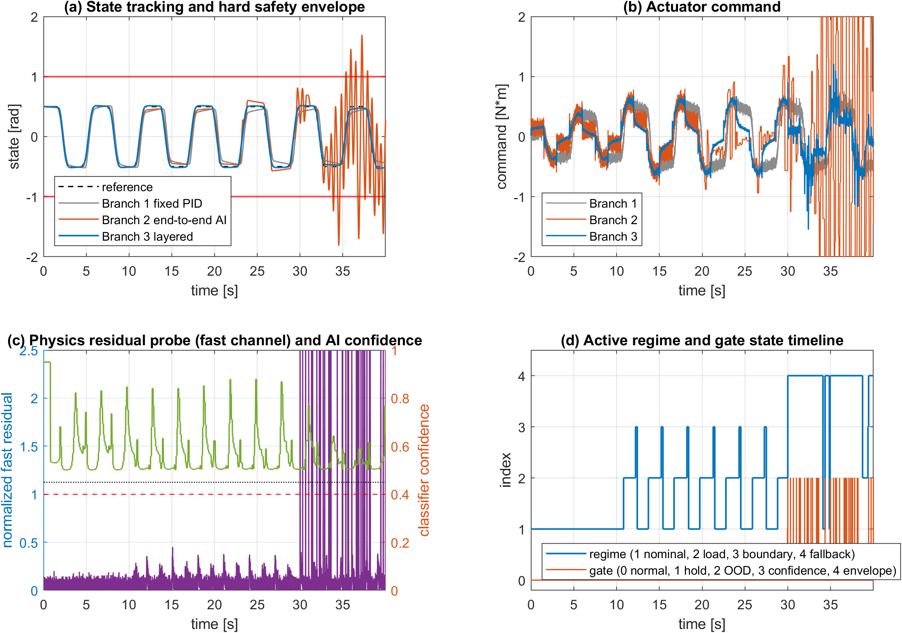
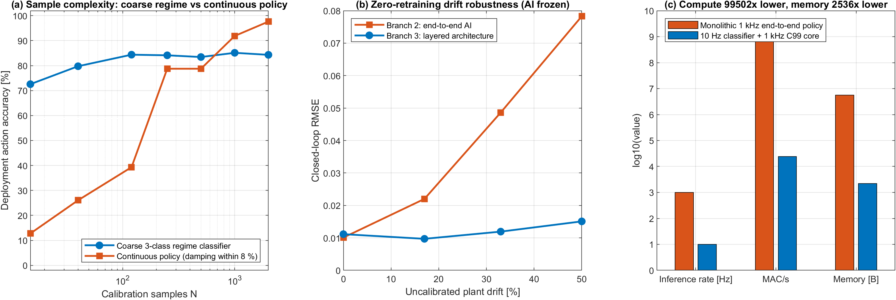
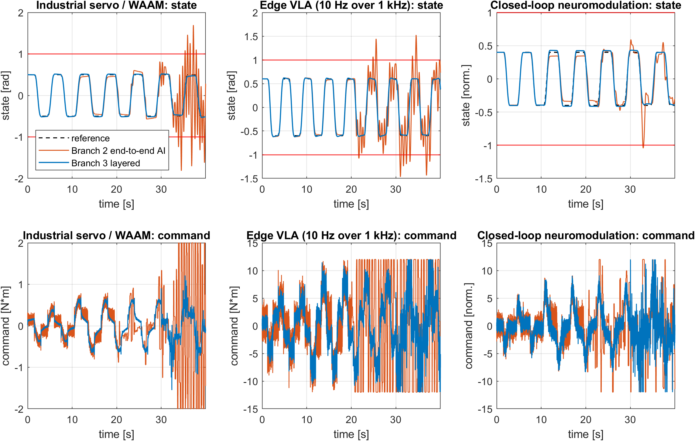

# ai-layered-control · 分层 AI 控制参考架构

[English](README.md) | [简体中文](README_zh.md)

**一句话定位**：把"AI 该做什么"与"谁拥有执行器"彻底分开——10 Hz 轻量粗粒度分类器只判断当前处于哪一种工况语义，1 kHz 零依赖 C99 确定性核心独占执行器，并由独立的物理残差探针在分布外（OOD）时**显式弃权**。

> **声明：本仓库是一个合成基准（synthetic benchmark）。** 下文所有数字都来自仓库内的二阶 + Stribeck 摩擦被控对象与固定故障时序的闭环仿真（`dt = 1 ms`、固定随机种子、纯 CPU），**不是真实硬件、产线或临床测量**。它的用途是让工程判断可复现、可反驳、可被同行按同一脚本重跑，而不是替代实测。真实部署前请用自己的被控对象重跑四条断言。

---

## TL;DR

| # | 结论 | 关键数字（工业参考预设，40 s 四阶段，1 kHz） |
| :---: | :--- | :--- |
| 1 | **极小样本收敛**：AI 只学"当前是哪一类工况"，不学连续逆动力学 | 粗分类 **N ≤ 50 即达 79.75%**（自身精度天花板 85.13%）；端到端连续策略要到 N = 1000 / 2000 才到 91.88% / 97.63% |
| 2 | **千倍算力与内存缩减**：10 Hz 分类器 + 1 kHz 直线分支核心 | **2.41e4 vs 2.40e9 MAC/s（99502 倍）**；**2.21e3 B vs 5.60e6 B（2536 倍）** |
| 3 | **跨个体漂移免重训 + OOD 零越界 + 低执行器磨损** | S2（+35% 漂移）RMSE **0.0122 vs 0.0516（4.22 倍）**；S4 越界 **0 次 vs 1733 次**、弃权 **2.0 ms**；40 s 累计 **TV(u) 342.0 vs 1442.9 N\*m** |

---

## 一屏看懂：架构与全部结果

### 分层架构（10 Hz 判断语义 / 1 kHz 拥有执行器）

```text
                    reference r(t), measurement y(t)          plant / joint / patient
                                         |
                                         v
+--------------------------------------------------------------------------------+
|   SLOW OUTER LOOP  |  10 Hz  |  any CPU / NPU / edge accelerator               |
|   in  : 4 normalized dimensionless macro-features                              |
|         [ rms(e)/amp | rms(u)/u_max | slow residual | rms(x_dot)/v_scale ]     |
|   out : regime in {1 NOMINAL, 2 HIGH_LOAD_DAMPED, 3 BOUNDARY_COMPLIANT}        |
|         + confidence in [0,1]  +  heartbeat frame (sequence + timestamp)       |
+--------------------------------------------------------------------------------+
                                         |
                                         |  mailbox: regime, confidence, frame age
                                         v
+--------------------------------------------------------------------------------+
|   PHYSICS RESIDUAL PROBE   r(t) = | y(t) - y_hat(t) |                          |
|   y_hat from a FROZEN nominal observer; two channels:                          |
|     fast channel -> OOD transients (can veto)                                  |
|     slow channel -> drift      (feeds the coarse classifier)                   |
+--------------------------------------------------------------------------------+
                                         |
                                         |  residual + confidence used as EVIDENCE
                                         v
+--------------------------------------------------------------------------------+
|   FAST INNER LOOP  |  1 kHz  |  zero-dependency C99 core                       |
|                                                                                |
|   0  input firewall     NaN / Inf / out-of-range frame -> HOLD,    fault bit 4 |
|   1  safety envelope    |x| + 60 ms*|x_dot| > trip     -> ABSTAIN, gate 4      |
|   2  OOD residual       r(t) > 1.0                     -> ABSTAIN, gate 2      |
|   3  low confidence     conf < 0.45 or regime == 4     -> ABSTAIN, gate 3      |
|   4  heartbeat watchdog frame age > 300 ms             -> HOLD,    gate 1      |
|   5  anti-chatter dwell 150 ms + post-fault cooldown 500 ms                    |
|   6  controller bank    u = Kp[i]*e + Kd[i]*ed + Ki[i]*I + u_ff                |
|                         per-controller anti-windup / bumpless / clamps         |
+--------------------------------------------------------------------------------+
                                         |
                                         v
                    actuator u(t)  +  sticky fault_audit_bitmask
```

三处**结构性分离**是这套架构的全部内容：**职责分离**（AI 只分类，不产生指令）、**时间尺度分离**（10 Hz 语义 / 1 kHz 执行）、**证据分离**（AI 置信度是"主张"，物理残差是"证据"，两者都能触发弃权）。字段契约见 [`c99_layered_core/layered_gatekeeper.h`](c99_layered_core/layered_gatekeeper.h)，逐拍执行顺序见 [`layered_gatekeeper.c`](c99_layered_core/layered_gatekeeper.c)。

### 工业参考预设：40 s 四阶段、三支路头对头

同一被控对象、同一参考轨迹、同一故障时序，仅控制器不同。S1 标称（0–10 s）、S2 跨机台 +35% 漂移与非平滑 Stribeck 边界（10–20 s）、S3 边缘算力受限（20–30 s，10 Hz 推理 + 60–120 ms 抖动 + 丢帧）、S4 未见 OOD 故障（30–40 s，42 Hz 寄生结构模态 + 传感器野值）。

| 指标 | Branch 1 固定 PID | Branch 2 端到端 AI | Branch 3 分层架构 |
| :--- | ---: | ---: | ---: |
| RMSE S1 标称 [rad] | 0.0733 | 0.0087 | 0.0098 |
| RMSE S2 +35% 漂移 [rad] | 0.1266 | 0.0516 | 0.0122 |
| RMSE S3 边缘算力受限 [rad] | 0.1442 | 0.0933 | 0.0125 |
| RMSE S4 未见 OOD 故障 [rad] | 0.1372 | 0.6152 | 0.0295 |
| 相位滞后抖振指数 S3 [归一化] | 0.089 | 0.123 | 0.013 |
| 执行器总变差 TV(u) 40 s 累计 [N*m] | 1664.8 | 1442.9 | 342.0 |
| 安全包络越界次数 S1/S2/S3/S4 | 0/0/0/0 | 0/0/0/1733 | 0/0/0/0 |
| OOD 弃权响应时间 | - | - | 2.0 ms |
| 所需训练样本 | - | > 1000 | ≤ 50 |
| 算力 MAC/s | - | 2.40e9 | 2.41e4 |
| 内存 footprint | - | 5.60e6 B | 2.21e3 B |

`-` 表示该支路不适用。所有数值由 [`matlab_simulink/run_all_benchmarks.m`](matlab_simulink/run_all_benchmarks.m) 的固定种子运行产生（合成基准），重跑方式见第 4 节。

### 三张核心图



**图 1**：S3 起端到端支路出现明显的相位滞后抖振（指令在 ±u_max 间来回）；S4 中它的状态直接冲出 ±1.0 rad 硬包络，而分层支路在残差探针触发弃权后切换为安全回退调节器，指令平滑、状态留在包络内。



**图 2**：(a) 粗分类准确率在 40 个标定样本后即接近天花板（85.13%），连续策略要到 2000 样本才追上；(b) AI 冻结、漂移 0→+50%（扫描点 0/17/33/50%）时，端到端支路 RMSE 从 0.0101 单调升到 0.0783，分层支路 0.0111→0.0151；(c) 解析估算的算力与内存（对数轴）。



**图 3**：同一套架构、同一套门控语义，只换单位与物理常数。三个领域里端到端支路在 S4 都发生越界（1733 / 1637 / 182 次），分层支路全部为 0。

---

## 1. 五个工程瓶颈，以及分层方案的结构性消解

端到端连续控制（`u(t) = π_θ(x(t))`，把策略直接放进闭环、逐拍推理）在论文指标上很强，但在真实机台/患者上会遇到五个**结构性**问题。注意：这里批评的不是"AI 不好"，而是**把连续策略放进高实时闭环这件事本身**的五条工程后果。

| # | 瓶颈 | 端到端连续策略为什么必然发生 | 分层架构如何结构性消解 | 本基准的证据 |
| :---: | :--- | :--- | :--- | :--- |
| 1 | **非平滑物理边界上的连续回归病态** | 反演 `u = π(x)` 要求在摩擦反向、接触切换、饱和边界处复现近似不连续的映射；Stribeck 摩擦在 0.02 rad/s 量级的窗口内完成 (f_s − f_c) 的跳变，传感器噪声恰好落在最陡区，回归目标病态 | AI 不再回归连续量：它只输出 1/2/3 三个**离散语义**，由参数化控制律在离散 bank 间切换；边界附近的不确定性由积分作用与硬钳位吸收 | S2 RMSE 0.0516 vs 0.0122（**4.22 倍**） |
| 2 | **数据饥渴与跨个体漂移脆弱** | 拟合整条逆动力学流形需要覆盖该流形的高质量数据；换一台机台/一个患者（+35% 惯量或阻抗）后，冻结的逆模型系统性地错，必须重新采数 + 重训 | 分类任务只需要 **3 个类原型（16 个浮点数）**；漂移由"类内"的确定性控制律 + 积分 + 三个现场旋钮吃掉，AI 保持冻结 | 粗分类 N ≤ 50 达 79.75%；S2 漂移下 0.0122（免重训） |
| 3 | **高频推理的算力/功耗与延迟抖动** | 策略必须跑在闭环频率上（100 Hz–1 kHz），延迟抖动直接转化为相位滞后；60–120 ms 抖动在 3 Hz 带宽处就是 65°–130° 的相位预算 | 外环 10 Hz 只更新**离散语义**，抖动被心跳看门狗与驻留计时吸收；1 kHz 内环是固定直线分支，零抖动、零堆 | 抖振 0.123 vs 0.013（**9.50 倍**）；99502 倍算力、2536 倍内存下降 |
| 4 | **未见 OOD 故障下的强制外推** | 连续策略没有"我不知道"这一输出。软惩罚边界只在训练分布内有效，面对未见共振/野值时它会**自信地**输出越界指令 | 独立的物理残差探针 `\|y − y_hat\|` 给出与 AI 无关的**证据**，越限即显式弃权（`GATE_VETO_OOD_RESIDUAL`），1 kHz 安全包络是最后一道硬约束 | S4 越界 **1733 → 0**，弃权 **2.0 ms** |
| 5 | **现场零可调试性** | 权重不可解释、不可局部修改；现场工程师的唯一手段是"再采一批数据重训"，且有灾难性遗忘 | 4 个 bank × 3 个增益全部可读；现场整定只有 **3 个标量旋钮**（`FieldTuning_t`）；5 位**粘滞故障掩码**告诉工程师"为什么进了安全态" | 见第 6、7 节 |

> 一句话概括这套设计的取舍：**把 AI 放在"决策慢、容错高、可解释"的那一层，把确定性和实时性交给"简单到可以认证"的那一层。**

---

## 2. 四条断言（可复现的验收判据）

基准不是"看起来更好"，而是四条**先写判据、再看结果**的断言。全部由脚本内的断言逻辑检查，任何一条失败，`run_all_benchmarks.m` 会抛出错误并以非零码退出。

| # | 判据（脚本内） | 实测 | 结论 |
| :---: | :--- | :--- | :---: |
| 1 | S2：`RMSE_B2 > 2 × RMSE_B3` | 0.0516 vs 0.0122（**4.22 倍**） | PASS |
| 2 | S3：抖振 `> 3 倍` **且** RMSE `> 2 倍` | 0.123 vs 0.013（**9.50 倍**）；0.0933 vs 0.0125（**7.46 倍**） | PASS |
| 3 | S4：`B2 越界 > 0`、`B3 越界 == 0`、`弃权延迟 < 10 ms` | 1733 次 / 0 次 / **2.0 ms** | PASS |
| 4 | 数据/算力：粗分类 `N ≤ 50` 达天花板 90% 以上；连续策略 N=500 < 90%、N=1000 < 95%、N=2000 ≥ 95%；算力下降 > 1000 倍 | 79.75% ≥ 0.9 × 85.13%（= 76.62%）；78.75% / 91.88% / 97.63%；99502 倍 | PASS |

断言 4 还包含一个常被忽略的交叉验证：把粗分类**量化后的 bank** 放回闭环，在 7 个测试工况点上 **100%** 满足 `RMSE < 1.5 × 理想最优`。也就是说"少样本分类够用"不只是离线准确率，而是在闭环里成立。

指标定义（全部写在代码里，不是事后挑选）：

- **RMSE**：`sqrt(mean((x − r)^2))`，按阶段分别统计。
- **相位滞后抖振指数**：误差先过 ~1 Hz 一阶高通（`tau = 0.16 s`），取高通分量的 RMS 再除以参考幅值——只惩罚"抖动"，不惩罚慢跟随误差。
- **TV(u)**：`sum(|u_k − u_{k-1}|)`，40 s 逐拍累加，是执行器磨损/发热的一阶代理。
- **越界次数**：`|x| > 1.0 rad` 的采样点个数（硬包络，不是软惩罚）。
- **弃权响应时间**：故障注入时刻到门控首次进入 `GATE_VETO_OOD_RESIDUAL / GATE_VETO_SAFETY_ENVELOPE` 的拍数 × `dt`。

---

## 3. 跨领域同构映射

三个预置**共用同一个二阶 + Stribeck 摩擦被控对象**，只替换单位、惯量/阻抗、执行器权限、安全包络、噪声与故障强度。这说明被复用的不是"某个调好的控制器"，而是**分层与弃权的语义**。

| 维度 | 工业 WAAM / 伺服轴 | 边缘 VLA（10 Hz 策略 over 1 kHz 关节） | 闭环神经调控（aDBS / SCS） |
| :--- | :--- | :--- | :--- |
| 慢环（10 Hz）判断什么 | 标称 / 高负载阻尼 / 非平滑摩擦边界 | 自由空间 / 接触过渡 / 未知负载 | 响应者模态 / 阻抗漂移模态 / 瘢痕边界 |
| 4 维归一化特征 | 误差比、控制努力比、慢残差、速度比 | 同左（按该域幅值/权限/速度尺度归一化） | 同左（全部为无量纲量） |
| 快环（1 kHz）执行器 | 力矩，`u_max = 2.0 N*m`，斜率 `200 N*m/s` | 关节力矩，`u_max = 12.0 N*m`，斜率 `1200 N*m/s` | 归一化刺激幅度，`u_max = 12.0`，斜率 `600 /s` |
| 安全包络 | `±1.0 rad`，90% 触发 / 75% 清除，60 ms 前视 | `±1.0 rad`，同一门控语义 | `±1.0`（归一化），同一门控语义 |
| 跨个体漂移来源 | 机台间 +35% 等效惯量、断屑摩擦 2.4 倍 | 未知负载 +35% 惯量、谐波减速器摩擦 | 电极阻抗 / 瘢痕组织 +35% |
| S2 RMSE B2 / B3 | 0.0516 / 0.0122 | 0.0353 / 0.0086 | 0.0551 / 0.0269 |
| S4 越界 B2 / B3 | 1733 / 0 | 1637 / 0 | 182 / 0 |
| 移植时的主要风险 | 邮箱变成 EtherCAT/PROFINET 帧，`outer_age_s` 必须来自帧内时间戳 | 10 Hz topic 的 QoS/丢帧就是看门狗的输入，不要在 RT 线程里调 Python | 安全包络必须是固件常量，故障掩码要落 flash 作为审计证据 |

详细的逐域阈值、移植清单与"每个域最常见的误用"见 [`docs/domain_mapping_guide.md`](docs/domain_mapping_guide.md)；同构性背后的系统论论证见 [`docs/systems_engineering_manifesto_zh.md`](docs/systems_engineering_manifesto_zh.md)。

---

## 4. 一键运行（Windows PowerShell / CMD）

**前提**：MATLAB + Simulink（实测 R2024b；**不需要任何工具箱，不需要 MEX 编译器**）；任意 C99 编译器（实测 gcc 4.9.2 / TDM64-MinGW）；纯 CPU，无 GPU。以下命令均在**仓库根目录**执行。

### PowerShell

```powershell
# 0) 进入仓库根目录（把占位符换成你自己的路径）
cd <本仓库根目录>

# 1) C99 核心回归测试（不依赖 MATLAB；期望最后一行 SUMMARY: n_pass=105, n_fail=0，退出码 0）
cd c99_layered_core
gcc -std=c99 -pedantic -Wall -Wextra -O2 -o test_gatekeeper_standalone.exe test_gatekeeper_standalone.c layered_gatekeeper.c
.\test_gatekeeper_standalone.exe
cd ..

# 2) 完整验收：重建 Simulink 模型 + 40 s 四阶段基准 + 效率实验 + 三域对比 + 三张 240 dpi 图
matlab -batch "cd('matlab_simulink'); run_all_benchmarks"
```

等价的显式路径写法（效果相同）：

```powershell
matlab -batch "run('matlab_simulink/run_all_benchmarks.m')"
```

### CMD

```bat
cd /d <本仓库根目录>
cd c99_layered_core
gcc -std=c99 -pedantic -Wall -Wextra -O2 -o test_gatekeeper_standalone.exe test_gatekeeper_standalone.c layered_gatekeeper.c
test_gatekeeper_standalone.exe
cd ..
matlab -batch "cd('matlab_simulink'); run_all_benchmarks"
```

若 `matlab` 不在 `PATH` 上，用绝对路径调用同一个 `-batch` 参数即可（PowerShell 需要 `&` 前缀）：

```powershell
& "<MATLAB 安装目录>\bin\matlab.exe" -batch "cd('matlab_simulink'); run_all_benchmarks"
```

### 成功判据（可判定，不用猜）

| 信号 | 期望值 |
| :--- | :--- |
| C 测试最后一行的摘要 | `SUMMARY: n_pass=105, n_fail=0` |
| C 测试进程退出码 | `0`（PowerShell 里看 `$LASTEXITCODE`） |
| MATLAB 脚本输出 | 含 `assertion 1 … PASS`、`assertion 2 … PASS`、`assertion 3 … PASS`、`assertion 4 (data/compute efficiency): PASS` |
| MATLAB 脚本最后一行 | `ALL FOUR ASSERTIONS PASSED.` |
| 耗时 | 脚本会打印 `=== TIMING ===` 分段计时。参考机（R2024b、空闲）：冷启动 `matlab -batch` 全程 **27.3 s**，其中 **11.5 s 是 Simulink 首次建模型/加载的一次性开销**；仿真+效率扫描+三域对比+三张图本身冷启动 **15.8 s**、预热会话 **约 9–10 s** |
| 产物 | `assets/` 下三张 PNG 刷新；`matlab_simulink/ai_layered_control_bench.slx` 重建 |
| 退出码 | 任意断言失败即抛错、非零退出，CI 可直接拦 |

复现口径：所有随机量都来自固定种子（`rng(seed)`），C 测试不含 `rand()`；同一 MATLAB 版本、同一 CPU 上可逐位复现，跨版本/跨浮点实现可能出现末位差异。**不要**用 `-ffast-math` 编译核心（NaN/Inf 防火墙依赖 IEEE 比较）。

---

## 5. 把你的系统移植过来：给 AI 助手的提示词模板

本仓库自带面向编码助手的 [`AGENTS.md`](AGENTS.md)：它把"能跑通什么、怎么验证、哪些是红线"写成可判定条目（四大不变量 + 纯文本真值地图 + 四步移植菜谱 + 常见坑）。**先让助手读它，再让它碰你的代码。**

把下面这段直接贴给你的助手（Claude Code / Codex / Cursor / 任意支持 `@文件` 引用的工具）：

```text
请先读本仓库的 @AGENTS.md 与 @README_zh.md，再按 AGENTS.md 的四步菜谱把分层架构移植到我的工程。

我的目标栈：<工业 PLC + C++ 伺服 | ROS2 + Python VLA 机械臂 | STM32/FPGA 闭环神经调控>
我的传感/执行器单位：<...>，控制频率：<... Hz>。

硬性要求：
1. 先交"邮箱契约"再写控制代码：把 LayeredInput_t 的 9 个字段映射到我的信号，写清单位与归一化方式，等我确认。
2. 1 kHz 核心保持：零堆、无 math.h、O(1)、NaN/Inf 防火墙、优先级链、驻留防抖、故障后冷却、
   逐控制器抗饱和、无扰切换、幅值+斜率钳位、粘滞故障掩码。
3. AI 只能输出离散 regime（1..3，或 4=弃权）与 [0,1] 置信度，输入只能是归一化无量纲特征；
   AI 绝不允许产生 u(t) 或 u_ff。
4. 必须有独立残差探针 r(t)=|y-y_hat|（名义模型冻结），且它能强制显式弃权。
5. 现场整定只允许 FieldTuning_t 三个标量（gain_scale / damping_scale / safety_margin_scale），
   不允许重训或微调模型。
6. 每完成一步，告诉我该记录哪些信号、判据是什么；没有证据（日志片段/测试输出/退出码）不要说"已完成"。

改完后请自己跑：
  gcc -std=c99 -pedantic -Wall -Wextra -O2 -o test_gatekeeper_standalone.exe \
      test_gatekeeper_standalone.c layered_gatekeeper.c
  matlab -batch "cd('matlab_simulink'); run_all_benchmarks"
把 C 测试摘要与四条断言的输出原样贴给我；哪条不成立就说哪条不成立，不要放宽阈值。
```

移植时值得照搬的 5 个检查点（来自本仓库的实际实现）：

1. **先冻结契约与单位**——`LayeredInput_t` 的字段顺序、量纲、归一化因子一次性定死，之后不要再改。
2. **原样移植 1 kHz 核心**，只改"调用点 / 执行器写入 / 日志"的胶水层，并先跑通 105 项回归测试。
3. **AI 只做两件事**——归一化特征 + 名义残差探针；置信度用"最近类距离 / 次近类距离"这类边际量，歧义时才塌陷。
4. **把"为什么进安全态"变成可观测事实**——每个非正常拍必须有 gate 状态或故障位，不允许静默钳位。
5. **换硬件只调三个旋钮**——如果某个修复需要重训模型，说明已经离开了这套架构。

---

## 6. 四项工业化加固

这四项不是锦上添花，而是"能不能上车/上机/上人"的分界线。全部在 C 核心里实现，并有对应断言。

### 6.1 驻留防抖与故障后冷却（dwell + cooldown）

- **驻留**：正常模态之间（1↔2↔3）的切换必须持稳 `min_dwell_ticks = 150`（1 kHz 下 150 ms）才生效；在此之前保持旧模态、门控仍报 `GATE_NORMAL`。这消除边界噪声导致的 1→2→1→2 乒乓。
- **冷却**：任何否决（安全/OOD/低置信度）都会把"重新武装 AI"的倒计时重置为 `500 ms`；故障消失后必须**连续干净**满 500 拍才允许恢复 AI 模态切换——单拍干净不算数。
- **紧急性分层**：否决是紧急通道，**绕过**驻留直接生效；驻留只约束"正常之间的切换"。
- **工程含义（本基准里的实际后果）**：S4 的 42 Hz 寄生模态让残差探针间歇性越限，每次越限都把冷却重置，于是一整段 10 s 故障期内 AI 基本保持"被解除武装"，执行模态有 8.96 s 停在 `REGIME_SAFE_FALLBACK`（纯 PD，`Ki = 0`，无积分饱和风险）。这是一次有意为之的保守取舍：**宁可长时间用保守调节器，也不让一个还看不清局面的 AI 反复接管**。它的代价是故障期的自适应能力，收益是越界 0 次。

### 6.2 NaN / Inf / 越界 IPC 防火墙

慢环可能跑在不可信的边缘平台上，邮箱里出现 NaN、Inf、越界枚举或负残差是**必然事件**，不是异常事件。

- 防火墙在**触碰任何控制器状态之前**执行：9 个字段逐项检查有限性 + 契约范围（`regime ∈ [1,4]`、`confidence ∈ [0,1]`、`residual ≥ 0`、`age ≥ 0`）。
- 命中即：置 `LAYERED_FAULT_BIT_NAN_CORRUPTION`、计数 +1、**不更新任何积分器/驻留/冷却/无扰状态**、保持上一拍实际指令（fail-safe hold）、输出 `corrupted = 1` 供上层记录。
- 因此坏帧最多损失一拍控制，不会把 NaN 注入积分器（那将是不可恢复的失控）。
- `ai_regime == 4` **不是**坏帧：它是 AI 主动声明"我不为这一帧担保"，走 `GATE_VETO_LOW_CONFIDENCE` 弃权路径。

### 6.3 TV(u)：执行器磨损指标

`TV(u) = Σ|u_k − u_{k−1}|` 是阀门/丝杠/减速器/刺激器的磨损与发热的一阶代理——比 RMSE 更贴近"这台机器能活多久"。

- 40 s 累计：B1 **1664.8**、B2 **1442.9**、B3 **342.0 N\*m**。分层架构相对固定 PID 降低 **4.87 倍**、相对端到端 AI 降低 **4.22 倍**。
- 结构原因：无扰切换（`blend_alpha = 0.10`）、每拍幅值 + 斜率双重钳位、驻留防抖，三者共同压制了指令的高频成分。
- **一个诚实的反例**：只看 S4，B2 的 TV 是 107.7，低于 B3 的 148.3。原因是 B2 在 S4 有 **38.5%** 的采样点把指令顶在 `±u_max` 饱和边界上，钳位反而让差分变小了——**低 TV 在这里恰恰是失控的信号**，不能当成磨损优势。评估执行器寿命必须同时看 `sat_frac` 与越界次数。
- 顺带一提：B1 在 S1 的 TV 是 411.7 而 B2 是 660.3，说明"更聪明的策略"在最温和的工况里反而更折腾；这也是端到端策略把"跟踪精度"当唯一目标函数的结果之一。

### 6.4 零堆、O(1) WCET 与故障审计位掩码

- **零依赖**：核心只 `#include <stdint.h>`，不含 `<math.h>`、不 `malloc`、不递归、不使用任何文件级可变全局状态（所有持久状态都在调用者传入的 `LayeredState_t` 里，可多实例并存）。
- **静态内存（实测 `sizeof`，32 位对齐）**：`LayeredState_t` = **84 B**，`LayeredConfig_t` = **116 B**，`FieldTuning_t` = **12 B**，输入/输出结构 36 B / 28 B。无堆，无栈抖动风险。
- **O(1) WCET**：一拍是固定直线分支序列（4 个 bank 控制器全量求值 + 4 个积分器回算 + 常数次比较与钳位），无循环次数依赖数据的路径。
- **粘滞故障审计位掩码**（只置位、不清零，可持久化到 flash/EEPROM）：

  | 位 | 宏 | 含义 | 现象 |
  | :--- | :--- | :--- | :--- |
  | `1<<0` | `LAYERED_FAULT_BIT_LATENCY_TIMEOUT` | 慢环心跳超时 | 执行器保持，`GATE_HOLD_LATENCY` |
  | `1<<1` | `LAYERED_FAULT_BIT_OOD_RESIDUAL` | 物理残差越限 | 显式弃权，`GATE_VETO_OOD_RESIDUAL` |
  | `1<<2` | `LAYERED_FAULT_BIT_LOW_CONFIDENCE` | 置信度不足或 AI 主动弃权 | 显式弃权，`GATE_VETO_LOW_CONFIDENCE` |
  | `1<<3` | `LAYERED_FAULT_BIT_ENVELOPE_BREACH` | 触及硬安全包络 | 强制安全回退，优先级最高 |
  | `1<<4` | `LAYERED_FAULT_BIT_NAN_CORRUPTION` | IPC 帧损坏（NaN/Inf/越界） | 拒绝该帧并保持指令 |

- **可认证性定位（谨慎表述）**：这套核心是**为可认证性而设计**的参考实现——MISRA-C 风格的直线代码、无动态内存、无库依赖、单一静态状态、可追溯到拍级的故障记录，便于按 IEC 61508（工业功能安全）与 IEC 62304（医疗器械软件生命周期）组织证据。**它本身不构成任何认证结论**，认证必须由具体产品的安全计划、验证与临床/现场证据完成。
- **验证方式**：`c99_layered_core/test_gatekeeper_standalone.c` 用 105 项断言覆盖优先级链、驻留、冷却、防火墙、抗饱和、无扰切换、三个旋钮、前馈、置信度粘滞与全局钳位不变量；`gcc -std=c99 -pedantic -Wall -Wextra -O2` 零警告，输出纯 7-bit ASCII（可在 GBK 控制台直接看）。

---

## 7. 现场整定：只有三个旋钮

新机台/新患者上线时，**不动 AI、不采新数据、不重训**，只调三个物理标量（`FieldTuning_t`，12 字节）：

| 旋钮 | 作用 | 调大的直觉后果 | 建议用法 |
| :--- | :--- | :--- | :--- |
| `gain_scale` | 同比例缩放所有 bank 的 P / I 增益 | 跟踪更硬、更快，但更易激励抖动与饱和 | 先定阻尼，再逐步抬高到刚好不抖 |
| `damping_scale` | 同比例缩放所有 bank 的 D 增益 | 反向/换向更稳，但噪声放大、指令更"碎" | 换向抖振的第一手段，配合 TV(u) 观察 |
| `safety_margin_scale` | 缩放硬安全包络的实际阈值 | `<1` 更保守（更早弃权/更早触发保护） | 只向下调（保守方向）；不得用它放宽临床/机械界限 |

一分钟流程（推荐的现场顺序）：① 用 `damping_scale` 压住换向抖振 → ② 用 `gain_scale` 把跟踪误差拉回验收线 → ③ 需要更保守时再下调 `safety_margin_scale` → ④ 记录 `fault_audit_bitmask` 作为该台设备的回归基线。

> 注意：本仓库的三旋钮是**结构说明与代码契约**（`test_gatekeeper_standalone.c` 的 stage 5/6 证明三个旋钮确实按预期方向改变指令），**没有**做"三旋钮 × 全工况"的扫描实验；不要把这些定性描述当成实测结论。

---

## 8. 隐私、体积与仓库纪律

- **无网络、无遥测、无上传**：C 核心与 MATLAB 脚本都不发起任何网络请求；没有账号、没有数据回收、没有"帮助改进产品"开关。
- **没有数据集**：仓库内唯一的"数据"是用固定种子生成的合成标定池，没有任何真实机器、产线或患者的记录。本架构本身**不产生**需要上传的训练数据——这正是"≤50 样本、免重训"的直接目的。
- **AI 层看不到原始信号**：10 Hz 分类器只接收 4 个**归一化无量纲标量**（误差比、控制努力比、慢残差、速度比）。即使外环跑在不可信的边缘平台上，泄露的也只是无量纲特征，而不是原始位置/电流/生理波形。
- **不写入本地绝对路径与用户名**：文档、脚本、`.slx` 元数据（由构建脚本显式置为工程名）都不含个人路径；本 README 里的命令使用占位符。
- **体积（实测）**：三张 240 dpi PNG 合计约 **0.68 MB**；生成的 Simulink 模型约 **56 kB**；C 头 + 实现约 **35 kB**；C 回归测试约 **54 kB**；MATLAB 脚本 5 个约 **93 kB**。代码 + 图合计约 **0.9 MB**，不含文档。
- **仓库纪律**：[`.gitignore`](.gitignore) 排除 `slprj/`、`*.slxc`、`*.autosave`、`*.mex*`、`*.exe`、`*.o`、`*.mat`、`_scratch/`、IDE/编辑器/AI 工具目录，同时显式 `!` 保留 `matlab_simulink/*.slx` 与 `assets/*.png`。仓库只应有**四个二进制文件**：一个生成的 `.slx` + 三张生成的图；其余全部是纯文本。

---

## 9. 适用边界与已知局限（先读这一节再引用数字）

**成立的场景**：

- 执行器回路本身是有明确物理模型的（机械、电气、刺激器），且"标称对象"能在调试期标定一次；
- 主要不确定性是**慢变**的（机台差异、负载、阻抗、老化）而不是每 10 ms 变一次；
- 存在**严格的安全包络**，必须能被独立于 AI 的机制保证；
- 现场工程师需要在不重训的前提下做局部整定。

**不适用 / 需要重新评估的场景**：

- 任务本身需要 >10 Hz 的连续策略更新（例如高频视觉伺服、需要按毫秒级外部感知连续改指令的接触任务）——本架构的外环带宽解决不了；
- 被控对象的主导非线性**不是慢变参数**，而是每拍都在变的强非线性，且没有可标定的名义模型（残差探针会失效）；
- 安全包络无法用状态量表达（例如只有"任务失败"这种不可微、不可测的判据）；
- 完全没有物理模型、只能纯数据驱动的场景：此时残差探针无定义，分层架构会退化成"分类器 + 一堆 PID"。

**反过来说，端到端策略仍然更优的场景**：数据极其充足、算力不受限、延迟可控，且安全由完全独立的硬件保护层承担——例如数据中心内的仿真、离线优化、或已有独立安全 PLC 的低频任务。本文档并不主张"端到端永远错"，而是主张"**在实时闭环里，把 AI 的权限收缩到它擅长的那一层**"。

**基准本身的局限（不要过度外推）**：

- 被控对象是单一的二阶 + Stribeck 摩擦模型（三个领域各一套参数），不是真实机电系统的全阶模型；
- "端到端支路"在本基准里用**学习了名义逆动力学的连续策略 + 10 Hz 节流**来代表，Panel C 的算力/内存是**解析估算**（1.2 M 参数策略 @1 kHz），不是实测 profile；
- 1 kHz 下的 O(1) 是**代码属性**（无堆、无库调用、固定分支），不是实测 WCET 剖面；上目标机后仍需按最长路径测 WCET 并留裕度；
- 所有结论都是合成基准结论。真实部署的验收必须在你的对象、你的传感器、你的安全边界上重跑四条断言。

更完整的适用边界讨论见 [`docs/systems_engineering_manifesto_zh.md`](docs/systems_engineering_manifesto_zh.md) 第 5 节。

---

<details>
<summary>点击展开：系统论推导与实验剖析（时间尺度分离 / 相位裕度 / 非平滑边界反演 / OOD 外推 / 逐图解读）</summary>

### A. 为什么"把 AI 放进 1 kHz 回路"在控制论上是自找麻烦

设闭环目标带宽 3 Hz（工业预设 `fn = 3.0 Hz`，`omega_c ≈ 18.85 rad/s`）。端到端策略每拍都要给出 `u`，于是推理延迟 τ 直接进入前向通道，贡献相位滞后 `φ = −ω_c·τ`：

- τ = 60 ms → 18.85 × 0.06 = 1.13 rad ≈ **65°**
- τ = 120 ms → 18.85 × 0.12 = 2.26 rad ≈ **130°**

而这条支路连自身的机械阻尼与积分作用能提供的裕度都未必有 65°。S3 里 `60–120 ms` 的抖动（再加上 15% 丢帧）之所以被称为"结构性失败"，是因为它**不是在削减裕度，而是把裕度吃成了负数**，表现为相位滞后型极限环——这正是抖振指数 0.123 vs 0.013 的来源（同一对象、同一参考、同一传感器噪声）。

分层架构并没有"更快地推理"，而是把抖动挪出了前向通道：1 kHz 内环的延迟恒为 1 拍（1 ms），外环 100 ms 的更新只改**离散模态**，其等效带宽在 1–2 Hz 量级，远低于 3 Hz 闭环带宽。换掉的是"每拍都要新的连续指令"这个前提，而不是"把模型做小"。

### B. 非平滑边界：为什么连续回归在这里是病态的

工业预设的 Stribeck 摩擦为 `F(v) = f_visc·v + f_c·tanh(v/v_eps) + (f_s − f_c)·exp(−|v|/v_s)·tanh(v/v_eps)`，其中 `v_s = 0.02 rad/s`、`v_eps ≈ 4e-4 rad/s`，`f_s = 0.45`、`f_c = 0.20 N*m`。也就是说，摩擦从静摩擦到库仑摩擦的**主要跳变发生在一个 0.02 rad/s 宽的窗口里**，其斜率量级 `(f_s − f_c)/v_s ≈ 12.5 N*m/(rad/s)`。

要在换向瞬间把 `u` 修得刚刚好，策略必须在这个窗口内复现近似阶跃的映射；而位置噪声 `sigma = 0.0025 rad` 经过微分通道后，恰好落在这个窗口的速度量级上。于是**回归目标在最陡的区域被最噪的输入评估**——这是条件数问题，不是训练技巧问题。分层方案不去反演这条曲线：它把换向归入 `REGIME_BOUNDARY_COMPLIANT`，用一组更硬的阻尼增益 + 积分吸收误差 + 斜率钳位，直接在"力"的层面把边界"挡住"。

### C. OOD：置信度是主张，残差是证据

端到端策略的输出层没有"我不知道"这个选项。软惩罚边界（reward shaping）只在训练分布内约束行为，对未见过的 42 Hz 结构模态与传感器野值没有约束力——B2 在 S4 的越界不是"精度不够"，而是"**外推了**"。

分层方案用一个与 AI **独立**的物理量做裁判：`r(t) = |y(t) − y_hat(t)|`，`y_hat` 来自冻结的名义观测器。它可能误报（模型不准时），但它**不会自信地撒谎**：残差是测量与模型之差，与 AI 的权重无关。再叠加"低置信度"与"硬安全包络"两级，形成**三重独立的否决来源**，任一成立即弃权。S4 实测：弃权在第 2 拍（2.0 ms）触发，越界 0 次；随后 AI 被冷却机制长时间解除武装（8.96 s 停在 `REGIME_SAFE_FALLBACK`），而纯 PD 回退调节器把 S4 的 RMSE 压在 0.0295。

### D. 数据效率的结构性解释

分类只需要恢复 3 个类原型（16 个浮点数：3×4 类均值 + 归一化尺度）；连续回归需要拟合整条逆动力学流形。本基准里给端到端支路的"策略头"是 495 项（4 变量、总次数 8 的完整单项式基），参数计数比约 30 倍，实测样本复杂度差得更悬殊：

| 标定样本 N | 15 | 40 | 120 | 250 | 500 | 1000 | 2000 |
| :--- | ---: | ---: | ---: | ---: | ---: | ---: | ---: |
| 粗分类（3 类）准确率 [%] | 72.56 | 79.75 | 84.38 | 84.13 | 83.44 | 85.13 | 84.31 |
| 连续策略（阻尼误差 < 8%）[%] | 12.75 | 26.06 | 39.31 | 78.75 | 78.75 | 91.88 | 97.63 |

粗分类在 40 个样本就逼近自己的天花板（85.13%，出现在 N = 1000），之后**不再变好**——因为它的天花板由"3 类离散化"本身决定，而不是数据量。连续策略直到 2000 个样本才接近饱和（97.63%）。这个"天花板先到"的性质才是关键：**它把"数据要多少"变成了一个可以在部署前算清的工程量，而不是一个只能靠试的问题**。

### E. 逐图解读（怎么用这些图做工程判断）

**图 1(a)**：S1/S2 三支路都贴着 ±0.5 rad 的参考走；S3 起 B2 明显滞后并抖动；S4 中 B2 的状态冲出红线（±1.0 rad 硬包络），B1 与 B3 都在包络内。**看点不是"谁更准"，而是"谁从未越界"**。
**图 1(b)**：S3/S4 里 B2 的指令在 ±2.0 N*m 之间高频往返，B3 的指令明显更平滑——这是 TV(u) 差距的直接来源。
**图 1(c)**：残差通道在 S4 之前基本贴着零，S4 开始后出现尖峰；这条曲线就是"弃权的证据链"。注意它是**物理量**，不是 AI 的自我评分。
**图 1(d)**：蓝线（regime）在 S2/S3 于 1↔2 之间切换、在 S4 长时间停在 4；橙线（gate）只在故障初期短暂升到 2。**这张图是给现场工程师看的**：任何一个非正常拍都有名字。

**图 2(a)**：两条曲线的交叉点告诉你"在这个问题上，分类范式在数据量上的优势窗口"。
**图 2(b)**：AI 冻结、漂移 0→+50%（扫描点 0/17/33/50%）的端到端支路单调恶化（0.0101→0.0783），分层支路基本持平（0.0111→0.0151）。**横轴没有"重训"这一步**——这正是"免重训"三个字的实验含义。
**图 2(c)**：对数轴，两根柱子代表 1.2 M 参数 @1 kHz 的策略，与 16 个浮点原型 + 2 kB 核心的对比。

**图 3**：三个领域并排，说明架构的复用单位是**语义与门控**，不是某个调好的增益表。

### F. 可证伪的预测（欢迎来打脸）

如果这套论证成立，那么在你的平台上重跑时应当观察到：

1. 把端到端策略的推理延迟人为抬高到 60–120 ms，其抖振指数应显著上升，而分层支路的抖振**基本不变**（因为抖动不在它的前向通道里）。
2. 把被控对象参数漂移从 0 扫到 +50% 且冻结 AI，分层支路的闭环 RMSE 应基本持平；若明显恶化，说明"漂移"超出了 bank 参数化的覆盖范围（需要新增模态，而不是继续调参）。
3. 在 S4 类故障下，**只要残差探针与安全包络是独立实现的**，越界次数应为 0；若不为 0，优先怀疑包络的"前视项"（本仓库用 `|x| + 60 ms·|x_dot|`）被调得过于宽松。
4. 粗分类准确率随样本数应出现"**先到天花板**"的形状；若它随 N 持续线性提升，说明特征或类定义有问题（类别不可分，等同于任务没定义清楚）。

</details>

---

## 10. 目录结构与文档索引

```text
ai-layered-control/
├── AGENTS.md                          # 给编码助手的真值地图 + 四步移植菜谱 + 常见坑
├── README.md / README_zh.md           # 英文 / 中文总览（同一套数字）
├── docs/
│   ├── systems_engineering_manifesto_en.md
│   ├── systems_engineering_manifesto_zh.md   # 中文系统论宣言（深度推导与适用边界）
│   └── domain_mapping_guide.md        # 跨域同构映射 + 逐域阈值与移植清单
├── c99_layered_core/                  # 可部署的 1 kHz 核心：C99、零依赖、零堆
│   ├── layered_gatekeeper.h           # 契约（先读这个）
│   ├── layered_gatekeeper.c           # 实现（逐拍执行顺序）
│   └── test_gatekeeper_standalone.c   # 105 项断言的回归测试
├── matlab_simulink/                   # 基准引擎 + 三个领域预置 + 模型构建器
│   ├── load_domain_profile.m
│   ├── sim_core_engine.m              # 三支路 × 四阶段；含 C 核心的逐行 MATLAB 镜像
│   ├── run_efficiency_analysis.m      # 样本复杂度 / 漂移 / 算力内存
│   ├── build_simulink_model.m         # 只用内置模块生成 .slx
│   ├── run_all_benchmarks.m           # 一键验收
│   └── ai_layered_control_bench.slx   # 生成的产物（不是真值）
└── assets/                            # 三张 240 dpi 图（由验收脚本生成）
    ├── benchmark_4stages_showdown.png
    ├── efficiency_and_generalization.png
    └── domain_profiles_comparison.png
```

阅读顺序建议：想**用**它 → 本文 + `AGENTS.md`；想**改**它 → `.h` 契约 → `.c` 实现 → `sim_core_engine.m` 的 MATLAB 镜像；想**论证**它 → [`docs/systems_engineering_manifesto_zh.md`](docs/systems_engineering_manifesto_zh.md)（英文版见 [`docs/systems_engineering_manifesto_en.md`](docs/systems_engineering_manifesto_en.md)）。

---

## 11. 许可

MIT，见 [`LICENSE`](LICENSE)。
