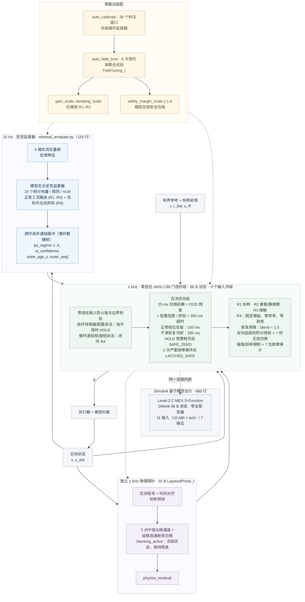

# ai-layered-control · v2.0.2

[](https://github.com/lijiawei255/ai-layered-control/releases/tag/v2.0.2)
[](c99_layered_core/layered_gatekeeper.h)
[](#36-复现)
[](LICENSE)
[](https://doi.org/10.5281/zenodo.23911915)
[](https://github.com/deepseek-ai/deepseek-harness)

[English](README.md) | [简体中文](README_zh.md) · [Agent 指引](AGENTS.md)

**让 AI 判断工况，让确定性控制掌握执行器：** 一套可移植的**零信任快慢分层参考架构**——10 Hz 定性监督与主动弃权、1 kHz C99 零信任安全门控内核，以及冻结 AI 后的现场旋钮整定。传统增益调度或固定阈值规则树只切分已知工况，在遭遇未建模机械谐振或分布外（OOD）扰动时，仍会盲目输出最近档位的控制律。不同于仅在安全边界拦截连续 AI 指令的传统 Simplex / 运行时保障（RTA）外壳，本架构从接口上剥离慢环的连续执行权，通过快慢双层主动弃权将控制权边界固化为跨环接口契约：10 Hz 慢环执行流形距离低置信度弃权并退守 R4 阻尼，1 kHz 快环则依据独立物理残差探针执行毫秒级强制否决。

## 为什么需要这一架构，以及快速导航

本仓库是一套采用 MIT 许可证的参考设计、对比基准与 AI 适配模板，面向科研与工程复用。**可复用的部分是一套全栈、双环参考架构，而不是单个 C 滤波器**：慢环、MCU 接入样板、确定性控制核和 Simulink 适配器是共享同一接口契约的四个对等模块。

### 四大可复用模块（共享同一跨环契约）

- **[1] [python_bench/minimal_template.py](python_bench/minimal_template.py) — 119 行，架构级极简：** 10 Hz 定性慢环，包含小样本建档（`auto_calibrate`：36 个标注窗口、15 个统计标量 / 60 B）、低置信度主动弃权、冻结 AI 的三旋钮现场整定（`auto_field_tune`，一对 19 行辅助函数）以及 `SLOT 1..3` 设备接入骨架。
- **[2] [c99_layered_core/gate_template.c](c99_layered_core/gate_template.c) — 120 行：** 1 kHz 裸机 MCU 中断接入样板，内置 **32 B 零动态内存物理残差探针**（`LayeredProbe_Step`：无模型中值 + 级联高通新息包络）、用于电刺激脉冲与换向边缘伪迹的 `blanking_active` 硬件消隐窗口，以及 `outer_seq` 提交标记模式。
- **[3] [c99_layered_core/layered_gatekeeper.h](c99_layered_core/layered_gatekeeper.h) / [.c](c99_layered_core/layered_gatekeeper.c) — 96 B 状态：** 零依赖 ANSI C99 安全仲裁与四档抗积分饱和控制微内核，面向 1 kHz 周期任务。
- **[4] [simulink_sfunc/sfun_layered_gatekeeper.c](simulink_sfunc/sfun_layered_gatekeeper.c) — 685 行：** 面向基于模型设计的 Level-2 C-MEX S-Function：`DWork` 存放 96 B 状态，零全局变量、零动态内存，**11 个输入**（10 路 ABI 输入加 `ack` 上升沿）与 **7 个输出**，围绕同一份冻结内核。

### 核心工程指标

- **离散定性路由与流形外主动弃权（样本与算力开销最小）：** 慢环 AI 只输出**离散档位编号（1..3）**与基于距离的**低置信度弃权（4）**，频率为 **10 Hz**，而不是拟合高维连续动作曲面。由于连续定量反馈与轨迹跟踪已由四档先验整定的确定性控制律库与标称前馈承担，10 Hz 慢环只需完成粗粒度离散档位分类与流形距离弃权；因此在 CPU 上仅需 **36 个标注宏观窗口**即可完成建档，在线标定与评估仅涉 **15 个统计标量 / 60 B（FP32）**，建档与在线推理全程无需 GPU。模板内置的 15 个统计标量最近原型分类器与六点受约束搜索（`auto_field_tune`）是基于 NumPy、无需机器学习框架的紧凑实现；在真实机器中，同一接口可承载带超界兜底分支的物理规则树、安全贝叶斯优化或其它分类模型。基线 B2（16,000 样本训练的 1 kHz 连续动作神经网络）需要 **16,000 个动作标签**、**5,664 个标量 / 22,656 B（FP32）** 以及完整的 **1 kHz** 连续推理算力。

- **96 B 零信任 C99 内核与瞬态加固保护：** 零堆 ANSI C99 内核以**十个输入字段**独占 **1 kHz** 执行器指令，对慢环实施四重零信任保护（分割式输入防火墙、`outer_seq` 本地时钟租约、32 B 独立物理残差探针 + 25 ms 相平面包络前瞻、300 ms 恢复冷却 + 150 ms 驻留抗抖）、九项核心保护职责与瞬态响应保护（`blanking_active` 硬件消隐冻结、四档反向追踪抗积分饱和、紧急 R4 旁路 `blend = 1.0`）。在本复合故障基准中，一旦 `physics_residual` 越过阈值，内核在同一个 **1 ms 控制 tick** 内触发否决并切入闭环 R4。

- **冻结 AI 拓扑，12 B 受约束物理现场整定：** 三个物理旋钮占 **12 B**，在六次联合受约束试验中支持对正向过载、交叉失配、反向轻载与复合单元漂移的受约束适配，无需重训冻结的 60 B 监督器，也无需现场 GPU 算力。

- **跨语言位级验证与 239 行可裁剪双端模板：** **265 项 C 回归检查**通过；Python/C 回放逐位一致（**max|du| = 0**），MATLAB/C 回放在 **5e-9** 以内，Level-2 S-Function 在 1,100 帧上复现全部七个输出，**最大差 = 0.0**。**119 行模板**（配合 120 行 MCU 模板，合计 **239 行**）开箱即可运行，支持按现场硬件与存量代码自由裁剪；Simulink 模型用于说明架构。

**人类读者：** [§1](#1-ai-可以慢控制权必须清楚) 用六个现场问题讲清控制权的划分；[§2](#2-复用什么人类与-agent-快速上手) 介绍四个可复用模块与三步接口适配；[§3.2](#32-四阶段对比) / [§3.3](#33-冻结-ai现场整定硬件) / [§3.4](#34-模态消融与独立保护) 给出实测对比、门控与弃权试验，以及配图。

**AI 编程助手（DeepSeek Harness / Kimi Code / OpenCode / ZCode / Qoder / Codex / Claude Code / Cursor）：** 先读 [AGENTS.md](AGENTS.md)，再替换 [minimal_template.py](python_bench/minimal_template.py) 中的 `SLOT 1..3`，并按设备契约填入十个输入字段。

## 1. AI 可以慢，控制权必须清楚

把 AI 接入工业机械臂、数控 / 增材制造（WAAM）或闭环神经调控（帕金森 aDBS、脊髓电刺激 / SCS）时，预测精度只是问题的一半；另一半是控制权——每一毫秒由谁掌握执行器指令。只要学习策略仍掌握连续指令，六类现场问题就会反复出现。本架构在确定性快环里逐项解决它们，而不是调模型；实测证据见 §3 的四个 10 s 阶段（S1 标称、S2 负载/静摩擦、S3 接触/噪声、S4 未见复合故障）。

- **样本稀缺 / 连续策略算力。** B2 需 16,000 个动作标签、5,664 个标量 / 22,656 B 与 1 kHz 推理，没有门控时仍有 **824 个 S4 越界 tick**；本架构把 10 Hz 层压缩为离散档位建议（`1..3`）+ 校准弃权（`4`），仅 **36 窗口，在线标定仅需 15 个统计标量 / 60 B**，连续反馈与前馈交给四个确定性档位。
- **刚性 vs 柔顺接触。** 单组增益无法既抑制负载又守住 **20 N**；B1 在 S3 达 **64.59 N**。四档 R1–R4、R3 柔顺接触、逐档反向追踪抗积分饱和与应急 R4 旁路 `blend = 1.0` 以确定性方式解决冲突。
- **未知流形。** 最近固定规则在对象振荡时持续输出，且没有“离标定数据多远”的度量。校准的距离置信度把盒内耦合负载偏置变成确定性的低置信度否决与 R4 阻尼。
- **个体 / 批次漂移。** 逐台重训需要现场不具备的数据与算力。冻结流形拓扑 + **12 B** `FieldTuning_t`，用六次受约束试验覆盖正向、交叉与反向失配。
- **慢环盲区、瞬态、链路中断。** 10 Hz 环最多盲 100 ms，脉冲与换向边沿污染新息，现场总线可能卡死。32 B 1 kHz 探针、`blanking_active` 冻结保持、`outer_seq` 本地时钟租约与有界 HOLD → `GATE_SAFE_ZERO` 补齐。
- **裸机资源与追责。** 固定 RAM、无分配器；事故需要因果证据。96 B 零堆 C99 内核保留 7 位粘滞审计掩码，三次严重故障后锁存 `GATE_LATCHED_SAFE`，直到显式确认。

分工由标定确定：`auto_calibrate` 取 **1% 经验下尾置信度分位数并乘以 `0.15x` 动态包络工作点系数**，使 36 窗口标定档案在 S1–S4 宽包络下不产生虚警。25 ms 带符号前瞻即 `h = x_max − |x|` 的一维 ZCBF 边界条件 `h_dot + h/T >= 0`。16,000 条标签是仿真样本预算，不是实测机时。

**推理带宽不等于执行权限：** 每秒计算一千次动作（1 kHz 推理带宽）并不使学习策略安全到可以掌握执行器：其输出仍只是缺乏物理保障的动作提议。执行权限意味着每一毫秒守在执行器入口，维护反馈不变量、反向追踪抗积分饱和、硬幅值/斜率限幅与独立否决兜底。本仓库提供的正是这样一道设备侧 AI 控制权限软件网关：慢环只回答“哪个档位？”（`1..3`）或“弃权”（`4`）；独立探针从时间对齐的标称模型新息与测量尖峰中导出否决证据；**仅 96 字节状态、零动态分配的 ANSI C99 内核**掌握 1 kHz 指令、闭环兜底与物理整定旋钮。监督器可以更换，执行契约保持不变。这条网关对慢环 AI 实施**四重零信任防线**：**接口与数值零信任**——慢环不能触碰执行器指令 `u` 或确定性前馈 `u_ff`，只能提交档位建议 `1..4`，而分割式输入防火墙对慢环字段中的任何 `NaN/±Inf`、越界档位或序号异常置位 `corrupted = 1`，并强制闭环 R4；**时间零信任**——传输帧龄 `outer_age_s` 从不被盲信，启用 `outer_seq` 后 1 kHz 内核用自己的时钟计量帧租约，因此卡死或被伪造的帧龄无法掩盖通信停滞；**物理零信任**——哪怕慢环输出满分置信度（`1.0`），只要 32 B 独立物理残差探针或 25 ms 相平面包络前瞻越过阈值，就在当前 1 ms tick 内被否决并替换为 R4；**恢复零信任**——故障消除或人工 `Layered_AcknowledgeFaultLatch` 解锁后，AI 无法在下一 tick 立即重掌控制权，必须通过 300 ms 干净恢复冷却与 150 ms 驻留抗抖检验。

**L0–L4 工业安全控制栈定位：** 本仓库收敛于 **L2——1 kHz 确定性安全仲裁** 与 **L3——10 Hz 校准定性路由**。唯一一份完整的 L0–L4 表（含 L2 为何必须是确定性代码、遵循 ISO/IEC TR 5469 的说明）在[系统工程宣言](docs/systems_engineering_manifesto_zh.md#分层系统边界l0l4)。



图中时序为本基准默认值。设备适配层在每个快环 tick 计算 `outer_age_s = now - source_timestamp`；当 `outer_seq` 非零时，内核以自己的 1 kHz 时钟测量帧龄，冻结或被伪造的 `outer_age_s` 无法掩盖慢环通信停滞。尖峰通道直接读取实测信号；宽频通道评估标称模型新息。

**七种可观测的门控裁决：** 这些是刻意设计、可解释的状态，由现场记录器记录：

| 代码 | 门控状态 | 行为 |
| :---: | :--- | :--- |
| 0 | `GATE_NORMAL` | 接受 AI 档位；所选控制律库在整定增益与确定性前馈下运行。 |
| 1 | `GATE_HOLD_LATENCY` | 慢环数据帧超时且快环传感器有效时，1 kHz 闭环按固定 **R4 阻尼律**退守；快环输入不可用子情形（仍报告 GATE_HOLD_LATENCY，同时置位 corrupted = 1 与 NAN_CORRUPTION）冻结并保持上一拍安全指令。保持的是执行器指令，而非机械位置。 |
| 2 | `GATE_VETO_OOD_RESIDUAL` | 物理新息超过阈值；残差否决锁存，直到低于清除比例。 |
| 3 | `GATE_VETO_LOW_CONFIDENCE` | 置信度低于阈值，或显式 `ai_regime = 4` 弃权；只能由可信的正常档位清除。 |
| 4 | `GATE_VETO_SAFETY_ENVELOPE` | 实测或预测状态触及包络；持续保持直至状态与预测均低于清除比例。 |
| 5 | `GATE_SAFE_ZERO` | 内核级 HOLD 超过 `max_hold_ticks = 100`：清空积分器与目标，并以 `max(u_slew_max_per_s * dt_s, 1 binary32 ULP(\|u_prev\|))` 的步长把指令降到零；当合法斜率预算低于一个可表示步长时，1 ULP 保底保证指令幅值严格单调降至零并在有限拍内完成，且绝不反向注入能量。配置损坏时使用固定的 100 tick 预算，立即清零并锁存。 |
| 6 | `GATE_LATCHED_SAFE` | 三次累计安全/OOD 否决事件（`max_fault_vetoes_before_latch = 3`）永久锁定 R4；只有 `Layered_AcknowledgeFaultLatch()` 能释放内核、重置事件计数器并重置恢复冷却。生命周期计数器与审计掩码保留。 |

锁存保持的 **7 位故障审计掩码**记录根因：延迟超时、OOD 残差、低置信度、包络越界、NaN 损坏、HOLD 超时与永久锁存。当否决处于激活状态、或 `gate == GATE_HOLD_LATENCY` 且当前档位为 R4、或永久锁存已置位且当前档位为 R4 时，**紧急旁路**跳过 `blend_alpha`，以 `blend = 1.0` 直接施加 R4 原始控制律；幅值与斜率限制仍然生效。

## 2. 复用什么：人类与 Agent 快速上手

| 可复用模块 | 规模 | 你带入系统的能力 |
| :--- | :--- | :--- |
| **[1] [minimal_template.py](python_bench/minimal_template.py)** | 119 行 | 独立的 10 Hz 监督器 + 1 kHz C 绑定：`auto_calibrate`、`auto_field_tune`、低置信度弃权与 `SLOT 1..3` |
| **[2] [gate_template.c](c99_layered_core/gate_template.c)** | 120 行 | 1 kHz MCU 接入样板：32 B `LayeredProbe_t`、`blanking_active`、`outer_seq` 租约与 PASS 自检 |
| **[3] [layered_gatekeeper.c](c99_layered_core/layered_gatekeeper.c) / [.h](c99_layered_core/layered_gatekeeper.h)** | 96 / 140 / 12 / 40 / 28 B | 面向 MCU、PLC 或 RTOS 周期任务的零依赖 ANSI C99 控制与安全门控内核 |
| **[4] [sfun_layered_gatekeeper.c](simulink_sfunc/sfun_layered_gatekeeper.c)** | 685 行 | 围绕同一冻结内核的 Level-2 C-MEX S-Function：11 输入、7 输出、无可变全局变量 |

复制 C99 内核时，请保留 [LICENSE](LICENSE) 中的 MIT 版权与许可声明。

**用 AI 编程助手接口适配（DeepSeek Harness / Kimi Code / OpenCode / ZCode / Qoder / Codex / Claude Code / Cursor）：** 让 Agent 阅读 [AGENTS.md](AGENTS.md)，依据设备契约替换[极简模板](python_bench/minimal_template.py)中的 `SLOT 1..3`，然后填入十个输入字段，并以 [gate_template.c](c99_layered_core/gate_template.c) 为基础搭建 MCU 样板。

> **一键复制给 AI 编程助手的接口适配指令：** 请先阅读 `AGENTS.md`（重点关注第 1 节零信任契约与第 4 节 Step 5 三层复用指南），再同时加载 `python_bench/minimal_template.py`（119 行）与 `c99_layered_core/gate_template.c`（120 行）。两个可复用模板合计 **239 行（少于 6,000 tokens）**，请一次性装入上下文窗口，切勿跨文件凭空编造接口。
>
> 请根据我当前设备的实际情况选择适配方式：（1）**完整双环接入**：用本设备的传感器 / 参考 / 执行器 I/O、已标定预测器与受约束安全试验回调替换 `SLOT 1..3`（按需复用或定制 `auto_calibrate` 与 `auto_field_tune`），并按 1 kHz 中断改造 `gate_template.c` 中的 `LayeredProbe_Step`、`blanking_active` 与 `outer_seq`；（2）**存量控制回路改造（参照 `AGENTS.md` Step 5）**：剥离 1-DOF 旋转基准台架，将 96 B `layered_gatekeeper.c` 按通道实例化接入我现有的控制任务，或按指令单独切片提取所需机制（`outer_seq` 本地时钟租约、`blanking_active` 伪迹消隐探针、反向追踪抗积分饱和或三次事件永久锁存）。
>
> 一切以现场实际与我的存量代码为准：这里的槽位（SLOT 1..3）、档位数量与函数签名只是参考起点，而非硬性规定。若我的设置需要增删档位、重塑结构体、把逻辑改写为定点数/C++/PLC 代码，或仅抽取单一机制（如流形外弃权、残差探针、消隐或本地时钟租约）融入现有回路，请自由适配与重构，以契合我的实际工程约束。

在仓库根目录先跑最小骨架（Python 3，以及位于 `CC` 或 `PATH` 的 C99 编译器），就绪后再跑完整基准：

```powershell
python -m pip install -r python_bench/requirements.txt
python python_bench/minimal_template.py
python python_bench/run_benchmark.py
```

### 三步接口适配

1. **定义并接线。** 约定单位、安全零点与输出限制；标定标称模型与控制器组，再接入传感器、参考和执行器。
2. **用小样本建档。** 对实测宏观特征运行 `auto_calibrate`，建立档位原型与置信度阈值。
3. **冻结 AI，现场整定。** 用 `auto_field_tune` 做受约束的跨工况试验，再在独立轨迹上验证所选旋钮。

两个适配辅助函数保持在 20 行以内，且与设备无关；下面的示例先完成原型档案的建档，再在分类器冻结的状态下整定三个物理旋钮：

```python
observations = np.vstack([probe_features(device, load) for load in (0.4, 2.0, 5.0)])
model = auto_calibrate(observations, np.repeat((1, 2, 3), 12))      # 36 个标注窗口 -> 15 个统计标量 / 60 B
cfg.update(min_ai_confidence=model[2], confidence_clear_ratio=model[3])
evaluate = lambda knobs: closed_loop_cost(device, knobs, model)    # ->（实测代价，是否合格）
tuning = auto_field_tune(evaluate)                                 # 6 次有界试验，AI 冻结
```

初始化一次；之后每个快环 tick 填满全部十个输入字段，并调用 `Layered_Step`：

```c
LayeredState_t state;
LayeredConfig_t config;
LayeredInput_t input;
FieldTuning_t field_tuning = {1.0f, 1.0f, 1.0f};
/* 从已整定的设备接口填充 config 与全部十个输入字段。 */
Layered_Init(&state, &config, &field_tuning);
LayeredOutput_t output = Layered_Step(&state, &config, &field_tuning, &input);
```

| 输入字段 | 含义 |
| :--- | :--- |
| `ai_regime` | 慢环决策：`1..3` 正常档位，`4` 显式弃权 |
| `ai_confidence` | 分类器置信度，范围 [0, 1]；原型分类器使用基于距离的数值 |
| `outer_age_s` | 最新慢环帧的帧龄，每个快环 tick 计算 |
| `physics_residual` | 归一化的独立标称物理新息，非负 |
| `x`、`x_dot` | 设备单位下的实测状态与导数 |
| `r`、`r_dot` | 同一单位下的有界参考与参考变化率 |
| `u_ff` | 已整定模型的确定性前馈；从不由 AI 产生 |
| `outer_seq` | 慢环帧序号；非零启用本地时钟租约，零保留旧版帧龄路径 |

`Layered_AcknowledgeFaultLatch(&state, &config)` 在现场工程师检查审计掩码之后释放已锁存单元；它保留生命周期计数器与 7 位掩码，并重置恢复冷却计时，使 AI 无法在下一个 tick 立刻回归。

### 三类集成示例与开放的设备接口

三个应用族共享同一种分工：**工业 WAAM / PLC 伺服**、**边缘 VLA / 快慢机器人**、**闭环 aDBS / SCS 神经调控**。它们是同一控制契约的示例，也对其他具有样本稀缺、单元差异、间歇接触、上下文不确定与严格输出约束的系统开放。

| 应用示例 | 慢环定性决策 | 设备适配层与确定性快环接入 |
|---|---|---|
| 工业 WAAM / PLC 伺服 | 工艺、层间热负载与接触档位 | 接入工艺、伺服 / 送丝律与执行器约束；在设备层实现力感知与硬性力限制；换批次时现场整定 |
| 边缘 VLA / 快慢机器人 | 任务与环境接触类别 | 接入 1 kHz 力矩 / 阻抗律；通过反馈与整定吸收关节静摩擦差异；用包络否决与兜底处理状态极限风险 |
| 闭环神经调控：aDBS / SCS | aDBS 使用脑生物标志物；SCS 使用体位 / 活动（平卧、行走、咳嗽）与接口状态 | 为 SCS 定义一阶刺激电流 / 诱发电位（ECAP）招募模型与伪迹探针，为 aDBS 定义生物标志物专用律；在设备输出 / 时序限制与临床既有舒适边界内验证个体化旋钮 |

在 SCS 场景中，1 kHz 伪迹探针沿用 [gate_template.c](c99_layered_core/gate_template.c) 的 `blanking_active` 模式：HAL 屏蔽刺激窗口，探针冻结内部状态而不对脉冲积分，并保持消隐前的残差输出，使周期性脉冲既不会误触发否决，也不会打断持续异常期间的锁存计数，异常结束后残差在非消隐拍自然衰减。背景：脉冲伪迹消隐常见于闭环脊髓电刺激（ECAP-SCS）与自适应脑深部电刺激（aDBS）。

新的物理领域需要新的单位、限制、控制律与探针；同领域内的新单元可以保留分类器，并用三个物理旋钮完成适配。

参见 [AGENTS.md](AGENTS.md)、[领域映射指南](docs/domain_mapping_guide.md) 与[系统工程论述](docs/systems_engineering_manifesto_zh.md)。部署代码不接受阶段标签、故障频率或仿真器真值。

### 硬件适配要点

迁往目标硬件时的配置要点：

1. **定义目标机器的失效安全动作（`R4` 与 `GATE_SAFE_ZERO`）。** 内核默认 `R4`（零参考、朝 `x = 0` 的固定低增益 PD）与 `GATE_SAFE_ZERO`（指令斜坡归零）对应水平旋转台架。适配垂直重力负载轴（需防下坠抱闸或位置保持）、WAAM 焊接（回退抬枪 / 断弧）或闭环神经调控 aDBS/SCS（刺激幅值必须非负；退守临床开环基线参数或受控关断）时，应按设备物理安全态替换这两条分支。
2. **结合执行器限幅标定包络前瞻与滤波器。** `25 ms` 带符号运动前瞻（`|x + T * x_dot|`，`T` 为前视时域）加方向无关的瞬时 `|x|` 保护，是对 `h = x_max - |x|` 的一维归零控制障碍函数（ZCBF）边界条件 `h_dot + h/T >= 0`；高惯量或强扰动设备需结合执行器饱和限幅与检测延迟标定切换裕度（例如通过可达集或控制障碍函数 CBF）。常开一阶平滑器 `blend_alpha` 提供指令平滑，解释了 B3 的大部分 TV 降幅；对相位敏感的高带宽回路可设为 `1.0`，仅依赖四档反向追踪抗积分饱和实现无扰切换。`gate_template.c` 中的 32 B 无模型中值 + 级联高通新息包络探针与 `run_benchmark.py` 中带台架标称模型的观测器复杂度不同，滤波系数需按目标采样率标定。
3. **跨中断数据交换与结构体同步。** `outer_seq` 定义跨环逻辑租约；裸机 MCU 上需通过双缓冲、关中断拷贝或原子发布顺序保证 1 kHz 中断不会撕裂慢环数据帧。若增删 C 端结构体字段，需同步更新 Python `ctypes` 绑定，并在单精度 FPU MCU 上重新验证 binary32 TwoSum 斜率限幅的舍入。需要逐位复现参考结果时，目标编译器须关闭 FMA 收缩（`-ffp-contract=off`，`FLT_EVAL_METHOD == 0`）。

## 3. 实证：五条对比支路，同一物理台架

### 3.1 受测支路

| 支路 | 慢环上下文 | 1 kHz 连续执行器指令 |
|---|---|---|
| B1 · 现代白盒基线 | 单一固定档位 | 标称逆动力学前馈 + 高增益抗积分饱和 PID |
| B2 · 学习式快慢策略 | 10 Hz 四维实测宏观特征，独立延迟 | 条件 512 中心 RBF 动作头，带钳位误差积分历史，`u = π(x, x_dot, r, r_dot, r_ddot, z, integ)` |
| B3 · 定性 / 定量分离 | 10 Hz 模型无关档位 + 置信度 + 时间戳 | C99 控制律库、九项保护职责、确定性前馈与现场整定 |
| B1+C99 Gate · 公平性对照 | 同 B1 | 同一 B1 控制律经透明 C99 门控外壳路由 |
| B2+C99 Gate · 公平性对照 | 同 B2 | 同一 B2 控制律经透明 C99 门控外壳路由 |

三条控制律分别是基线 B1（定参高增益 PID + 逆动力学前馈）、基线 B2（16,000 样本训练的 1 kHz 连续动作神经网络，动作头带一个钳位误差积分特征）与本架构 B3（10 Hz 定性路由 + 1 kHz C99 安全门控）。两行 `+C99 Gate` 不是新的控制律：它们把相同的 96 B 门控挂载到 B1 与 B2 之上，使对比能够区分运行时保障外壳带来的收益与慢速定性层带来的收益。


**共同实验条件：** 正常运行时 B1 与 B3 接收**相同的标称前馈**，共享同一套抗积分饱和、幅值与斜率限制；B1 的高增益在主表中给出最低的原始 S2 RMSE（**0.017125 rad**），但固定参数的水床效应仍把 S3 接触力推到 **64.59 N**（使用相同的 `alpha = 0.3` 低通时为 63.47 N）。B2 的动作头以完整 1 kHz 运行——40 s 内 **40,000 次动作评估**，快环状态零延迟——并给出最高的 S3 接触力（**65.71 N**）；它带有钳位误差积分历史特征，但没有外部确定性 PID 稳定器，也没有物理门控，因此承担更大的 S2 误差与 **824 个 S4 越界 tick**。物理规则树读取与原型分类器相同的实测特征，并与其 S1/S2 决策及 19.9 N 的 S3 接触峰值一致。基准测试与自检套件完整覆盖全部七种门控状态、抗积分饱和切档以及 HOLD → `SAFE_ZERO` → 锁存路径。透明挂载到同一 1 kHz C99 门控（正常档位增益为零、单位前馈、`blend_alpha = 1`；包络/残差/延迟/保持/R4/斜率参数相同）后，B1 与 B2 无需重新整定基线即达到零 S4 越界 tick。S4 的 OOD 否决基于真实的未建模柔性模态残差加随机毛刺过程；宽频残差检测延迟见 §3.4 折叠区。

所有支路共享执行器幅值与斜率限制、传感器处理、噪声、参考、被控对象与故障实现。B1 没有 `blend_alpha` 平滑器。S3 与 S4 的 60–120 ms 上下文延迟与 8% 丢帧作用于 10 Hz 慢环（B2 与 B3）；B2 的动作头是带一个钳位误差积分历史特征的标称 PD 映射，且无外部确定性 PID 稳定器。B3 的一阶指令平滑在每个 tick 生效。

主表（§3.2）、现场整定表（§3.3）与模态消融表（§3.4）的全部已发布指标在显示精度上跨 Python/C 与 MATLAB 双端一致，唯一例外是未门控的 B2 S4 行；该行的跨引擎核对见 §3.3 折叠区。

### 3.2 四阶段对比

**关键结论：** B1 是固定高增益白盒基线；B2 是学习式快慢连续动作策略；B3 是本分层架构。主运行结果如下：

- **S1/S2——保持同量级跟踪精度，指令变化更低：** B3 的跟踪误差与 B1 同量级，同时把 TV 从 **8,217.67 / 8,100.68** 降到 **1,565.97 / 2,081.44 N·m**。
- **S3——柔顺的单边接触：** B1 达到 **64.59 N**，约为 20 N 预算的 **3.23 倍**；B3 切换到柔顺 R3 档，把接触力保持在预算内，为 **19.9 N**。B3 的 TV 为 **3,870.03 N·m**，B2 为 **13,819.75 N·m**。
- **S4——未建模柔性模态下零包络越界（图 1，30–40 s）：** B1/B2 分别记录 **834 / 824 个越界 tick**（`|x| > 1 rad`）。B3 在未建模柔性模态残差上否决并进入闭环 R4：**0 越界**，TV 为 **1,528.1 N·m**。R4 放弃参考跟踪以保护包络。

四个 10 s 试验阶段：S1 标称、S2 +35% 负载/静摩擦、S3 单边接触、S4 未建模柔性模态（故障注入）。

总时长 40 s，控制周期 1 ms，物理积分采用两个 0.5 ms 子步。执行器限制为 **20 N·m** 与 **2,000 N·m/s**。状态包络为 **|x| ≤ 1 rad**；S3 的接触力预算为 **20 N**，力臂 0.25 m。

RMSE 比较同一 tick 的参考与真实状态。TV 是阶段内指令变化绝对值之和。越界 tick 指真实状态超出包络，与门控激活分别统计。表格使用 Python + C99，种子 7。MATLAB 在显示精度上复现主指标；唯一例外是未门控 B2 的 S4 行，见 §3.3 折叠区。

| 阶段 | 支路 | RMSE / rad | TV(u) / N·m | 越界 tick | 峰值接触力 / N |
|---|---|---|---|---|---|
| S1 | B1 | 0.000664 | 8217.67 | 0 | — |
| S1 | B2 | 0.002924 | 6190.93 | 0 | — |
| S1 | B3 | 0.000585 | 1565.97 | 0 | — |
| S2 | B1 | 0.017125 | 8100.68 | 0 | — |
| S2 | B2 | 0.020591 | 6309.24 | 0 | — |
| S2 | B3 | 0.020165 | 2081.44 | 0 | — |
| S3 | B1 | 0.028964 | 15959.27 | 0 | 64.59 |
| S3 | B2 | 0.063644 | 13819.75 | 0 | 65.71 |
| S3 | B3 | 0.074317 | 3870.03 | 0 | 19.9 |
| S4 | B1 | 0.411028 | 10385.35 | 834 | — |
| S4 | B2 | 0.379105 | 12670.52 | 824 | — |
| S4 | B3 | 0.534138 | 1528.1 | 0 | — |
| S4 | B1+C99 Gate | 0.538413 | 1593.41 | 0 | — |
| S4 | B2+C99 Gate | 0.536971 | 1588.89 | 0 | — |

两条门控基线在 S1–S3 与其基础控制器逐位一致（透明外壳在那里不改变任何东西），因此只列出其 S4 行；外壳的效果恰好体现在包络越界列。


**双层公平性结论。** 对比在两个层面是公平的。

**第一层——96 B C99 内核作为通用运行时保障外壳。** 在普通基线下，S4 显示 **834（B1）/ 824（B2）** 个真实状态包络越界 tick；挂载到相同 C99 门控的同一 B1 与 B2 在 S4 达到 **0 越界 tick**（`B1+C99 Gate`、`B2+C99 Gate` 行）。门控是透明挂载的——正常档位增益为零、单位前馈、`blend_alpha = 1`，以及相同的包络/残差/延迟/保持/R4/斜率参数——因此无需重新整定基线。

**第二层——顶层架构在简单安全外壳之外还带来了什么。** 即使挂载相同的 C99 门控，单档 B1 与连续动作 B2 仍违反 S3 柔顺接触预算（峰值 **64.59 N** 与 **65.71 N**，均远超 20 N 设备预算），因为刚度/柔顺冲突与 S2-vs-S3 帕累托冲突无法由单一固定增益集或单一无外部确定性稳定器的连续映射解决。冻结 AI 现场整定表给出相同结果：挂载门控后，B1+C99-Gate 在全部四种失配下 **0 个可行候选**，而 B3 在全部四种失配下都能找到可行旋钮集，其独立随机种子下的 40 s S3 任务保持在 **12.86–15.12 N**。B3 还只需 **15 个统计标量用于在线标定** 与 **36 个建档窗口**，因为它把高带宽连续控制下沉到确定性内核与先验模型，然后在 10 Hz 下处理档位选择、弃权与三个物理旋钮。

### 3.3 冻结 AI，现场整定硬件

**关键结论——免重训适配（图 2）：** 分类器保持冻结，`auto_field_tune` 在联合约束集下搜索六个有界增益/阻尼候选。正向过载（**+35% / +50%** 复合漂移）分别接受 **`(1.0, 1.0, 1.0)`** 与 **`(0.75, 1.0, 1.0)`**；交叉失配（**J +40%，b −30%**）接受出厂元组 **`(1.0, 1.0, 1.0)`**；反向轻载（**J、b、fc、fs −25%**）降档到 **`(0.75, 1.0, 1.0)`**。独立随机种子下的 40 s S3 任务保持在 **15.12 / 14.43 / 13.91 / 12.86 N**，全部在 20 N 预算内。挂载同一 C99 门控后，B1+C99-Gate 在四种失配下均有 **0 个可行候选**；若强行采用其 S2 误差最低的 **`(2,1,1)`** 参数（反事实对照），四个任务峰值接触力将高达 **75.51 / 75.49 / 75.53 / 104.54 N**。

“+35% / +50% 漂移”= **惯量上升叠加强静摩擦**（本台架上放大的摩擦主导 S2 误差）。RMSE 单位为 rad，TV 单位为 N·m。

| 工况 | 接受旋钮（增益、阻尼、裕度） | S2 RMSE 前 | S2 RMSE 后 | S3 任务峰值 / N | B1+C99-Gate 可行候选 | B1+C99-Gate 最低代价旋钮 | B1+C99-Gate S2 RMSE | B1+C99-Gate S3 任务峰值 / N |
| :--- | :---: | ---: | ---: | ---: | ---: | :---: | ---: | ---: |
| 漂移 = 0.35 | (1.0, 1.0, 1.0) | 0.01995 | 0.01995 | 15.12 | 0 | (2.0, 1.0, 1.0) | 0.007751 | 75.51 |
| 漂移 = 0.50 | (0.75, 1.0, 1.0) | 0.027298 | 0.032103 | 14.43 | 0 | (2.0, 1.0, 1.0) | 0.009317 | 75.49 |
| 交叉 J +40%，b −30% | (1.0, 1.0, 1.0) | 0.004754 | 0.004754 | 13.91 | 0 | (2.0, 1.0, 1.0) | 0.001353 | 75.53 |
| 反向 J/b/fc/fs −25% | (0.75, 1.0, 1.0) | 0.002602 | 0.003733 | 12.86 | 0 | (2.0, 1.0, 1.0) | 0.000966 | 104.54 |

搜索对每个工况消耗 **6 个候选 × 40 s 整定试验 + 6 × 10 s 独立墙体相位接触探测 + 6 s S2 验证运行**；设备轨迹秒数与主机计算秒数是分开的量。获准的 B3 整定在每个工况下都保持正常阶段否决 / R4 占比为零。在漂移与反向工况下，整定函数主动下调增益，以让出部分 S2 跟踪刚度来换取全部四种工况满足 20 N 接触力契约。


<details>
<summary><b>详情：同预算反事实对照、指令平滑与物理测试台架</b></summary>

B3 在漂移 = 0.35 与交叉工况按 `增益 / 阻尼 / 安全裕度` 顺序接受 **`(1.0,1.0,1.0)`**，在漂移 = 0.50 与反向工况接受 **`(0.75,1.0,1.0)`**。B1+C99-Gate 的 S2 最优候选 **`(2,1,1)` 不可行**，独立 40 s 任务峰值接触力为 **75.51 / 75.49 / 75.53 / 104.54 N**，B3 为 **15.12 / 14.43 / 13.91 / 12.86 N**。

每条支路获得同样的六个固定增益/阻尼联合候选：`(0.75,1)`、`(1,1)`、`(1.25,1)`、`(2,1)`、`(1.25,0.5)`、`(1.25,0.75)`；安全裕度保持 1。每一对独立评估。每次 40 s 试验包含正弦与斜坡参考、静摩擦、接触与 OOD。合格要求是零状态越界、S1 RMSE < 0.01 rad，并且每个正常阶段峰值接触力 < 20 N、否决占比 ≤ 5%、R4 占比 ≤ 10%。目标函数是实测 S2 误差。若无候选合格，辅助函数保留当前旋钮；这正是每台 B1+C99-Gate 单元都保留出厂元组的原因。

**指令平滑解释了 B3 的大部分 TV 优势：** 给 B1 相同的逐 tick 低通系数 `alpha = 0.3` 后，TV 显著下降，但接触力仍然过大：

| 控制器 | S1 TV | S3 TV | S3 峰值 / N |
|---|---|---|---|
| B1 | 8217.67 | 15959.27 | 64.59 |
| B1 + LP | 2120.64 | 8278.80 | 63.47 |
| B3 | 1565.97 | 3870.03 | 19.9 |

### 物理测试台架

| 阶段 | 物理机制 |
|---|---|
| S1 · 标称 | 惯量 0.010 kg·m²，黏性阻尼 0.060 N·m·s/rad，地面刚度 0.300 N·m/rad；动 / 静摩擦 0.6 / 1.0 N·m |
| S2 · +35% 负载/静摩擦 | 惯量 +35%；动 / 静摩擦 3.09 / 6.2625 N·m。Karnopp 零速带 0.003 rad/s；驱动力不足时状态锁住，突破后切换为滑动摩擦 |
| S3 · 单侧接触 | 单侧墙：刚度 300 N·m/rad，阻尼 0.8 N·m·s/rad；S3 期间位置为 0.43 + 0.025 sin(2π·0.73t + phase) + 0.24 exp(−(t−20)/0.25) rad，包含连续接近过程。白噪声测量标准差 0.006 rad；上下文延迟 60–120 ms，8% 丢帧 |
| S4 · 未建模柔性模态（故障注入） | 在 30.037 s，由惯量 20% / 80% 分配的电机 / 负载双惯量对替代刚性执行器；正刚度、正阻尼产生 12→24 Hz 扫频模态。负载传感还叠加 0.025 rad 偏置 |

惯量与黏性阻尼变化持续到 S3/S4；摩擦升高属于 S2。漂移比例为 d 时，阻尼为 0.060(1 + 0.3d) N·m·s/rad，+35% 时为 0.0663。两个引擎使用相同的 32 位 LCG 和有界、单位方差白噪声构造，不添加正弦测量噪声。柔性被控对象在检验的固定模态频率下具有衰减的零输入响应。扫频模型全程使用正刚度与正阻尼。

B2 在 **16,000 条标称模型动作标签**上训练：75% 覆盖邻近的正弦 / 斜坡轨迹，其位置与速度误差相关；25% 保留宽范围的误差 / 上下文覆盖。类似接触的上下文会软化其标称动作目标。强静摩擦、移动墙和柔性执行器属于部署偏移。Panel A 另行在漂移单元标签上训练；评估轨迹不作为训练标签。

Panel A 以对数误差轴给出 64 / 256 / 1,024 / 4,096 / 16,000 个动作标签（最多 512 中心）的实测曲线，原始数据保留在 `--json` 报告中。标称精度随预算逐步提升；漂移下 256 标签的冻结策略已经失效，而更大预算的重训同样无法稳定超过冻结策略——这正是"冻结拓扑 + 12 B 现场整定"的依据。

### 控制律库

| 控制器 | Kp | Ki | Kd | 前馈比例 |
|---|---|---|---|---|
| B1 | 110 | 300 | 1.5 | 1 |
| B3 R1 · 标称 | 60 | 60 | 1.2 | 1 |
| B3 R2 · 重载 / 摩擦 | 110 | 300 | 1.5 | 1 |
| B3 R3 · 柔顺接触 | 8 | 2 | 0.8 | 1 |
| B3 R4 · 安全兜底 | 2 | 0 | 0.35 | **0** |

R4 使用**零参考、固定增益与零前馈**，独立于所有现场旋钮。状态坐标的零点必须是已整定的安全兜底点。弃权期间，该阻尼律刻意放弃轨迹跟踪，把状态拉向零以保住包络。摩擦可能让物理状态在到达零之前停住。

### 跨引擎浮点一致性核对

主表、现场整定表与模态消融表在显示精度上跨 Python/C 与 MATLAB 完全一致，未门控的 B2 S4 行除外；该行的 821–824 tick 区间来自病态法方程在不同平台 BLAS/线性代数求解器下的差异，所有带门控支路与 B3 结果完全一致。Python/C 指令一致为逐位精确（6,000 帧上 max|du| = 0）；MATLAB/C 一致为 40,000 个正常帧、40,000 个慢环通信故障帧与四次 40,000 帧整定注入回放上 max|du| = 5e-9，另有 10,000 tick 的 `outer_seq` 租约回放（覆盖 HOLD → `SAFE_ZERO`、零序号损坏路径与冷却恢复）上 max|du| = 3.6e-8。被淘汰的 B1 候选参数在反事实对照下的接触力峰值在两个引擎间带有约 1e-14 的双精度敏感性，不改变任何可行性判定。

</details>

### 3.4 模态消融与独立保护

固定档位消融保留**同一套快速安全门控**。动态分类与物理规则只读取实测特征。下面六种监督器均为零状态包络越界。

| 监督器 | S1 RMSE | S2 RMSE | S3 RMSE | S4 RMSE | S3 TV | S3 峰值 / N |
|---|---|---|---|---|---|---|
| R1 | 0.000585 | 0.04731 | 0.0376 | 0.449248 | 6235.16 | 29.77 |
| R2 | 0.000721 | 0.018957 | 0.029178 | 0.53869 | 8276.36 | 63.66 |
| R3 | 0.001567 | 0.414278 | 0.061565 | 0.543373 | 3636.69 | 8.51 |
| R4 | 0.44028 | 0.529412 | 0.460963 | 0.461034 | 6183.85 | 0.00 |
| 动态 | 0.000585 | 0.020165 | 0.074317 | 0.534138 | 3870.03 | 19.9 |
| 规则 | 0.000585 | 0.020165 | 0.074317 | 0.534138 | 3870.03 | 19.9 |

固定档位结果暴露了负载与接触之间的取舍：标称档在 S3 付出 29.77 N，重载档 63.66 N，柔顺档接受 S2 跟踪误差以取得 8.51 N。R4 的零接触力是阻尼兜底，不是跟踪控制器。在主试验各阶段，固定规则集（相同的残差与包络逻辑，无最近类置信度）精确复现了分类器运行——那里的工况边界是已知的；两者的分水岭只出现在已标定支撑集之外，如下一实验所示。


**1 kHz 快环门控消融：** 移除快环门控后，分层监督器退化为上下文传感器。S4 复合故障随即产生 **383 个越界 tick**，峰值指令达到 20 N·m 执行器限制。仅靠位置包络门控可把越界压到 **14 个**，但指令仍达 **20.0 N·m**，并触发累计永久锁存（**8,185 个锁存 tick**）。完整 B3 路径凭借 1 kHz 物理残差探针在首个样本拒绝该故障：零越界、零锁存，S4 峰值 **2.51 N·m**。

| 配置 | S4 越界 tick | S4 峰值 \|u\| / N·m | `GATE_LATCHED_SAFE` tick | 四阶段 TV / N·m |
| :--- | ---: | ---: | ---: | ---: |
| `unguarded_dual`（无快环门控） | 383 | 20.0 | 0 | 19,116.9 |
| `envelope_only_dual`（仅位置包络） | 14 | 20.0 | 8,185 | 9,370.0 |
| 完整 B3（包络 + 1 kHz 残差） | 0 | **2.51** | 0 | 9,045.5 |

**流形外弃权（`off_manifold_abstention`，种子 0–4）：** 测试台架保持正常幅度（0.46 rad）与建档噪声，并加入标称预测器不知道的未建模耦合常值负载转矩（0.08 N·m）。单维支撑盒由 36 个标注建档窗口的经验逐维跨度加 25% 裕度导出；该盒来自标定档案，不使用特征归一化的代数饱和限。五个种子的**盒内占比均为 1.0**，因此单维规则树始终留在自己的盒内、退守率为 **0%**；但多维联合特征仍位于流形之外。流形距离置信度由 199 个独立标称 10 Hz 帧按 **1% 逐帧分裂共形下尾顺序统计量**标定（无插值：199 个样本取第 2 小值；触发 0.70857，清除 0.74399，二者严格小于 1.0），再用 **5 帧（500 ms）持续性**滤除孤立滤波瞬态。五个种子下分类器对 **99.5%** 的慢环帧给出检出（每个种子 19,380 个 R4 tick），而单维规则树退守率为 **0%**；独立标称对照组记录 **0** 个误否决 tick。

| 种子 | 盒内占比 | `B3` 帧检出率 | `rules` 退守率 | `B3` RMSE / rad | `B3_no_conf` RMSE / rad | `rules` RMSE / rad | `B3` 低置信度 tick |
| :---: | ---: | ---: | ---: | ---: | ---: | ---: | ---: |
| 0 | 1.0 | 0.995 | 0.000 | 0.361455 | 0.001106 | 0.001106 | 19380 |
| 1 | 1.0 | 0.995 | 0.000 | 0.361987 | 0.000768 | 0.000768 | 19380 |
| 2 | 1.0 | 0.995 | 0.000 | 0.361581 | 0.000757 | 0.000757 | 19380 |
| 3 | 1.0 | 0.995 | 0.000 | 0.361091 | 0.000770 | 0.000770 | 19380 |
| 4 | 1.0 | 0.995 | 0.000 | 0.361120 | 0.000754 | 0.000754 | 19380 |

所有配置均零包络越界、`max|x| = 0.46 rad`。本审计的裁决指标是检出率，不是跟踪 RMSE；弃权一旦触发，B3 的 RMSE 必然高于不弃权对照，这是弃权生效的直接证据。弃权是对未建模负载的设计响应；若设备必须在该偏移下继续跟踪，应把它加入预测器或建档档案，而不是要求分类器接受它。

**接触记忆释放：** 接触特征组合带符号的标称模型残差功率与 20 ms 低速停滞下的单向跟踪误差项，对真实接触保持 8 s 表面记忆。释放遵循有向卸载判据（证据累积时记录的接触法向符号 + 指令、跟踪误差与实测速度方向），在无任何单步参考阈值的情况下抑制惯性卸载瞬态；一旦实测位置以超阈值速度越过记忆接触点，即解除该接触面记忆（不依赖绝对位置坐标），自由态记忆以 **0.10 s** 时间常数衰减。已释放的表面在连续 20 个采样满足持续受阻判据后重新使能。重复的 S3→S1→S3 周期记录两次接触窗口：

| 接触窗口 | 峰值接触力 / N | R3 占比 |
| :--- | ---: | ---: |
| 第一次 S3 | 10.62 | 94.8 % |
| 第二次 S3 | 9.92 | 95.8 % |

| 转换 | 转换后最后一个 R3 tick 时刻 | 末窗口 R3 占比 | S1 RMSE / rad |
| :--- | ---: | :--- | ---: |
| `reverse_s3_to_s1`——撤墙 | **0.219 s** | 最后 2 s 占比 0.000 | 0.00404 |
| `retreat_s3_to_s1`——保留墙，参考回到内部零点 | **0.219 s** | 最后 5 s 占比 0.000 | 0.03035 |

末窗口不含任何 R3 tick，后退段 S1 以 0.03035 rad RMSE 跟踪内部参考。

独立物理探针同时监测尖峰与宽频新息；快环用它执行显式 OOD 弃权。一旦 `physics_residual` 越过阈值，内核在同一个 1 ms 控制 tick 内触发否决并切入闭环 R4。

<details>
<summary><b>详情：接触/噪声分离、墙体相位、故障注入与接口边界</b></summary>

**标称噪声下仍能识别接触：** 第四维特征相对于残差负载能量累计带符号的标称模型残差功率，带激活阈值与针对间歇接触的释放记忆。它读取实测加速度、速度与已施加指令，不读取噪声 RMS 或墙体时序。其余特征描述跟踪误差、出力和慢环预测残差。S3 噪声降到标称后，两种监督器仍选择 R3 并满足接触预算：

| 噪声标准差 / rad | 监督器 | S3 R3 占比 | S3 峰值 / N | S3 否决占比 | S3 R4 占比 |
|---|---|---|---|---|---|
| 0.006 | 动态 | 94.99% | 19.9 | 0% | 0% |
| 0.0015 | 动态 | 94.99% | 17.51 | 0% | 0% |
| 0.0015 | 规则 | 94.99% | 17.51 | 0% | 0% |
| 0.006；无墙 | 动态 | 0% | 0.00 | 0% | 0% |
| 0.006；无墙 | 规则 | 0% | 0.00 | 0% | 0% |

否决占比与 R4 占比是两个不同的量：解除否决后的恢复冷却仍可能保持 R4。无墙且噪声升高时两种实现都不进入 R3，且本对照中均无假否决与 R4 tick。

安全探针把中值尖峰通道与**宽频高频预测残差包络**结合起来：时间对齐的标称加速度预测、25 Hz 双极点低通、5 Hz 高通预测残差、8 ms 能量窗口、按 500 rad/s² 归一化以及 1 s 释放包络。部署的探针不接收任何故障频率。

完整复合故障在一个控制 tick 内触发快环强制否决。**异常检出延迟与内核响应时间是两种不同的量：** S4 从 30.037 s 注入故障到 30.315 s 首次触发残差否决，检出延迟为 **278 ms**。在随机毛刺通道存在时，主 B3 运行的 S4 阶段记录 **9,577 个 OOD 否决 tick**；残差否决保持锁存，回路保持在闭环 R4（**9,685 个 R4 tick**），本次任务没有 HOLD 或 SAFE_ZERO 升级，全程最大状态保持在 **0.516 rad**（远在 1.0 rad 包络内）。审计另行移除快环门控：无门控双环随即产生 383 个真实状态越界。自 22 s 起的持续慢环通信损坏（`slow_corruption`）产生 **18,000 个损坏帧**、持续的闭环更新与**零越界**，全程最大 **|x| = 0.516 rad**；损坏的通信帧在标志与计数器上可见，而有效传感器让兜底闭环继续运行。平滑的单环基线（`b1_smoothed`，B1 上相同的低通系数）仍显示 **921 个 S4 越界 tick**，从而把包络安全的来源定位到快环门控而非平滑器。


#### 接口、多轴与超时约定

九项核心职责是输入 / 配置校验、预测包络否决、残差否决、置信度 / 弃权否决、心跳看门狗、最小驻留、恢复冷却、带反向追踪抗积分饱和与幅值/斜率限制的控制律库执行，以及锁存式故障报告。活动档的积分器在混合滤波器之前对幅值/斜率受限指令做反向计算，非活动档跟踪最终施加的指令；幅值限制先于斜率限制。驻留、延迟与诊断计数器在 `UINT32_MAX` 饱和。C ABI 与函数签名保持固定：96 B 状态、140 B 配置、12 B 旋钮、40 B 输入和 28 B 输出。

**非法慢环通信帧或现场旋钮选择闭环 R4：** 置位 `corrupted` 并锁存已有的损坏故障位；包络与残差否决保持更高优先级。非法快环信号或配置保留内核级 HOLD（指令保持）路径。旋钮非法时在内部替换为 `(1,1,1)` 继续运行 R4，以保持正常档位跟踪积分器有限。带符号的状态、参考、速度与前馈值合法；只有归一化残差必须非负。增益与阻尼旋钮范围 **[0.10,4.0]**；安全裕度范围 **[0.10,1.0]**，只能收紧包络。这些范围界定输入有效性；可用的工作点由受约束的 `auto_field_tune` 试验给出，闭环适用性由该试验与独立墙体相位 S3 接触验证共同验证。R4 忽略旋钮缩放、轨迹参考与前馈。

为每个轴 / 通道使用**独立的状态、探针、旋钮元组与时间戳**。只在单位与限制一致处共享只读配置；耦合约束属于设备适配层。适配层原样传递 `outer_age_s` 与 `outer_seq`，由 1 kHz 内核执行 **350 ms** 超时（`GATE_HOLD_LATENCY` 闭环 R4 → `GATE_SAFE_ZERO`）。使用 `outer_seq` 时，内核以自己的时钟检查同一停摆：序号变化打开新租约，序号不变则租约老化，序号回落到零按慢环通信损坏帧处理。干净恢复会经过内核的 **300 ms** 冷却。慢环帧过期但快环传感器有效时，1 kHz 回路保持在固定 R4 律上闭环；只有快环输入不可用时，内核级 C `HOLD`（指令保持）才开环冻结**执行器指令**；超过 HOLD 预算后，内核把指令降到零并锁存证据。

</details>

### 3.5 小样本建档、资源与领域映射

`auto_calibrate(samples, labels)` 从 **36 个标注宏观窗口**构建三个四维原型与置信度参数，三个 10 s 建档探测各取十二个窗口。在线标定因此仅需 **15 个统计标量**（十二个原型值、一个距离衰减系数和两个置信度阈值）。两个置信度阈值同源：`auto_calibrate` 取 **1% 经验下尾置信度分位数并乘以 `0.15x` 动态包络工作点系数**，使 36 窗口标定档案在 S1–S4 宽包络下不产生虚警。

`auto_field_tune(evaluate, current)` 冻结该模型，用实测误差和显式的跨工况合格结果搜索物理增益。两个辅助函数占 [119 行模板](python_bench/minimal_template.py) 中的 **19 行**。

| 资源类别 | 规模 |
|---|---|
| 条件 RBF，含归一化、中心、宽度、输出系数与积分特征 | 5,664 个标量；FP64 45,312 B / FP32 存储 22,656 B |
| 原型分类器 | 在线标定 15 个统计标量；FP32 存储 60 B |
| C99 状态 / 配置 / 现场旋钮 / 输入 / 输出 | **96 / 140 / 12 / 40 / 28 B** |
| `LayeredProbe_t`（1 kHz 残差探针，门控样板） | **32 B** |
| C99 目标代码体积（.text 段），GCC 4.9.2 x86-64 | `-Os`：6,952 B；`-O2`：8,404 B |

FP32 字节数只是存储换算；RBF 数值运行使用 FP64。状态 RAM、模型存储与代码体积是相互独立的量。Python 报告 RBF 与 C 调用的主机时间，包含 ctypes 开销；它们不是目标 WCET。内核只使用 `<stdint.h>`、固定规模算术，不含堆、I/O、libm 或可变全局变量。


### 3.6 复现

Python 3 + 现有 NumPy / matplotlib 依赖；内核路径需要 C99 编译器：

```powershell
python -m pip install -r python_bench/requirements.txt
python python_bench/run_benchmark.py
python python_bench/run_benchmark.py --no-c
python python_bench/run_benchmark.py --selftest
python python_bench/minimal_template.py
gcc -std=c99 -pedantic -Wall -Wextra -Wdouble-promotion -ffp-contract=off -O2 -o c99_layered_core/test_gatekeeper_standalone.exe c99_layered_core/layered_gatekeeper.c c99_layered_core/test_gatekeeper_standalone.c
.\c99_layered_core\test_gatekeeper_standalone.exe
gcc -std=c99 -pedantic -Wall -Wextra -Wdouble-promotion -ffp-contract=off -O2 -o c99_layered_core/gate_template.exe c99_layered_core/layered_gatekeeper.c c99_layered_core/gate_template.c
.\c99_layered_core\gate_template.exe
```

模板要求全部十个输入字段，并在 C 源或头文件变化时重编；编译失败会直接报错。它的 PASS 检查跟踪误差、零真实状态越界与零异常门控。基准的 `--no-c` 路径是完整 Python 镜像。C 回归：**265 项通过，零失败**。MCU 模板自检在走完 HOLD → `SAFE_ZERO`、三次 OOD 故障事件 → `GATE_LATCHED_SAFE`、消隐冻结、`outer_seq` 提交和一次成功确认后以零退出。Python/C 回放：**6,000 帧**，覆盖 R1 = 901、R2 = 900、R3 = 303、R4 = 3,896 个 tick，包括 ack 重新使能以及两条触发路径上 7→5→3→1→0 的斜率成形归零；离散输出精确一致，连续指令逐位一致（**max|du| = 0**）。编译器通过 `CC` 或 `PATH` 查找。

MATLAB R2024b + Simulink，使用内置函数与模块。完整验收需要 C99 编译器；缺失即报错：

```powershell
matlab -batch "cd('matlab_simulink'); run_all_benchmarks"
matlab -batch "cd('matlab_simulink'); verify_core_equivalence"
matlab -batch "clearvars; sim('matlab_simulink/ai_layered_control_bench.slx'); disp('standalone model PASS')"
```

验收运行打印五项 PASS，重建现有模型和三张 240 dpi 图，并输出 JSON。MATLAB/C 回放覆盖 **40,000 个正常帧与 40,000 个持续慢环通信故障帧**，离散输出精确，**max|du| = 5e-9**。另有 10,000 tick 的 `outer_seq` 租约回放，覆盖本地帧租约、内核级 HOLD（指令保持）→ `SAFE_ZERO`、序号跌回 0 与冷却恢复，离散输出精确，**max|du| = 3.6e-8**。还有四次 40,000 帧回放，在 5 s 注入非法旋钮：全部零 HOLD tick、零越界、积分器有限。Level-2 C-MEX S-Function 链接同一冻结内核；1,100 帧逐帧比较在门控码 0–6 上复现全部七个输出，**最大差 = 0.0**。在 `simulink_sfunc/` 下构建：

```powershell
mex -v -I../c99_layered_core sfun_layered_gatekeeper.c ../c99_layered_core/layered_gatekeeper.c
```

`.slx` 是自包含的架构示意；定量结果由数值引擎和 S-Function 生成。其 B2 延迟 / 保持位于上下文路径，动作路径以 1 kHz 运行。请读[构建脚本](matlab_simulink/build_simulink_model.m)作为模型源码。

### 设计溯源与参考文献

将四档反向追踪抗积分饱和与零信任仲裁收进 96 B 的 1 kHz 内核，10 Hz 慢环才能收敛为 60 B（15 个统计标量）的定性路由器，跨机台物理适配才能收敛为 12 B 的三旋钮整定。各模块实现所对应的基础文献与标准如下：

- **Simplex 与运行时保障（RTA）：** Sha (2001), *IEEE Software* 18(4)、[AFRL RTA](https://github.com/act3-ace/run-time-assurance) 与 [ISO/IEC TR 5469:2024](https://www.iso.org/standard/81283.html)——本内核在此基础上引入 `outer_seq` 本地时钟租约，并拆分“慢环超时闭环 R4 退守”与“快环传感失效开环保持”两条降级路径。
- **无扰监督切换与抗积分饱和：** Åström & Hägglund 反算追踪抗积分饱和——激活档在 `blend_alpha` 平滑前按限幅值反算，非激活档实时追踪已施加指令 `u_applied`，紧急切入 R4 时以 `blend = 1.0` 直接旁路平滑滤波。
- **运动学安全包络与无误差斜率限幅：** Ames et al. (2019), *ECC* 归零控制障碍函数（一维 ZCBF 有符号前瞻 `|x + T*x_dot| <= x_max`），以及斜率限幅器中基于 Knuth / Dekker `TwoSum` 无误差变换的 binary32 舍入方向判定。
- **分裂共形弃权与脉冲消隐：** Vovk et al. 及 Lei et al. (2018), *JASA* 的有限样本分裂共形预测（用于慢环流形距离主动弃权），以及临床闭环神经调控（ECAP-SCS / aDBS）的脉冲伪迹消隐（32 B 探针中的 `blanking_active` 内部状态冻结与残差保持）。

## 许可与引用

Copyright (c) 2026 Jiawei Li。本参考设计、对比基准与 AI 适配模板采用宽松的 [MIT 许可证](LICENSE)，可用于学术研究、教学和商业应用，包括闭源产品。复制或分发软件及其实质部分时，请包含 MIT 版权与许可声明。无需邮件联系作者或另行申请授权。

如果本工作有帮助，欢迎 Star 或使用 [CITATION.cff](CITATION.cff) 引用；两者都是可选的。引用文件包含作者、ORCID 和发布元数据。

**适用范围：** 本仓库是一套非认证的工程参考架构，由个人开发者维护，为指定基准测试台提供参考控制契约与可复现的数值证据。

应用映射是适配方向，不是硬件、临床或功能安全验证或认证，亦不替代 IEC 61508、ISO 13849、ISO 26262 或 IEC 62304 等标准下的认证与生命周期过程要求。

部署需要针对具体设备进行危险分析、包络定义与验证。任何工业、机器人或生物医学真实设备的集成都必须保留独立于本软件的硬件安全保护：硬件急停（E-stop）、安全转矩关断（STO）、硬件电荷平衡限制器。
