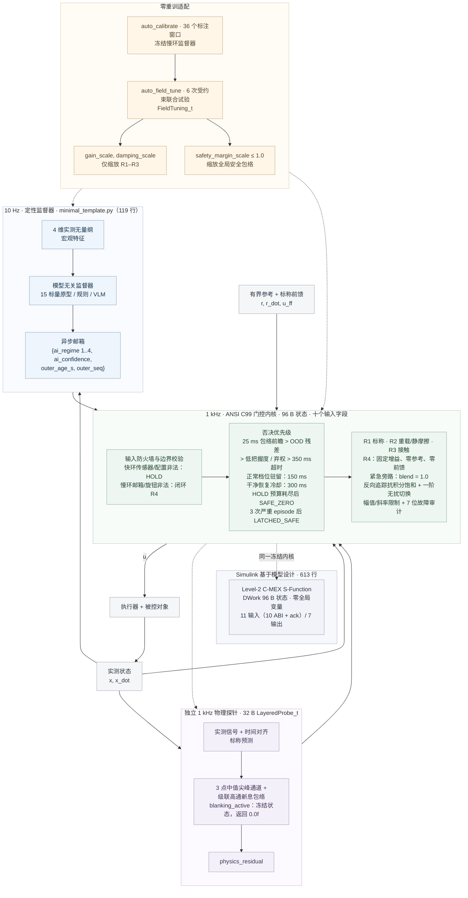

# ai-layered-control · v2.0.2

[](https://github.com/lijiawei255/ai-layered-control/releases/tag/v2.0.2)
[](c99_layered_core/layered_gatekeeper.h)
[](#36-复现)
[](LICENSE)
[](https://doi.org/10.5281/zenodo.23911915)
[](https://github.com/deepseek-ai/deepseek-harness)

[English](README.md) | [简体中文](README_zh.md) · [Agent 指引](AGENTS.md)

**让 AI 判断工况，让确定性控制核掌握执行权。** 一套可移植的快慢分层参考架构：10 Hz 定性监督、1 kHz C99 反馈回路，以及冻结 AI 后的现场旋钮整定。

## 为什么需要这一架构，以及快速导航

这是一个采用 MIT 许可证的参考设计、对比基准与 AI 适配模板，面向科研与工程复用。可复用的部分是一套**全栈、双环参考架构**，而不是单个 C 滤波器：慢环、MCU 接入样板、确定性控制核和 Simulink 适配器是共享同一接口契约的四个对等模块。

**四个可复用模块，一份契约。**

- **[1] [python_bench/minimal_template.py](python_bench/minimal_template.py) — 119 行。** 10 Hz 定性慢环，包含小样本建档（`auto_calibrate`：36 个标注窗口、15 个标量 / 60 B）、低把握度主动弃权、冻结 AI 的三旋钮现场整定（`auto_field_tune`，一对 20 行帮助函数）以及 `SLOT 1..3` 设备接入骨架。
- **[2] [c99_layered_core/gate_template.c](c99_layered_core/gate_template.c) — 120 行。** 1 kHz 裸机 MCU 中断接入样板，内置 **32 B 零动态内存物理残差探针**（`LayeredProbe_Step`：中值抗毛刺 + 级联高通新息包络）、用于电刺激脉冲与换向边缘伪迹的 `blanking_active` 硬件消隐窗口，以及 `outer_seq` 提交标记模式。
- **[3] [c99_layered_core/layered_gatekeeper.h](c99_layered_core/layered_gatekeeper.h) / [.c](c99_layered_core/layered_gatekeeper.c) — 96 B 状态。** 零依赖 ANSI C99 安全仲裁与四档抗积分饱和控制微内核，面向 1 kHz 周期任务。
- **[4] [simulink_sfunc/sfun_layered_gatekeeper.c](simulink_sfunc/sfun_layered_gatekeeper.c) — 613 行。** 面向基于模型设计的 Level-2 C-MEX S-Function：`DWork` 存放 96 B 状态，零全局变量、零动态内存，**11 个输入**（10 路 ABI 输入加 `ack` 上升沿）与 **7 个输出**，围绕同一份冻结内核。

**关键数字。**

- **小样本建档，无需 GPU。** 慢环监督器在 CPU 上由 **36 个标注宏观窗口**完成标定，存储 **15 个标量 / 60 B（FP32）**；B2 则为 **16,000 个动作标签 / 20,596 B（FP32）**。
- **96 B 确定性 C99 兜底。** 零动态内存的 ANSI C99 内核掌握 **1 kHz** 执行器指令，具备 **十个输入字段**、32 B 独立物理残差探针和九项核心保护职责。在本复合故障基准中，首个尖峰在同一个 **1 ms 控制 tick** 内触发否决并切入闭环 R4 兜底。
- **冻结 AI，物理现场整定。** 三个旋钮占 **12 B**，通过受约束的适配应对正向过载、交叉失配、反向轻载和复合机台漂移，无需重训监督器。
- **跨语言回放与 119 行骨架。** **233 项 C 回归检查**全部通过；Python/C 回放逐位一致（**max|du| = 0**），MATLAB/C 回放在 **5e-8** 以内，Level-2 S-Function 在 1,100 帧上复现全部七个输出，**最大差 = 0.0**。**119 行模板**开箱即可运行；Simulink 模型用于说明架构。

**人类读者：** [§1](#1-ai-可以慢控制权必须清楚) 用六个现场问题讲清控制权的划分；[§2](#2-复用什么人类与-agent-快速上手) 介绍四个可复用模块与三步移植；[§3.2](#32-四阶段对比) / [§3.3](#33-冻结-ai现场整定硬件) / [§3.4](#34-模态消融与独立保护) 给出实测对比、新增的门控与弃权试验，以及配图。

**AI 编程助手（Cursor / Claude Code / Codex）：** 先读 [AGENTS.md](AGENTS.md)，再替换 [minimal_template.py](python_bench/minimal_template.py) 中的 `SLOT 1..3`，并按设备契约填入十个输入字段。

## 1. AI 可以慢，控制权必须清楚

把 AI 接入工业机械臂、数控 / 增材制造（WAAM）或闭环神经调控（帕金森 aDBS、脊髓电刺激 / SCS）时，问题不止于预测精度：每一毫秒，究竟由谁决定执行器怎么做？慢速但理解上下文的模型加上快速的神经动作头，确实提升了响应能力。可一旦学习策略仍然掌握连续指令，六个现场问题就会持续存在——每一个问题在成为超参数之前，都有其因果机制。

1. **样本稀缺，试验昂贵。** 像 B2 这样的连续动作网络需要 **16,000 个动作标签 / 20,596 B（FP32）** 才能覆盖其局部映射，而每一次真实硬件试验都消耗机时并可能损坏基准测试装置。慢环不学习策略，它只对粗粒度工况分类，因此在 CPU 上完成 **36 个标注宏观窗口 / 15 个标量 / 60 B** 的 `auto_calibrate` 并冻结一份原型档案就足够了。

2. **刚性与柔顺工况相互冲突。** 单一固定参数的白盒回路（B1）只能在抗扰与接触柔顺之间取舍。它的高增益能有效破除静摩擦，却把 S3 的接触力推到 20 N 预算下的 **64.59 N**。快环掌握四档确定性控制器组——R1 标称、R2 重载、R3 柔顺接触、R4 固定增益兜底——每个 tick 对每一档做反向追踪抗积分饱和，并保留**紧急 R4 旁路（`blend = 1.0`）**，从制动响应中移除一阶无扰切换的相位滞后。

3. **未知流形与亚健康振荡。** 本基准所对比的固定阈值规则树（未额外内嵌显式流形距离/密度模型时）与模糊控制器没有“与训练数据之间的距离”这一概念；对象已经振荡，它们仍在输出最近的规则。原型分类器携带基于距离的**把握度**，当工作点离开已标定流形、进入 **`OFF_MANIFOLD`** 流形外工况时触发低把握度主动弃权，退守 R4 阻尼——该工况即 §3.4 中未建模的传动死区叠加 4 Hz 轻阻尼安装模态。

4. **跨机台、批次与单元漂移，且没有重训算力。** 关节惯量、阻尼、摩擦和接触刚度在单元之间变化，而现场没有 GPU。该架构让**冻结的 AI 流形拓扑**与 **12 B 物理旋钮元组**（`FieldTuning_t`）保持正交；`auto_field_tune` 运行六次有界、受约束的试验，可在不触碰分类器的情况下标定正向过载（+35% / +50%）、交叉失配（J +40%，b −30%）与反向轻载（−25%）。

5. **慢环盲区、瞬态伪迹与通信中断。** 10 Hz 监督器最长有 100 ms 的盲区，刺激脉冲与换向边缘会污染新息，现场总线也可能卡死。**1 kHz、32 B 的消隐探针**在 `blanking_active` 期间冻结状态并返回 `0.0f`；**96 B 内核**则增加 25 ms 状态安全包络与相平面前瞻、独立残差否决、`outer_seq` 本地时钟租约，以及有界 HOLD——超时后升级为 **`GATE_SAFE_ZERO`**，并按斜率限制泄放能量。

6. **芯片资源死限与事故追责。** MCU 或 PLC 控制任务的 RAM 固定，也没有分配器；工业与医疗事故需要因果证据。内核是零动态内存的 ANSI C99，**三次累计严重故障 episode** 会永久锁存 **`GATE_LATCHED_SAFE`**，并留下 **7 位黑盒掩码**（`fault_audit_bitmask`）。只有显式调用 `Layered_AcknowledgeFaultLatch()` 并走过恢复冷却，才能重新武装 AI。

**推理带宽不等于执行权限。** 把模型加速到每秒推理 1,000 次（1 kHz 推理带宽），并不等于可以把执行器直接交给它——模型输出的依然只是缺乏物理边界保障的“动作提议”；真正的“执行权限”，是每一毫秒守在执行器门口维护反馈不变量、反向追踪抗积分饱和、硬幅值/斜率限幅以及独立否决刹车的底层控制主权。本仓库提供一套设备侧的 AI 控制权限软件网关。慢环只回答“哪个工况？”（`1..3`）或“弃权”（`4`）。独立探针从时间对齐的标称模型新息与测量尖峰中导出否决证据。**仅 96 字节状态、零动态分配的 ANSI C99 内核**掌握 1 kHz 指令、闭环兜底与物理整定旋钮。监督器可以更换，执行契约保持不变。



图中时序为本基准的默认值。设备适配层在每个快环 tick 计算 `outer_age_s = now - source_timestamp`；当 `outer_seq` 非零时，内核以自己的 1 kHz 时钟测量帧龄，冻结或被伪造的 `outer_age_s` 无法掩盖邮箱停摆。尖峰通道直接读取测量信号，宽频通道评估标称模型新息。

**七种可观测的门控裁决。** 它们都是刻意设计、可解释的状态，由现场记录器记录：

| 代码 | 门控状态 | 行为 |
| :---: | :--- | :--- |
| 0 | `GATE_NORMAL` | 接受 AI 档位；所选控制器档在整定增益与确定性前馈下运行。 |
| 1 | `GATE_HOLD_LATENCY` | 邮箱过期或快环输入不可用；保持上一次施加的指令。保持的是执行器指令，而非机械位置。 |
| 2 | `GATE_VETO_OOD_RESIDUAL` | 物理新息超过阈值；残差否决锁存，直到低于清除比例。 |
| 3 | `GATE_VETO_LOW_CONFIDENCE` | 把握度低于阈值，或显式 `ai_regime = 4` 弃权；只能由可信的正常档位清除。 |
| 4 | `GATE_VETO_SAFETY_ENVELOPE` | 实测或预测状态触及包络；粘滞至状态与预测均低于清除比例。 |
| 5 | `GATE_SAFE_ZERO` | 原生 HOLD 超过 `max_hold_ticks = 100`：清空积分器与目标，并在 `u_slew_max_per_s` 下把指令降到零。配置损坏时使用固定的 100 tick 预算，立即清零并锁存。 |
| 6 | `GATE_LATCHED_SAFE` | 三次累计安全 / OOD 否决 episode（`max_fault_vetoes_before_latch = 3`）永久锁定 R4；只有 `Layered_AcknowledgeFaultLatch()` 能释放内核、重置 episode 计数器并重新武装冷却。生命周期计数器与审计掩码保留。 |

粘滞的 **7 位故障审计掩码**记录根因：延迟超时、OOD 残差、低把握度、包络越界、NaN 损坏、HOLD 超时和永久锁存。当否决处于激活状态或永久锁存已置位、且当前档位为 R4 时，**紧急旁路**跳过 `blend_alpha`，以 `blend = 1.0` 直接施加 R4 原始控制律；幅值与斜率限制仍然生效。

## 2. 复用什么：人类与 Agent 快速上手

| 可复用模块 | 规模 | 拿走的能力 |
| :--- | :--- | :--- |
| **[1] [minimal_template.py](python_bench/minimal_template.py)** | 119 行 | 独立的 10 Hz 监督器 + 1 kHz C 绑定：`auto_calibrate`、`auto_field_tune`、低把握度弃权与 `SLOT 1..3` |
| **[2] [gate_template.c](c99_layered_core/gate_template.c)** | 120 行 | 1 kHz MCU 接入样板：32 B `LayeredProbe_t`、`blanking_active`、`outer_seq` 租约与 PASS 自检 |
| **[3] [layered_gatekeeper.c](c99_layered_core/layered_gatekeeper.c) / [.h](c99_layered_core/layered_gatekeeper.h)** | 96 / 140 / 12 / 40 / 28 B | 面向 MCU、PLC 或 RTOS 周期任务的零依赖 ANSI C99 控制与安全门控内核 |
| **[4] [sfun_layered_gatekeeper.c](simulink_sfunc/sfun_layered_gatekeeper.c)** | 613 行 | 围绕同一冻结内核的 Level-2 C-MEX S-Function：11 输入、7 输出、无可变全局变量 |

复制 C99 内核时，请保留 [LICENSE](LICENSE) 中的 MIT 版权与许可声明。

**用 AI 编程助手移植（Cursor / Claude Code / Codex）：** 让 Agent 阅读 [AGENTS.md](AGENTS.md)，依据设备契约替换[极简模板](python_bench/minimal_template.py)中的 `SLOT 1..3`，然后填入十个输入字段，并以 [gate_template.c](c99_layered_core/gate_template.c) 为基础搭建 MCU 样板。

> **一键复制给 AI 编程助手的移植指令。** 阅读 `AGENTS.md` 与 `python_bench/minimal_template.py`（119 行），用本设备的传感器 / 参考 / 执行器 I/O、已标定预测器与受约束安全试验回调替换三处 `SLOT 1..3`，保持 `auto_calibrate` 与 `auto_field_tune` 不变。
>
> 再按 1 kHz 中断改造 `c99_layered_core/gate_template.c`（120 行）中的 `LayeredProbe_Step`、`blanking_active` 与 `outer_seq`。两个可复用模板合计 **239 行（少于 6,000 tokens）**，可一次性无损装入同一个上下文窗口，不需要跨文件凭空编造接口。

在仓库根目录先跑最小骨架（Python 3，以及位于 `CC` 或 `PATH` 的 C99 编译器），就绪后再跑完整基准：

```powershell
python -m pip install -r python_bench/requirements.txt
python python_bench/minimal_template.py
python python_bench/run_benchmark.py
```

### 三步移植

1. **定义并接线。** 约定单位、安全零点与输出限制；标定标称模型与控制器档，再接入传感器、参考和执行器。
2. **用小样本建档。** 对实测宏观特征运行 `auto_calibrate`，建立工况原型与把握度阈值。
3. **冻结 AI，现场整定。** 用 `auto_field_tune` 做受约束的跨工况试验，再在独立轨迹上验证所选旋钮。

两个自适应帮助函数保持在 20 行以内，且与设备无关；下面的示例先完成原型档案的建档，再在分类器冻结的状态下整定三个物理旋钮：

```python
observations = np.vstack([probe_features(device, load) for load in (0.4, 2.0, 5.0)])
model = auto_calibrate(observations, np.repeat((1, 2, 3), 12))      # 36 个标注窗口 -> 15 个标量 / 60 B
cfg.update(min_ai_confidence=model[2], confidence_clear_ratio=model[3])
evaluate = lambda knobs: closed_loop_cost(device, knobs, model)    # ->（实测代价，是否合格）
tuning = auto_field_tune(evaluate)                                 # 6 次有界试验，AI 冻结
```

初始化一次；之后每个快环 tick 填满全部十个输入字段，并调用 `Layered_Step`：

```c
LayeredState_t state;
LayeredConfig_t config;
LayeredInput_t input;
FieldTuning_t field_tuning = {1.0f, 1.0f, 1.0f};
/* 从已整定的设备接口填充 config 与全部十个输入字段。 */
Layered_Init(&state, &config, &field_tuning);
LayeredOutput_t output = Layered_Step(&state, &config, &field_tuning, &input);
```

| 输入字段 | 含义 |
| :--- | :--- |
| `ai_regime` | 慢环决策：`1..3` 正常档位，`4` 显式弃权 |
| `ai_confidence` | 分类器把握度，范围 [0, 1]；原型分类器使用基于距离的数值 |
| `outer_age_s` | 最新慢环帧的帧龄，每个快环 tick 计算 |
| `physics_residual` | 归一化的独立标称物理新息，非负 |
| `x`、`x_dot` | 设备单位下的实测状态与导数 |
| `r`、`r_dot` | 同一单位下的有界参考与参考变化率 |
| `u_ff` | 已整定模型的确定性前馈；从不由 AI 产生 |
| `outer_seq` | 慢环帧序号；非零启用本地时钟租约，零保留旧版帧龄路径 |

`Layered_AcknowledgeFaultLatch(&state, &config)` 在现场工程师检查审计掩码之后释放已锁存单元；它保留生命周期计数器与 7 位掩码，并重新武装恢复冷却，使 AI 无法在下一个 tick 立刻回归。

### 三类集成示例与开放的设备接口

三个应用族共享同一种分工：**工业 WAAM / PLC 伺服**、**边缘 VLA / 快慢机器人**、**闭环 aDBS / SCS 神经调控**。它们是同一控制契约的示例，也对其他具有样本稀缺、单元差异、间歇接触、上下文不确定和严格输出约束的系统开放。

| 应用示例 | 慢环定性决策 | 设备适配层与确定性快环接入 |
|---|---|---|
| 工业 WAAM / PLC 伺服 | 工艺、层间热负载与接触工况 | 接入工艺、伺服 / 送丝律与执行器约束；在设备层实现力感知与硬性力限制；换批次时现场整定 |
| 边缘 VLA / 快慢机器人 | 任务与环境接触类别 | 接入 1 kHz 力矩 / 阻抗律；通过反馈与整定吸收关节静摩擦差异；用包络否决与兜底处理状态极限风险 |
| 闭环神经调控：aDBS / SCS | aDBS 使用脑生物标志物；SCS 使用体位 / 活动（平卧、行走、咳嗽）与接口状态 | 为 SCS 定义一阶刺激电流 / 诱发电位（ECAP）招募模型和伪迹探针，为 aDBS 定义生物标志物专用律；在设备输出 / 时序限制与临床既有舒适边界内验证个体化旋钮 |

对 SCS 而言，1 kHz 伪迹探针沿用 [gate_template.c](c99_layered_core/gate_template.c) 的 `blanking_active` 模式：HAL 屏蔽刺激窗口，探针冻结而不是把脉冲积分进去，返回的残差为零，因此已经抬高的数值无法借消隐期维持 OOD 否决。接口背景：[Saluda ECAP 闭环 SCS](https://www.saludamedical.com/international/evoke-eva/) 与 [Medtronic 自适应 DBS](https://news.medtronic.com/2025-02-24-Medtronic-earns-U-S-FDA-approval-for-the-worlds-first-Adaptive-deep-brain-stimulation-system-for-people-with-Parkinsons)。

新的物理领域需要新的单位、限制、控制律与探针；同领域内的新单元可以保留分类器，并用三个物理旋钮完成适配。

参见 [AGENTS.md](AGENTS.md)、[领域映射指南](docs/domain_mapping_guide.md) 与[系统工程论述](docs/systems_engineering_manifesto_zh.md)。部署代码不接受阶段标签、故障频率或仿真器真值。

## 3. 实证：三条控制路径，同一物理试验场

### 3.1 三条控制路径

| 支路 | 慢环上下文 | 1 kHz 连续执行器指令 |
|---|---|---|
| B1 · 现代白盒基线 | 单一固定档位 | 标称逆动力学前馈 + 高增益抗积分饱和 PID |
| B2 · 学习式快慢策略 | 10 Hz 四维实测宏观特征，独立延迟 | 条件 512 中心 RBF 动作头，`u = π(x, x_dot, r, r_dot, r_ddot, z)` |
| B3 · 定性 / 定量分离 | 10 Hz 模型无关档位 + 把握度 + 时间戳 | C99 控制器组、九项保护职责、确定性前馈与现场整定 |

**基线是全力对手，不是稻草人。** 正常运行时 B1 与 B3 接收**相同的标称前馈**，共享同一套抗积分饱和、幅值与斜率限制；B1 的高增益在主表中给出最低的原始 S2 RMSE（**0.017125 rad**），但固定参数的水床效应仍把 S3 接触力推到 **64.59 N**（使用相同的 `alpha = 0.3` 低通时为 63.47 N）。B2 的动作头以完整 1 kHz 运行——40 s 内 **40,000 次动作评估**，快环状态零延迟——并给出最低的 S3 接触力（**12.52 N**）；但由于没有显式积分器或物理门控，它承担更大的 S2 误差和 **589 个 S4 越界 tick**。物理规则树读取与原型分类器相同的实测特征，并与其 S1/S2 决策及 19.47 N 的 S3 接触峰值一致。

所有支路共享执行器幅值与斜率限制、传感器处理、噪声、参考、对象与故障实现。B1 没有 `blend_alpha` 平滑器。延迟只作用于 B2 的上下文；其策略不含积分器输入，也没有外部 PD 稳定器。B3 的一阶指令无扰切换在每个 tick 生效。

学习式快慢系统是一个活跃的工程方向；[Helix 02](https://www.figure.ai/news/helix-02) 是其中一例。设计目标是 **2027 年及以后在受限设备上的部署**。

所有主表指标、5 组 holdout 与 4 组现场整定中 B3 在双引擎下 100% 一致；B2 的岭回归权重在 NumPy 与 MATLAB LAPACK 下存在约 1.9e-6 的双精度尾数差，在宽频灵敏度测试中可引起第 4 位小数的细微差异。

### 3.2 四阶段对比

**关键结论。** B1 是固定高增益白盒基线；B2 是学习式快慢连续动作策略；B3 是本分层架构。主运行结果如下：

- **S1/S2——保持同量级跟踪精度，指令变化大幅降低。** B3 的跟踪误差与 B1 同量级，同时把 TV 从 **8,217.67 / 8,100.68** 降到 **1,567.40 / 2,083.14 N·m**。
- **S3——柔顺的间歇接触。** B1 达到 **64.59 N**，约为 20 N 预算的 **3.23 倍**；B3 切换到柔顺 R3 档，把接触力保持在预算内，为 **19.47 N**。B3 的 TV 为 **3,873.76 N·m**，B2 为 **12,621.12 N·m**。
- **S4——复合故障下零包络越界（图 1，30–40 s）。** 面对扫频双惯量模态与传感器尖峰，B1/B2 分别记录 **840 / 589 个越界 tick**（`|x| > 1 rad`）。B3 在首个尖峰的同一控制 tick 内否决并进入闭环 R4：**0 越界**，TV 为 **1,545.01 N·m**。R4 放弃参考跟踪以保护包络。

S1 检验标称跟踪，S2 检验负载与静摩擦漂移，S3 检验间歇接触与测量噪声，S4 检验未见过的复合故障。

总时长 40 s，四个 10 s 阶段，控制周期 1 ms，物理积分采用两个 0.5 ms 子步。执行器限制为 **20 N·m** 与 **2,000 N·m/s**。状态包络为 **|x| ≤ 1 rad**；S3 的接触力预算为 **20 N**，力臂 0.25 m。

RMSE 比较同一 tick 的参考与真实状态。TV 是阶段内指令变化绝对值之和。越界 tick 指真实状态超出包络，与门控激活次数分别统计。表格使用 Python + C99，种子 7。MATLAB 独立复现主指标的显示精度。

| 阶段 | 支路 | RMSE / rad | TV(u) / N·m | 越界 tick | 峰值接触力 / N |
|---|---|---|---|---|---|
| S1 | B1 | 0.000664 | 8217.67 | 0 | — |
| S1 | B2 | 0.003031 | 6261.70 | 0 | — |
| S1 | B3 | 0.000630 | 1567.40 | 0 | — |
| S2 | B1 | 0.017125 | 8100.68 | 0 | — |
| S2 | B2 | 0.042307 | 6569.89 | 0 | — |
| S2 | B3 | 0.020819 | 2083.14 | 0 | — |
| S3 | B1 | 0.028964 | 15959.27 | 0 | 64.59 |
| S3 | B2 | 0.099757 | 12621.12 | 0 | 12.52 |
| S3 | B3 | 0.069478 | 3873.76 | 0 | 19.47 |
| S4 | B1 | 0.411768 | 10383.77 | 840 | — |
| S4 | B2 | 0.367208 | 11349.37 | 589 | — |
| S4 | B3 | 0.539985 | 1545.01 | 0 | — |


### 3.3 冻结 AI，现场整定硬件

**关键结论——免重训适配（图 2）。** 分类器保持冻结，`auto_field_tune` 在联合约束集下搜索六个有界增益/阻尼候选。正向过载（**+35% / +50%** 复合漂移）选择 **`(1.25, 0.5, 1)`**，独立 S2 验证 RMSE 降低 **18.7% / 16.5%**；完整任务验证零包络越界，接触峰值为 20 N 预算内的 **17.93 / 18.65 N**。交叉失配（**J +40%，b −30%**）选择同一元组，RMSE 降低 **20.4%**，任务峰值 **16.75 N**。反向轻载（**J、b、fc、fs −25%**）使出厂元组在搜索任务中不可行，峰值 **21.64 N**；帮助函数自动降档到唯一合格的候选 **`(0.75, 1.0, 1)`**（搜索峰值 18.50 N），该候选使任务峰值降到 **13.12 N**、越界为零，并以 S2 RMSE **0.002704 → 0.004041** 换取接触安全。B1 的六个候选在所有工况下都未通过联合约束；契约保留其出厂旋钮，而它 S2 最优的 **`(2,1,1)`** 会在两台漂移单元上付出 **75.51 / 75.49 N** 与 **1,397 / 1,031 个越界 tick**。

分类器保持冻结。这些独立 S2 验证使用 6 s、幅度 0.43 rad、种子 811 的轨迹，由所有控制器共享，与上文 10 s 的 S2 窗口分开统计。“+35% / +50% 机台漂移”指**惯量变化叠加强静摩擦**，不是仅改变惯量；本试验场中摩擦放大主导 S2 误差。RMSE 单位为 rad，TV 单位为 N·m。

| 工况 | B1 出厂 RMSE | B3 出厂 (1,1,1) | B3 所选旋钮 | B3 整定后 RMSE | B3 TV：前 → 后 | 任务 S3 峰值 / N | 任务越界 |
| :--- | ---: | ---: | :---: | ---: | :---: | ---: | ---: |
| +35% 复合漂移 | 0.016682 | 0.020331 | (1.25, 0.5, 1) | 0.016522 (**−18.7%**) | 1249.03 → 864.10 | 17.93 | 0 |
| +50% 复合漂移 | 0.023648 | 0.027846 | (1.25, 0.5, 1) | 0.023253 (**−16.5%**) | 1254.20 → 902.48 | 18.65 | 0 |
| 交叉失配（J +40%，b −30%） | 0.002961 | 0.005191 | (1.25, 0.5, 1) | 0.004134 (**−20.4%**) | 1239.75 → 812.21 | 16.75 | 0 |
| 反向失配（J、b、fc、fs −25%） | 0.001398 | 0.002704 | (0.75, 1.0, 1) | 0.004041（以跟踪换接触） | 1259.05 → 1189.92 | 13.12 | 0 |

搜索对每条支路、每台单元消耗 **240 s 设备轨迹**，随后是 **12 s 配对 S2 验证 + 40 s 完整任务验证**。主机计算时间单独报告。合格的 B3 整定把漂移单元上的独立 S2 验证 RMSE 降低 **18.7% / 16.5%**，并在所有工况下保持正常阶段否决 / R4 占比为零。反向工况下，帮助函数通过降低增益维持接触柔顺；RMSE 上升是 20 N 契约的代价，不是搜索失败。


<details>
<summary><b>📊 详情：同预算反事实、指令平滑与物理试验场</b></summary>

B3 在漂移与交叉工况按 `增益 / 阻尼 / 安全裕度` 顺序选择 **`(1.25,0.5,1)`**，在反向工况选择 **`(0.75,1,1)`**。B1 的 S2 最优候选 **`(2,1,1)` 不可行**，仅作为反事实展示，不是获准部署；独立完整 40 s 任务暴露了它的接触力代价：

| 工况 | 候选 | S3 峰值 / N | S3 TV / N·m | S3 否决占比 | S3 R4 占比 | 任务越界 tick |
|---|---|---|---|---|---|---|
| +35% | B3 (1.25,0.5,1) | 17.93 | 2061.94 | 0.00% | 0.00% | 0 |
| +35% | B1 (2,1,1) | 75.51 | 16372.36 | 0.00% | 0.00% | 1397 |
| +50% | B3 (1.25,0.5,1) | 18.65 | 2061.46 | 0.00% | 0.00% | 0 |
| +50% | B1 (2,1,1) | 75.49 | 16347.53 | 0.00% | 0.00% | 1031 |

每条支路获得同样的六个固定增益/阻尼联合候选：`(0.75,1)`、`(1,1)`、`(1.25,1)`、`(2,1)`、`(1.25,0.5)`、`(1.25,0.75)`；安全裕度保持 1。每一对独立评估。每次 40 s 试验包含正弦与斜坡参考、静摩擦、接触与 OOD。合格要求是全程零状态越界、S1 RMSE < 0.01 rad，并且每个正常阶段峰值接触力 < 20 N、否决占比 ≤ 5%、R4 占比 ≤ 10%。目标函数是实测 S2 误差。若无候选合格，帮助函数保留当前旋钮；这正是每台 B1 单元都保留出厂元组的原因。

**指令平滑解释了 B3 的大部分 TV 优势。** 给 B1 相同的逐 tick 低通系数 `alpha = 0.3` 后，TV 显著下降，但接触力仍然过大：

| 控制器 | S1 TV | S3 TV | S3 峰值 / N |
|---|---|---|---|
| B1 | 8217.67 | 15959.27 | 64.59 |
| B1 + LP | 2120.64 | 8278.80 | 63.47 |
| B3 | 1567.40 | 3873.76 | 19.47 |

### 物理试验场

| 阶段 | 物理机制 |
|---|---|
| S1 · 标称跟踪 | 惯量 0.010 kg·m²，黏性阻尼 0.060 N·m·s/rad，地面刚度 0.300 N·m/rad；动 / 静摩擦 0.6 / 1.0 N·m |
| S2 · 单元漂移：惯量 + 静摩擦 | 惯量 +35%；动 / 静摩擦 3.09 / 6.2625 N·m。Karnopp 零速带 0.003 rad/s；驱动力不足时状态锁住，突破后切换为滑动摩擦 |
| S3 · 接触与边缘抖动 | 单侧墙：刚度 300 N·m/rad，阻尼 0.8 N·m·s/rad；S3 期间位置为 0.43 + 0.025 sin(2π·0.73t + phase) + 0.24 exp(−(t−20)/0.25) rad，包含连续接近过程。白噪声测量标准差 0.006 rad；上下文延迟 60–120 ms，8% 丢帧 |
| S4 · 未见过的复合 OOD | 在 30.037 s，由惯量 20% / 80% 分配的电机 / 负载双惯量对替代刚性执行器；正刚度、正阻尼产生 12→24 Hz 扫频模态。负载传感还叠加 0.025 rad 偏置与 0.18 rad 尖峰 |

惯量与黏性阻尼变化持续到 S3/S4；摩擦升高属于 S2。漂移比例为 d 时，阻尼为 0.060(1 + 0.3d) N·m·s/rad，+35% 时为 0.0663。两个引擎使用相同的 32 位 LCG 和有界、单位方差白噪声构造，不添加正弦测量噪声。柔性对象在检验的固定模态频率下具有衰减的零输入响应。扫频模型全程使用正刚度与正阻尼。

B2 在 **16,000 条标称模型动作标签**上训练：75% 覆盖邻近的正弦 / 斜坡轨迹，其位置与速度误差相关；25% 保留宽范围的误差 / 上下文覆盖。类似接触的上下文会软化其标称动作目标。强静摩擦、移动墙和柔性执行器属于部署偏移。Panel A 另行在漂移单元标签上训练；评估轨迹不作为训练标签。

Panel A 使用真实条件 RBF，在 64 / 256 / 1,024 / 4,096 / 16,000 个动作标签下、最多 512 个中心，于对数误差轴报告标称性能、冻结迁移和重训迁移，包括低预算下的失稳轨迹。曲线非单调；重训并不能稳定恢复标称精度。

### 控制器组

| 控制器 | Kp | Ki | Kd | 前馈比例 |
|---|---|---|---|---|
| B1 | 110 | 300 | 1.5 | 1 |
| B3 R1 · 标称 | 60 | 60 | 1.2 | 1 |
| B3 R2 · 重载 / 摩擦 | 110 | 300 | 1.5 | 1 |
| B3 R3 · 柔顺接触 | 8 | 2 | 0.8 | 1 |
| B3 R4 · 安全兜底 | 2 | 0 | 0.35 | **0** |

R4 使用**零参考、固定增益与零前馈**，独立于所有现场旋钮。状态坐标的零点必须是已整定的安全兜底点。弃权期间，该阻尼律刻意放弃轨迹跟踪，把状态拉向零以保住包络。摩擦可能让物理状态在到达零之前停住。

</details>

### 3.4 模态消融与独立保护

固定档位消融保留**同一套快速安全门控**。动态分类与物理规则只读取实测特征。下面六种监督器均为零状态包络越界。

| 监督器 | S1 RMSE | S2 RMSE | S3 RMSE | S4 RMSE | S3 TV | S3 峰值 / N |
|---|---|---|---|---|---|---|
| R1 | 0.000630 | 0.048769 | 0.037056 | 0.536478 | 6238.73 | 29.13 |
| R2 | 0.000715 | 0.019624 | 0.029165 | 0.538375 | 8278.80 | 63.47 |
| R3 | 0.002368 | 0.416069 | 0.069065 | 0.538638 | 3642.12 | 6.93 |
| R4 | 0.440280 | 0.529412 | 0.460963 | 0.461034 | 6183.85 | 0.00 |
| 动态 | 0.000630 | 0.020819 | 0.069478 | 0.539985 | 3873.76 | 19.47 |
| 规则 | 0.000630 | 0.020819 | 0.075100 | 0.540437 | 3950.99 | 19.47 |

固定档位结果暴露了负载与接触之间的取舍：标称档在 S3 付出 29.13 N，重载档 63.47 N，柔顺档接受 S2 跟踪误差以取得 6.93 N。R4 的零接触力是阻尼兜底，不是跟踪控制器。规则树与原型分类器在主要 S1/S2 结果和 19.47 N 的 S3 峰值上一致；它们的 S3 阶段 R3 占比略有差别（93.49% 对 94.99%），表现为 S3/S4 RMSE 第三位小数的差异（0.075100 / 0.540437 对 0.069478 / 0.539985）。因此规则树或紧凑 VLM 可以替换原型分类器，而不改变执行器归属。

**1 kHz 快环门控消融。** 移除快环门控后，分层监督器退化为上下文传感器。S4 复合故障随即产生 **509 个越界 tick**，峰值指令达到 20 N·m 执行器限制。仅靠位置包络门控要恢复零越界，只能在三次否决 episode 后触发累计永久锁存（9,085 个锁存 tick），且锁存前指令仍达 **20.0 N·m**。完整 B3 路径凭借 1 kHz 物理残差探针在首个尖峰拒绝该故障：零越界、零锁存，S4 峰值 **3.33 N·m**。

| 配置 | S4 越界 tick | S4 峰值 \|u\| / N·m | `GATE_LATCHED_SAFE` tick | 四阶段 TV / N·m |
| :--- | ---: | ---: | ---: | ---: |
| `unguarded_dual`（无快环门控） | 509 | 20.0 | 0 | 19,528.1 |
| `envelope_only_dual`（仅位置包络） | 0 | 20.0 | 9,085 | 9,242.8 |
| 完整 B3（包络 + 1 kHz 残差） | 0 | **3.33** | 0 | 9,069.3 |

**流形外弃权（`off_manifold_abstention`，种子 0–4）。** 试验场加入 **18 mN·m 传动死区**和 **4 Hz 轻阻尼安装模态**，`noise_scale = 0.05`。B3 支路的快环单步残差始终不超过 **0.223**，`B3_no_conf` 与 `rules` 变体则达到 **0.828 / 0.825**；三者都低于 **1.0** 的 OOD 阈值，残差探针看不见振荡。固定规则树和敲除把握度门的变体继续跟踪并振荡。原型距离把握度触发 **900–1600 个低把握度 1 kHz 门控 tick**，弃权到 R4 阻尼，相对规则树的 RMSE 降幅超过 50%（相对 `B3_no_conf` 为 48.3%–56.6%）：

| 种子 | `B3` RMSE / rad | `B3_no_conf` RMSE / rad | `rules` RMSE / rad | `B3` 低把握度 tick |
| :---: | ---: | ---: | ---: | ---: |
| 0 | 0.014458 | 0.029455 | 0.029431 | 1300 |
| 1 | 0.014705 | 0.029448 | 0.029456 | 1600 |
| 2 | 0.014640 | 0.028320 | 0.029430 | 1600 |
| 3 | **0.012797** | 0.029453 | 0.029453 | 900 |
| 4 | 0.013187 | 0.029454 | 0.029454 | 1600 |

所有配置均零状态包络越界；差别在于未建模模态下的振荡幅度。这正是慢接口设计的证据：没有手写的按模态分支规则时，本基准所对比的固定阈值规则树（未额外内嵌显式流形距离/密度模型时）只会输出最近的规则，而带流形距离把握度的原型分类器可以直接识别分布外漂移并弃权。

**接触记忆的非对称性。** 第四维特征累计带符号的标称模型残差功率，并配有激活阈值与释放记忆，使间歇接触不会在 R3 与 R1 之间反复抖动。接触证据一消失，记忆就同样快速地泄放：

| 转换 | 最后一个 R3 tick 的时刻 | 残留 R3 占比 |
| :--- | ---: | :--- |
| `reverse_s3_to_s1`——撤墙 | **0.119 s** | S1 R3 占比 0.012 |
| `retreat_s3_to_s1`——保留墙，参考后退 | 3.919 s | 最后 5 s R3 占比 0.000 |

墙一旦撤走，回路在最后一个 R3 tick（0.119 s）之后一个 tick、即 0.120 s 离开柔顺 R3，经过短暂过渡后在 2.020 s 回到 R1；S1 阶段只有 1.2% 仍处于 R3。若保留墙，回路在最后一个 R3 tick（3.919 s）之后一个 tick、即 3.920 s 离开 R3，最后五秒不含任何 R3 tick。

独立物理探针同时监测尖峰与宽频新息；快环用它执行显式 OOD 弃权。复合故障的首个尖峰在同一控制 tick 内触发否决。

<details>
<summary><b>🔍 详情：接触/噪声分离、墙体相位、故障注入与接口边界</b></summary>

**标称噪声下仍能识别接触。** 第四维特征相对于残差负载能量累计带符号的标称模型残差功率，带激活阈值与针对间歇接触的释放记忆。它读取实测加速度、速度与已施加指令，不读取噪声 RMS 或墙体时序。其余特征描述跟踪误差、出力和慢新息。S3 噪声降到标称后，两种监督器仍选择 R3 并满足接触预算：

| 噪声标准差 / rad | 监督器 | S3 R3 占比 | S3 峰值 / N | S3 否决占比 | S3 R4 占比 |
|---|---|---|---|---|---|
| 0.006 | 动态 | 94.99% | 19.47 | 0% | 0% |
| 0.0015 | 动态 | 90.88% | 17.40 | 1.11% | 4.11% |
| 0.0015 | 规则 | 93.49% | 17.40 | 0% | 0% |
| 0.006；无墙 | 动态 | 0% | 0.00 | 1.52% | 4.52% |
| 0.006；无墙 | 规则 | 0% | 0.00 | 0% | 0% |

否决占比与 R4 占比是两个不同的量：否决解除后，恢复冷却仍可能保持 R4。没有墙时，噪声升高从不会选择 R3；在该对照中，原型监督器有一段短暂的低把握度 / 恢复区间。

安全探针把中值尖峰通道与**宽频高频新息包络**结合起来：时间对齐的标称加速度预测、25 Hz 双极点低通、5 Hz 高通新息、8 ms 能量窗口、按 500 rad/s² 归一化以及 1 s 释放包络。部署的探针不接收任何故障频率。

完整复合故障的首个尖峰在同一控制 tick 触发否决。**异常检出延迟与内核响应时间是两种不同的量。** 关闭尖峰通道后，0.2 rad 传感器在 12 / 18 / 37 / 83 / 137 Hz 的振荡分别在安静初始化后 **30 / 6 / 4 / 3 / 3 ms** 被检出。若在复合试验中移除尖峰、把握度、包络与超时否决，宽频探针在 **670 ms** 后检出，保持零越界，并把 S4 最大 |x| 限制在 **0.6984 rad**。只移除 OOD 否决时，其余门控仍保持零越界，但 S4 最大 |x| 升到 **0.8591 rad**，TV 升到 **1,718.48 N·m**；三次包络越界会触发永久锁存并持续 **9,085 个 tick**。

主运行在 S1 全程使用 R1，S2 的 96.8% 使用 R2，S3 的 94.99% 使用 R3；正常阶段没有否决。S4 在故障发生后保持 R4。自 22 s 起持续 `ai_confidence = NaN` 产生 **18,000 个损坏帧**，R4 指令继续更新，**零越界**，全程最大 **|x| = 0.5159 rad**。损坏在标志与计数器上始终可见，有效传感器让兜底闭环继续运行。

五组独立噪声 / 相位运行给出 B1/B2 的 S4 越界 **777–899 / 622–753 个 tick**，B3 全部为零。出厂 B3 的 S3 接触力范围 **16.94–26.14 N**，每个相位都没有越过状态包络。10 Hz 帧率与正常档位驻留会延迟切换，因此首次碰撞可能早于 R3 选择完成（主运行 19.47 N）。在全部五组运行中，B3 相对 B1 的 S3 接触峰值比例始终处于 **B1 的 0.24–0.35 倍（最高 0.35 倍）**。合格整定表用独立噪声验证已整定的墙体相位。使用一个 / 两个 / 四个物理子步时，B3 峰值接触力为 **20.03 / 19.47 / 19.35 N**，状态越界为零。移除上下文抖动后，B2 的主 S3 峰值从 **12.52 N** 变为 **10.22 N**。接触力、状态安全与异步上下文敏感性是相互独立的结论。

#### 接口、多轴与超时约定

九项核心职责是输入 / 配置校验、预测包络否决、残差否决、把握度 / 弃权否决、心跳看门狗、最小驻留、恢复冷却、带反向追踪抗积分饱和与幅值/斜率限制的控制器组执行，以及粘性故障报告。每个积分器跟踪已施加指令；幅值限制先于斜率限制。驻留、延迟与诊断计数器在 `UINT32_MAX` 饱和。C ABI 与函数签名保持固定：96 B 状态、140 B 配置、12 B 旋钮、40 B 输入和 28 B 输出。

**非法慢环邮箱或现场旋钮选择闭环 R4**，置位 `corrupted` 并锁存已有的损坏故障位；包络与残差否决保持更高优先级。非法快环信号或配置保留原生指令 HOLD 路径。旋钮非法时在内部替换为 `(1,1,1)` 继续运行 R4，以保持正常档位跟踪积分器有限。带符号的状态、参考、速度与前馈值合法；只有归一化残差必须非负。增益与阻尼旋钮范围 **[0.10,4.0]**；安全裕度范围 **[0.10,1.0]**，只能收紧包络。这些范围定义输入合法性，不保证闭环稳定；可用工作增益来自受约束的 `auto_field_tune` 试验。R4 忽略旋钮缩放、轨迹参考与前馈。

为每个轴 / 通道使用**独立的状态、探针、旋钮元组与时间戳**。只在单位与限制一致处共享只读配置；耦合约束属于设备适配层。慢环 **350 ms** 超时时，适配层发送显式 R4 弃权并保留真实帧龄。使用 `outer_seq` 时，内核以自己的时钟检查同一停摆：序号变化打开新租约，序号不变则租约老化，序号回落到零按邮箱损坏处理。干净恢复会经过内核的 **300 ms** 冷却。原生 C `HOLD` 冻结**执行器指令**，不是机械位置；超过 HOLD 预算后，内核把指令降到零并锁存证据。

</details>

### 3.5 小样本建档、资源与领域映射

`auto_calibrate(samples, labels)` 从 **36 个标注宏观窗口**构建三个四维原型与把握度参数，三个 10 s 建档探测各取十二个窗口。模型有 **15 个存储标量**：十二个原型值、一个距离衰减系数和两个把握度阈值。

`auto_field_tune(evaluate, current)` 冻结该模型，用实测误差和显式的跨工况合格结果搜索物理增益。两个帮助函数占 [119 行模板](python_bench/minimal_template.py) 中的 **20 行**。

| 资源类别 | 规模 |
|---|---|
| 条件 RBF，含归一化、中心、宽度与输出系数 | 5,149 个标量；FP64 41,192 B / FP32 存储 20,596 B |
| 原型分类器 | 15 个标量；FP32 存储 60 B |
| C99 状态 / 配置 / 现场旋钮 / 输入 / 输出 | **96 / 140 / 12 / 40 / 28 B** |
| `LayeredProbe_t`（1 kHz 残差探针，门控样板） | **32 B** |
| C99 对象 text，GCC 4.9.2 x86-64 | `-Os`：6,144 B；`-O2`：7,172 B |

FP32 字节数只是存储换算；RBF 数值运行使用 FP64。状态 RAM、模型存储与代码体积是相互独立的量。Python 报告 RBF 与 C 调用的主机时间，包含 ctypes 开销；它们不是目标 WCET。内核只使用 `<stdint.h>`、固定规模算术，不含堆、I/O、libm 或可变全局变量。


### 3.6 复现

Python 3 + 现有 NumPy / matplotlib 依赖；内核路径需要 C99 编译器：

```powershell
python -m pip install -r python_bench/requirements.txt
python python_bench/run_benchmark.py
python python_bench/run_benchmark.py --no-c
python python_bench/run_benchmark.py --selftest
python python_bench/minimal_template.py
gcc -std=c99 -pedantic -Wall -Wextra -O2 -o c99_layered_core/test_gatekeeper_standalone.exe c99_layered_core/layered_gatekeeper.c c99_layered_core/test_gatekeeper_standalone.c
.\c99_layered_core\test_gatekeeper_standalone.exe
gcc -std=c99 -pedantic -Wall -Wextra -O2 -o c99_layered_core/gate_template.exe c99_layered_core/layered_gatekeeper.c c99_layered_core/gate_template.c
.\c99_layered_core\gate_template.exe
```

模板要求全部十个输入字段，并在 C 源或头文件变化时重编；编译失败会直接报错。它的 PASS 检查跟踪误差、零真实状态越界与零异常门控。基准的 `--no-c` 路径是完整 Python 镜像。C 回归：**233 项通过，零失败**。MCU 模板自检在走完 HOLD → `SAFE_ZERO`、三次 OOD episode → `GATE_LATCHED_SAFE`、消隐冻结、`outer_seq` 提交和一次成功确认后以零退出。Python/C 回放：**6,000 帧**，覆盖 R1 = 901、R2 = 900、R3 = 304、R4 = 3,895 个 tick，包括 ack 重新武装以及两条触发路径上 7→5→3→1→0 的斜率成形归零；离散输出精确一致，连续指令逐位一致（**max|du| = 0**）。编译器通过 `CC` 或 `PATH` 查找。

MATLAB R2024b + Simulink，使用内置函数与模块。完整验收需要 C99 编译器；缺失即报错：

```powershell
matlab -batch "cd('matlab_simulink'); run_all_benchmarks"
matlab -batch "cd('matlab_simulink'); verify_core_equivalence"
matlab -batch "clearvars; sim('matlab_simulink/ai_layered_control_bench.slx'); disp('standalone model PASS')"
```

验收运行打印五项 PASS，重建现有模型和三张 240 dpi 图，并输出 JSON。MATLAB/C 回放覆盖 **40,000 个正常帧与 40,000 个持续邮箱故障帧**，离散输出精确，**max|du| = 5e-9**。另有 10,000 tick 的 `outer_seq` 租约回放，覆盖本地帧租约、原生 HOLD → `SAFE_ZERO`、序号跌回 0 与冷却恢复，离散输出精确，**max|du| = 4.5e-8**。还有四次 40,000 帧回放，在 5 s 注入非法旋钮：全部零 HOLD tick、零越界、积分器有限。Level-2 C-MEX S-Function 链接同一冻结内核；1,100 帧逐帧比较在门控码 0–6 上复现全部七个输出，**最大差 = 0.0**。在 `simulink_sfunc/` 下构建：

```powershell
mex -v -I../c99_layered_core sfun_layered_gatekeeper.c ../c99_layered_core/layered_gatekeeper.c
```

`.slx` 是自包含的架构示意；定量结果由数值引擎和 S-Function 生成。其 B2 延迟 / 保持位于上下文路径，动作路径以 1 kHz 运行。请读[构建脚本](matlab_simulink/build_simulink_model.m)作为模型源码。

这一安全分工与 Simplex / 运行时保障相关；参见 [AFRL RTA](https://github.com/act3-ace/run-time-assurance) 与 [ISO/IEC TR 5469:2024](https://www.iso.org/standard/81283.html)。

## 许可与引用

Copyright (c) 2026 Jiawei Li。本参考设计、对比基准与 AI 适配模板采用宽松的 [MIT 许可证](LICENSE)，可用于学术研究、教学和商业应用，包括闭源产品。复制或分发软件及其实质部分时，请包含 MIT 版权与许可声明。无需邮件联系作者或另行申请授权。

如果本工作有帮助，欢迎 Star 或使用 [CITATION.cff](CITATION.cff) 引用；两者都是可选的。引用文件包含作者、ORCID 和发布元数据。

**适用范围。** 本仓库为指定试验场提供参考控制契约和可复现的数值证据。

应用映射是适配方向，不是硬件、临床或功能安全验证或认证。

部署需要针对具体设备进行危险分析、包络定义与验证。
